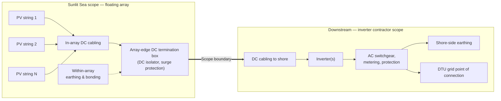

## Addressees and references

Submitted to:

- Morten Frøkjær Petersen, COWI A/S — mfpn@cowi.com
- Emma García, COWI A/S — emga@cowi.com
- Martin Bartholomäus, DTU — mabart@dtu.dk
- Peter Behrensdorff Poulsen, DTU — ppou@dtu.dk

Submitted by:

- Sunlit Sea AS, Grønnegata 10, 0350 Oslo, Norway. Organisasjonsnummer 922 633 924.
- Point of contact: Eirik Larsen, eirik@sunlitsea.no.

Tender reference: COWI project A252319, document FPV Research-RFP, version 1.0, 23 October 2026.
Proposal validity: 90 days from the date of this document.
Pricing basis: EUR, exclusive of VAT, delivered DAP DTU Risø (Incoterms 2020) unless amended at contract.

## 1 Executive summary

Sunlit Sea offers its Sunlit Sea CONNECT floating platform as the floating-PV solution for the DTU Risø research facility. CONNECT integrates a standard commercial 710–740 Wp glass–glass PV module in a cast polyurethane structure, hinged into a rigid array at a small fixed tilt, with the panel resting slightly above water. The system is designed for calm-to-moderate sea states consistent with inshore Danish fjord conditions.

Sunlit Sea CONNECT builds on Sunlit Sea's commercial Gen 1 heritage — 60 kWp at Mannheim Cablepark (Germany) in operation since 2023, and 105 kWp at Skiftestjørna (Norway) in operation since autumn 2024 — and on FPV wave-tank testing within the Horizon Europe SUREWAVE consortium (SINTEF-coordinated, Grant Agreement 101083342). Sunlit Sea also leads WP6 (FPV model chain) in the Horizon Europe SuRE consortium (IFE-coordinated, Grant Agreement 101135567), where the floater is advanced against a four-domain model chain covering structural, thermal, pressing and life-cycle performance. Sunlit Sea's Gen 1 product carries DNV RP-0584 verification (2022); the DNV FPV framework (RP-0584 together with the ST-C108 flytstruktur and ST-E309 mooring standards released May 2026) is the design reference for CONNECT.

Sunlit Sea's delivery scope is the integrated floating platform, from the underside of the module up to and including the DC string wiring to the array edge. Mooring and anchoring, inverters, electrical balance of system beyond the array, civil and shore-side works are not supplied by Sunlit Sea; they are delivered by the project developer or by a local marine/electrical contractor engaged by DTU/COWI. The implications for the RFP scope are consolidated in Section 4 (Reservation list and deviations) and reflected in the financial proposal in Section 5.

## 2 Technical proposal (RFP §4.1)

### 2.1 Proposed solution and key design assumptions

- Floating platform: Sunlit Sea CONNECT. Rigid array of CONNECT modules coupled through polyurethane-foam connector rods on all four sides of each module. The connector rods act as structural interconnection and as buoyancy elements.
- PV module: standard commercial 710–740 Wp glass–glass monofacial module, 2384 × 1303 mm, dropped into the cast PU frame at deployment. Preferred module brand to be confirmed at contract based on then-current supply conditions; the frame geometry accepts any module in the stated size and power class.
- Float body: cast polyurethane structure bonded to the panel edge, with a load-distributing bottom plate on the underside. The current base case is a flat 0.8 mm aluminium 5083-H111 plate; the final material and geometry for the shipping configuration are confirmed at design freeze.
- Fixed geometry: the CONNECT hinge geometry sets a small fixed tilt and leaves the panel resting slightly above water. Specific tilt angle and freeboard values are confirmed at design freeze. Neither is customisable per installation.
- DC design: modules strung in series within the array, string count and inverter interface sized to the inverter selected on the DTU/COWI side. Earthing and bonding of exposed metallic parts provided within the array; termination at the array edge handed over to the inverter contractor.
- Design life: stated at design freeze against the DNV ST-C108 framework (May 2026). The operative commercial commitment is the floating-platform workmanship warranty in Section 2.11.
- Design reference: the DNV FPV framework — RP-0584 (recommended practice) together with the ST-C108 (flytstruktur) and ST-E309 (mooring) standards released May 2026 — is the reference frame for the CONNECT design. Sunlit Sea's Gen 1 product carries DNV RP-0584 verification (2022).
- Natura 2000 location: the cast polyurethane structure and the bottom plate are the two material classes in direct water contact. Marine-grade PU is selected for low leaching in continuous water contact; Sunlit Sea's operating Gen 1 fleet (Mannheim, Germany since 2023 and Skiftestjørna, Norway since autumn 2024) carries the same PU-plus-metal material system in water. No copper or zinc is exposed to seawater; no sacrificial anodes are used. The materials dossier is issued with the design basis prior to construction.

{width=5.5in}

### 2.2 Preliminary layout

- Reference system size: 35 kWp (RFP financial-proposal basis).
- Module count: 48–50 CONNECT modules at 710–740 Wp, giving 34.1–37.0 kWp installed depending on the final module selected.
- Array footprint for a 7 × 7 layout: approximately 16.7 m × 9.1 m (152 m²). Final layout, including walkway/access provisions and any bridge-side alignment, will be issued as a controlled drawing within the design-basis package after contract award.
- Inverter location(s), cable routes and connection to shore are shown as interface points on the layout; the physical equipment selection and installation on those interface points sit with the inverter contractor.

### 2.3 Equipment schedule

| Item | Manufacturer / class | Model | Quantity | Key ratings |
|:-------------------|:---------------|:-------------------|:--------|:-------------------|
| PV module | Tier-1 glass–glass, 710–740 Wp class | To confirm at contract | 48–50 | 710–740 Wp, 2384 × 1303 mm, monofacial |
| Floating platform (CONNECT module) | Sunlit Sea | Sunlit Sea CONNECT | 48–50 | Small fixed tilt, panel resting slightly above water, calm-to-moderate sea states |
| Inter-module connectors (PU-foam rods) | Sunlit Sea | CONNECT connector rod | — | One rod per module side, buoyant, salt-water fatigue resistant |
| DC string cabling, connectors, grounding (within array) | Standard PV accessories | To confirm at contract | As designed | 1500 V DC class |
| Mooring, anchoring, inverters, AC balance, SCADA, shore-side electrical | Not in Sunlit Sea scope | — | — | See Section 4 |

### 2.4 PV module, inverter and floating-system datasheets

A Sunlit Sea CONNECT datasheet reflecting the current design state is available on request. Design values on the datasheet are subject to revision as the design is finalised at design freeze.

Candidate PV-module datasheets in the 710–740 Wp glass–glass class will be issued at contract. The inverter datasheet is issued by the party supplying the inverter.

### 2.5 Mooring and anchoring concept, and required site data

Mooring and anchoring are not supplied by Sunlit Sea. In every commercial Sunlit Sea deployment, mooring design, anchor type selection, anchor installation and ongoing mooring inspection are the project developer's or EPC's scope.

For the DTU Risø site, the mooring concept is a ring of compliant lines (polyester/HMPE) between the array perimeter and anchor points distributed around the array. The pier and harbour bulkhead on the northeast side are candidates for fixed anchoring if DTU/COWI confirm the structures can take the loads; the open-water sides require bottom anchors. The number and position of anchor points, the anchor type at each location and the line sizing are set by a qualified mooring contractor at detailed design, from the site data listed below.

Site data expected from DTU/COWI for the mooring contractor to finalise design:

- Bathymetric survey of the array footprint and the mooring footprint, resolution 0.5 m or better.
- Bottom composition at proposed anchoring points (soft sediment, firm sediment, bedrock).
- Water-level variation range (astronomical plus surge) and ice conditions, if any, for Roskilde Fjord at the Risø site.
- Any restrictions on anchoring near the pier, the harbour bulkhead or the planned floating bridge extension.

Sunlit Sea supplies the mooring contractor with the floating-body data they need to run their own mooring analysis under site-specific wind and wave conditions. Sunlit Sea does not perform coupled mooring and hydrodynamic analysis; that work stays with the mooring contractor.

Dataset supplied at the current Gen 2 TRL:

- Per-float dry mass and mass distribution along the array.
- Static draft, static freeboard and submerged shape per float, in the as-moored configuration.
- Above-water projected area per float for wind load.
- Attachment-point locations on the array perimeter and polyurethane material properties at each attachment.
- Array layout and hinge geometry (fixed by the CONNECT design).

Values that firm up through Gen 2 TRL maturation and are released to the mooring contractor as they become available:

- Mass moment of inertia per float.
- Allowable load per attachment (tension and shear).
- Allowable relative displacement and rotation at the inter-float hinges.
- Array-level in-plane stiffness from integrated-array tests.

Mooring line tensions and anchor loads computed by the contractor are returned to Sunlit Sea for a consistency check against the allowable interface loads once those are released.

### 2.6 Preliminary electrical single-line diagram

A preliminary single-line diagram at proposal level is shown below. The diagram ends at the array-edge DC termination. Downstream of that point — DC-to-inverter cabling, inverter(s), AC distribution, metering, protection and grid interface — is shown as a schematic interface only and is the responsibility of the inverter contractor to detail.

### 2.7 Electrical boundary

- Sunlit Sea supplies DC up to and including the array-edge DC termination box on the floating platform.
- Everything downstream — DC-to-inverter cabling, string combiners if required, inverters, AC switchgear, transformers, metering, protection settings, SCADA, communications and shore-side connection to the DTU grid — is outside Sunlit Sea's scope.
- Earthing and bonding of exposed metallic parts is provided within the array; the shore-side earthing scheme is agreed at design-basis stage with the inverter contractor.

### 2.8 Energy-yield estimate

Preliminary annual-production estimate for a 35 kWp CONNECT array at the DTU Risø site, 55.6915 °N / 12.0809 °E. Methodology: PVGIS 5.2 (EU JRC) for irradiation, a nine-component loss decomposition yielding PR = 90 %, and a 2 % FPV cooling bonus vs a land-mounted reference. The estimate is refined with a site-specific simulation at contract once the PV module brand, inverter model and precise array orientation are confirmed.

| Headline | Value |
|---|---|
| Installed DC capacity | 35 kWp |
| POA irradiation (2° south-facing) | 1 063 kWh/m²/year |
| Performance Ratio | 90.0 % |
| FPV cooling bonus (vs land reference) | +2 % |
| Annual AC yield | 34.2 MWh/year |
| Specific yield | 976 kWh/kWp/year |
| Capacity factor (DC nameplate) | 11.1 % |

Irradiation source: PVGIS 5.2 TMY. Horizontal GHI at the site is 1 045 kWh/m²/year; tilting to 2° south adds a +1.7 % plane-of-array gain. PVGIS rejected the input coordinates as over-sea (the array sits in the fjord) and the lookup was moved to the nearest land grid cell at 55.6865 °N / 12.0809 °E, ~550 m south of the input point and within one PVGIS grid cell. Irradiation varies negligibly over that distance.

PR decomposition (sum 10 %, yielding PR = 90 %): temperature coefficient 3.0 %, inverter 2.0 %, DC cable 1.0 %, AC cable 0.5 %, mismatch 0.5 %, soiling 0.5 %, LID 0.5 %, availability 1.0 %, transformer 1.0 %. PVGIS's own crystSi model at these conditions gives an implied PR of 92.3 %, so the nine-component list is marginally conservative relative to PVGIS. The 2 % FPV cooling bonus is a conservative default drawn from published FPV field studies; a site-measured value is not available and will be refined once Sunlit Sea's own pilot thermal measurements land.

Scenario range (GHI ±5 %, PR −3/+2 percentage points):

| Scenario | Annual AC yield |
|---|---|
| Low | 31.4 MWh/year |
| Base | 34.2 MWh/year |
| High | 36.7 MWh/year |

Key assumptions and limitations: PVGIS regional satellite irradiation, no site-specific pyranometer measurement; tilt fixed at 2° per the CONNECT architecture; monofacial modules; no bathymetry-dependent albedo; no shading from local obstructions beyond PVGIS horizon masking; grid-connection availability assumed matched to DTU operating hours; FPV cooling bonus assumed uniform month-on-month. A full six-section simulation report with the complete loss table, PR cross-check and monthly production profile has been generated from the same model and is available on request.

### 2.9 Construction and commissioning methodology

Sunlit Sea supplies the floating platform as a factory-finished product (CONNECT frames with PV modules installed and factory-side DC string wiring terminated at the array-edge DC box); on-site installation is carried out by an installation contractor appointed by DTU/COWI. The recommended on-site sequence for a 35 kWp CONNECT delivery at Risø is:

- Receiving and staging: CONNECT modules received at the Risø harbour quayside, pre-assembled by the installation contractor into 7–8 module strings at a staging area.
- Launch: strings launched from the harbour slip or the floating bridge, towed into position and hinge-coupled on water.
- Mooring installation: by the mooring contractor, in parallel with array assembly; mooring lines connected to the array perimeter at the launch stage.
- Array-edge DC termination: connected to the DC-to-inverter cable supplied by the inverter contractor, at the interface defined in §2.7.
- Pre-commissioning: visual inspection, torque-check records on all mechanical connections, insulation test and polarity check on each string, mooring tension verification.
- Commissioning: joint test of inverter functional operation at the agreed point of connection with the inverter contractor.
- Handover: punch-list closure, as-built drawings, O&M manual (Sunlit Sea scope: float, hinges, inter-module connectors), warranty documents.

Indicative duration of the on-site sequence from mobilisation to handover for a 35 kWp CONNECT system at this site: four to five weeks. Proposed window is 5 July – 3 August 2027 (see §3.1 and §4.1 for the three-month shift from the RFP-stated 5 April – 3 May 2027 window and the reason for it).

Sunlit Sea can be engaged on an hourly consultancy basis to supervise the launch, hinge-coupling, mooring interface and commissioning steps. This is offered as an optional service — see Table 4.

### 2.10 Subcontractors and key suppliers

- Polyurethane casting: via Sunlit Sea's qualified casting partner, with a parallel Norwegian in-house casting line. Casting allocation for this delivery is confirmed at contract.
- Bottom-plate material (base case: aluminium 5083-H111 from a European mill): subject to final design-freeze selection and supply agreement.
- PV module: Tier-1 Chinese or European supplier in the 710–740 Wp glass–glass class.
- On-site installation: outside Sunlit Sea scope — to be contracted locally by DTU/COWI with a Danish marine or civil-works contractor (Sunlit Sea can suggest candidates).
- Mooring, inverters, electrical balance of system beyond the array edge: outside Sunlit Sea scope — to be contracted locally by DTU/COWI (Sunlit Sea can suggest Danish marine-contractor candidates if useful).

### 2.11 Warranties

- Floating platform (CONNECT module, including the cast PU structure, bottom plate and hinge hardware): 10-year workmanship warranty against defects in materials and manufacture.
- Inter-module PU-foam connector rods: 10-year workmanship warranty.
- PV module product warranty and performance warranty: as issued by the module manufacturer (typically 12-year product / 25-year linear performance for Tier-1 glass–glass modules).
- Design life: the float design life is being established against the DNV ST-C108 framework (May 2026) and is stated in the design-basis package at design freeze. The 10-year workmanship warranty above is the commercial commitment.
- A plant-level availability or production guarantee is not offered on this proposal, because the generation side depends on the inverter and shore-side scope that Sunlit Sea does not supply.

Recommended spare stock for an early-series CONNECT deployment: ten PV panels of the same module brand and class, held on site by DTU/COWI. This supports swap-in testing as part of the research programme, lets the operator replace any panel identified at a warranty inspection without waiting on supplier lead time, and gives inventory cover for first-year operational adjustments. CONNECT is early in its field-deployment programme and the first operating season is expected to generate learnings on module handling, cleaning cadence and inspection intervals; an on-site reserve shortens the cycle from observation to response. Priced in Table 4 line 20.

### 2.12 Preventive maintenance and optional O&M

Recommended preventive maintenance activities for the float side:

- Underside inspection for biofouling and biological growth: three times in the first year of operation, then annually. The first-year frequency reflects uncertainty in the local biofouling rate at Roskilde Fjord; the subsequent interval is confirmed from the first-year findings.
- Soiling inspection monthly, with cleaning triggered only when soiling is measurably affecting output. Bird droppings are removed regardless of overall soiling level — localised droppings can shade a single cell into reverse bias and create a module hotspot.
- Visual inspection of the PU frame, panel seals and hinge connectors: carried out at the monthly soiling inspection.
- Torque-check records on mechanical connections: first inspection at 6 months, then annually.
- Mooring-line condition check: performed by the mooring contractor on their own interval.

Fixed-camera video surveillance of the array is recommended. Remote inspection shortens the interval between a problem (growth, soiling, loose component, weather damage, animal interaction, vandalism) and detection, and reduces the number of boat-based inspection visits needed over the plant's life.

An annual float-side O&M visit is offered as an optional service, priced in Table 4 line 19. Monthly soiling inspections can be delegated to local staff on short training; video review can be handled remotely by Sunlit Sea if a camera stream is made available.

### 2.13 Surveys and investigations assumed available

Assumed to be provided by DTU/COWI prior to design freeze:

- Bathymetric survey of the array and mooring footprint.
- Water-level and ice-condition data for Roskilde Fjord at the Risø site.
- Bottom composition at anchoring points.
- Grid connection point, voltage level, available capacity and DTU technical conditions (per RFP §3.5).

Investigations carried out by Sunlit Sea as part of the proposed solution:

- Floating-body data package for the mooring contractor as set out in §2.5 (per-float mass, static draft and freeboard, submerged shape, above-water projected area, attachment-point locations and PU material properties).
- Factory incoming inspection of PV modules.

### 2.14 Site marking and hazard warning

The array is an unlit floating obstruction in a recreational water body and an electrically energised installation that cannot be switched off while sunlit (the array-edge DC isolator disconnects downstream infrastructure but leaves the panels themselves at open-circuit voltage, typically 300–600 VDC for a 35 kWp string layout). Marking scope split as follows:

- Navigation marking of the array perimeter: yellow special-mark buoys per the IALA buoyage system with yellow synchronised flashing lights for night marking, specified and permitted per Søfartsstyrelsen (Danish Maritime Authority) rules. Scope and permit sit with DTU/COWI as the site owner; Sunlit Sea does not supply buoys or lights.
- Shore-side warning signage at the pier head and at any public boat-launch point in the harbour, warning of the floating electrical installation and barring unauthorised approach. Scope sits with DTU/COWI (shore-side infrastructure).
- Electrical hazard labelling on the array itself: ISO 7010 pictograms (electric shock, no touch, no diving) and "DANGER — HIGH VOLTAGE DC — NO ACCESS" text labels in Danish and English on each visible module perimeter. Supplied and installed by Sunlit Sea as part of factory assembly.
- Perimeter fencing or a physical exclusion barrier is not usual for FPV at this scale and is not included; the perimeter marking buoys serve as the on-water deterrent.

Note: "high voltage" on the array labels is the public-safety wording; the technical IEC 60038 threshold for high voltage is 1 500 VDC and the string voltage is below that. The labelling convention reflects the lethal shock risk, not the IEC classification.

### 2.15 Notifications, permits and approvals

Facility permit and grid connection are handled by DTU/COWI (RFP §3.5). No additional permits are expected to fall on Sunlit Sea's scope. Any Natura 2000 compliance documentation related to the float materials will be issued by Sunlit Sea on request.

### 2.16 Dependencies on DTU, COWI or third parties

- Facility permit, grid connection, construction access and laydown areas: DTU/COWI.
- Mooring and anchoring design and installation: local marine contractor engaged by DTU/COWI.
- Inverter(s), AC switchgear, SCADA, shore-side electrical works: inverter contractor engaged by DTU/COWI.
- PV module procurement: Sunlit Sea, subject to module-brand confirmation at contract.
- Site data per Section 2.5: DTU/COWI.

### 2.17 Access, workboats, launch areas, waste management

- Access: assumed via the Risø harbour slip and the floating bridge referenced in RFP §2.1.
- Workboats and cranes: Sunlit Sea does not provide installation plant. For a 35 kWp CONNECT delivery we recommend a 2–5 t crane on the pier or harbour quay for module staging, and one small workboat with a two-person crew for on-water hinge coupling and mooring-line connection. Procurement and operation of this plant sit with the installation contractor appointed by DTU/COWI.
- Launch area: harbour quayside immediately west of the Risø campus.
- Temporary storage: approximately 50 m² of covered or weather-protected storage at the harbour for staged PU frames and PV modules.
- Waste quantities: packaging materials (wood pallets, cardboard, plastic strapping) estimated at 1–2 m³ for the full 35 kWp delivery; disposed of via the DTU/COWI site waste scheme.

## 3 Commercial proposal (RFP §4.2)

### 3.1 Delivery programme

Sunlit Sea proposes a construction window of **5 July – 3 August 2027**, a three-month shift from the 5 April – 3 May 2027 window stated in the RFP. The shift reflects the next available PU casting slot on Sunlit Sea's dedicated line for this first-of-kind CONNECT delivery; it preserves the four-to-five-week on-site sequence the RFP envisaged. If DTU/COWI's project calendar can accommodate the shift, the indicative milestones are:

- Contract signature: December 2026.
- Design freeze and factory procurement release: January 2027.
- PU casting and module procurement: January – June 2027.
- Site mobilisation: 5 July 2027.
- Array assembly and launch: 5 July – 24 July 2027.
- Pre-commissioning and handover: 25 July – 3 August 2027.

This programme is indicative; it becomes binding on contract signature with the module brand and casting route confirmed. Procurement lead time on the PV modules and the booked PU casting slot are the schedule drivers.

If DTU/COWI's own project calendar cannot accommodate the July – August window (grid-tie dates, Risø research-calendar constraints, or others), Sunlit Sea is open to a shorter shift (one or two months instead of three) subject to a casting-slot re-negotiation; this is a point for discussion between proposal and contract signature.

### 3.2 Procurement constraints

- PV module lead time from Tier-1 Chinese suppliers typically 10–14 weeks DAP Europe. Earlier contract signature improves the schedule buffer.
- Polyurethane casting capacity is allocated against Sunlit Sea's broader project pipeline; a parallel Norwegian in-house casting line provides schedule resilience. Allocation for this delivery is confirmed at contract.

### 3.3 Commercial and contractual assumptions

- Quotation validity: 90 days from the date of this document.
- Payment milestones (indicative, open to negotiation at contract):
    - 20% at contract signature.
    - 50% at factory release of CONNECT modules and PV modules.
    - 20% at delivery to Risø.
    - 10% at handover.
- Advance-payment security: a parent-company payment guarantee can be issued against the 20% advance if required; terms to be agreed at contract.
- Incoterms: DAP DTU Risø (Incoterms 2020) as the base case.
- Taxes/VAT: prices exclude VAT; Danish VAT treatment under reverse-charge or standard rules to be confirmed with DTU/COWI at contract.
- Currency: EUR.
- Limitations: Sunlit Sea's total aggregate liability under the contract is capped at the contract price. Consequential losses (loss of revenue, loss of production, loss of use) are excluded.
- Delivery-date damages: no liquidated damages for late delivery are offered on this proposal. Schedule relief for delay caused by factors outside Sunlit Sea's control (module supply disruption, PU casting supplier delays, port or customs delay, DTU/COWI-side permit or grid-connection slippage, force majeure) is agreed at contract. A mutual schedule-slip notification and re-plan mechanism with a target 30-day joint resolution window is proposed as the baseline, in place of unilateral financial penalties on either side.

### 3.4 Relevant floating-PV experience

- Mannheim Cablepark, Germany — 60 kWp Sunlit Sea Gen 1 array in operation since 2023 for Rixen Cableway. Reference contact details on request.
- Skiftestjørna, Haugaland Næringspark, Tysvær, Norway — 105 kWp Sunlit Sea Gen 1 array in operation since autumn 2024, operated under a PPA to EV PowerCharge AS.
- SUREWAVE (Horizon Europe GA 101083342) — Sunlit Sea is the FPV floater partner in the SINTEF-coordinated consortium; FPV wave-tank testing completed within the project informs the CONNECT design.
- SuRE (Horizon Europe GA 101135567) — Sunlit Sea leads WP6 (FPV model chain) in the IFE-coordinated consortium; D6.1 submitted, D6.2 in preparation.

Reference contact details on request, subject to the respective customer's consent.

## 4 Reservation list and deviations (RFP §4.3)

All deviations and exclusions are consolidated here. Where an RFP item is not listed below, this proposal is intended to comply with the RFP requirements.

### 4.1 Scope deviations from RFP §3.1

- On-site installation of the floating array (RFP §3.1.3): not supplied by Sunlit Sea. To be contracted separately by DTU/COWI with a local marine or civil-works contractor. Sunlit Sea supplies the factory-finished product (CONNECT frames with modules installed and factory-side DC string wiring terminated at the array-edge DC box), the recommended installation sequence (§2.9), and — optionally, on an hourly basis — on-site supervision of the launch, hinge-coupling, mooring interface and commissioning sequence.
- Mooring and anchoring (RFP §3.1.1, §3.1.2, §3.1.3): not supplied by Sunlit Sea. Design and installation to be contracted separately by DTU/COWI with a local marine contractor. Sunlit Sea supplies the floating-body data package to the mooring contractor as set out in §2.5; coupled mooring and hydrodynamic analysis is the mooring contractor's scope.
- Inverters and associated mounting (RFP §3.1.2): the base proposal places inverter selection, supply and installation outside Sunlit Sea's contract, consistent with the RFP's own financial-line 16 (total price excluding inverter procurement and supply). This leaves inverter brand/model with DTU/COWI's engineering preference and the installation with a local electrical contractor. If DTU/COWI would prefer inverter supply inside Sunlit Sea's contract, that is equally workable; a priced variant is issued once the inverter model is agreed. The DC side on Sunlit Sea's scope is sized to the selected inverter at design freeze.
- Electrical balance of system beyond the array edge, including DC-to-inverter cabling, string combiners, AC switchgear, transformers, metering, protection, SCADA and communications (RFP §3.1.2, §3.1.4): not supplied by Sunlit Sea.
- Civil / shore-side works (RFP §3.1.3): not supplied by Sunlit Sea.
- Shore-side earthing scheme: not supplied by Sunlit Sea; the array-side earthing is in scope and interfaces at the array edge.
- O&M manual: supplied for the Sunlit Sea scope (floating platform) only; the full-plant O&M manual aggregating all contractors' documentation is the responsibility of the main contractor or project engineer.
- Construction window (RFP §2 Table 1): proposed 3-month shift from the RFP's 5 April – 3 May 2027 to **5 July – 3 August 2027** to align with Sunlit Sea's next available PU casting slot for this first-of-kind CONNECT delivery. Full programme in §3.1. A shorter shift is discussable between proposal and contract signature if DTU/COWI's project calendar requires it.

### 4.2 Design-fixed items

- PV module class is fixed at 710–740 Wp glass–glass monofacial, 2384 × 1303 mm. Customer-supplied modules or alternative module geometries are not supported.
- The CONNECT hinge geometry fixes the module tilt (small, indicatively around 2°; the exact value is confirmed at design freeze). Custom tilts and adjustable-tilt variants are not available.
- Freeboard: the panel rests slightly above water with the specific freeboard set by the CONNECT geometry; not customisable per installation.
- The float geometry is not customisable per installation.

### 4.3 Optional second configuration (RFP §1)

Sunlit Sea offers one floating-system configuration (Sunlit Sea CONNECT). The RFP's option of a second, sufficiently different configuration is not offered in this proposal. The optional-price line 17 (discount for two different floating systems) is therefore marked not applicable.

### 4.4 Plant availability / production guarantee

Not offered on this proposal because the generation side depends on the inverter, SCADA and shore-side scope outside Sunlit Sea's contract (see Section 2.11).

## 5 Financial proposal and price breakdown (RFP §4.4)

Prices below are in EUR, exclusive of VAT, delivered DAP DTU Risø, for the 35 kWp reference system (48–50 CONNECT modules). Unit prices are given in EUR/kWp against the 35 kWp reference.

All prices in this section are **indicative order-of-magnitude estimates** for a first-of-kind pilot delivery from Norway to Denmark; they are confirmed commercially before formal submission and are subject to module-market and FX movement at contract.

### Table 3 — Mandatory price breakdown

Columns: quantity (physical unit count or "lump sum"); unit price (EUR per physical unit); EUR/kWp (line total ÷ 35 kWp, included per RFP §4.4); total (EUR). EUR/kWp is a ratio to system size, not a per-unit price; it is not summable across lines. Line 14 computes EUR/kWp as 61 000 ÷ 35, not as the column sum.

| # | Item | Quantity | Unit price (EUR) | EUR/kWp | Total (EUR) |
|:---|:------------------------------------------------|:----------|:-----------------|:--------|:-----------|
| 1 | Engineering, project management, transport and logistics, site mobilisation and temporary work (Sunlit Sea scope only) | lump sum | 8 000 | 229 | 8 000 |
| 2 | PV modules (glass–glass, ~740 Wp class, Tier-1 supplier) | 48 panels | 146 | 200 | 7 000 |
| 3 | Floating platform / mounting system (Sunlit Sea CONNECT: cast PU structures, bottom plates, inter-module PU-foam connector rods) | 48 modules | 625 | 857 | 30 000 |
| 4 | Mooring and anchoring system | — | Not in scope — see §4.1 | — | — |
| 5 | Inverter | — | Not in scope — see §4.1; see line 16 | — | — |
| 6 | Electrical balance of system (array-side DC: string cabling and array-edge DC termination box, factory-installed) | 1 system | 5 000 | 143 | 5 000 |
| 7 | Monitoring / communications / SCADA | — | Not in scope — see §4.1 | — | — |
| 8 | Mechanical and Electrical installation (on-site) | — | Not in scope — see §4.1; factory-side DC termination included in line 6; optional on-site supervision in Table 4 line 18 | — | — |
| 9 | Civil / shore-side works | — | Not in scope — see §4.1 | — | — |
| 10 | Testing and commissioning, documentation and training (Sunlit Sea scope: pre-commissioning checks, as-built documentation, O&M manual for the Sunlit Sea scope) | 1 package | 3 500 | 100 | 3 500 |
| 11 | Initial spare parts and special tools (Sunlit Sea scope) | 1 kit | 1 500 | 43 | 1 500 |
| 12 | End-of-life removal and disposal costs (indicative, 25-year horizon, net of material recovery) | 1 system | 4 000 | 114 | 4 000 |
| 13 | Other costs (contingency, documentation, label printing per §2.14, miscellaneous) | lump sum | 2 000 | 57 | 2 000 |
| 14 | **TOTAL (Sunlit Sea scope only — excludes items 4, 5, 7, 8, 9 and the downstream portion of item 6)** | — | n/a (sum not meaningful on unit prices) | **1 743** | **61 000** |

Note on terminology: the RFP's "TOTAL TURNKEY PRICE" line assumes a single contractor delivers all items 1–13. Sunlit Sea's proposal does not supply mooring, inverter, SCADA, civil works or on-site installation; line 14 is therefore the Sunlit Sea scope total, not a full-plant turnkey figure.

### Table 4 — Optional and alternative-view prices (per RFP §4.4.1)

Lines 15–17 are inherited from the RFP's own §4.4.1 template. Of those, line 16 is a reformulation of the base total (what would the price look like without the inverter?), not an optional add-on that the buyer can choose; it is included in this table because the RFP structure places it here. Lines 15, 17 and the added lines 18–20 are genuinely optional — each is a buyer-selectable or bidder-proposable item that sits outside the Table 3 base scope.

| # | Item | Quantity | Unit price (EUR) | EUR/kWp | Total (EUR) |
|:---|:------------------------------------------------|:----------|:-----------------|:--------|:-----------|
| 15 | Bridge / Pontoon for access to all floating systems | — | Not offered — see §4.1 (civil/shore-side works) | — | — |
| 16 | Total price excluding inverter procurement and supply — alternative view of the base total, not an optional add-on. Equals line 14 because the inverter is already outside Sunlit Sea's base scope (see §4.1). Listed here per RFP §4.4.1 to normalise comparison against bids that do include the inverter. | 1 system | = line 14 | = line 14 | = line 14 (61 000) |
| 17 | Discount for proposals including two different floating systems (of 35 kWp each) | — | Not applicable — see §4.3 | — | — |
| 18 | On-site installation supervision by a Sunlit Sea engineer — base scope: one site mobilisation from Oslo (round-trip flight, up to four hotel nights, ground transport), up to three on-site days (staging kick-off, launch supervision, commissioning witnessing), remote design-support hours during the install sequence, and a written commissioning report delivered within two weeks of handover. Additional on-site days billed at €1 000 /day (engineering + accommodation + per diem). Additional remote engineering hours billed at €120 /h. Weather standby on site at €800 /day. A second site mobilisation (phased install or commissioning slip) is quoted at approximately €3 500 per trip at the time it is needed. | 1 base mobilisation | 7 000 | 200 | 7 000 |
| 19 | Annual float-side O&M visit — base scope: one Sunlit Sea engineer, round-trip travel from Oslo (flight, one hotel night, ground transport), up to one day on site (visual inspection of PU structure, hinges, seals and connectors; torque-check records; photo documentation) and a written inspection report delivered within two weeks of the visit. Additional on-site time billed at the line 18 hourly rate (€120 /h). Replacement parts (e.g. PV panel swap from the line 20 reserve), underwater biofouling cleaning requiring a diver, follow-up visits, and any remedial work are agreed and quoted separately. | 1 base visit/year | 4 000 | 114 /year | 4 000 /year |
| 20 | Recommended spare panel reserve for the early-series deployment (held on site by DTU/COWI for swap-in testing and first-year operational cover) | 10 panels | 150 | 43 | 1 500 |

### 5.1 Pricing notes

- Line 14 is Sunlit Sea's total scope price; it does not represent a full turnkey plant price, because mooring, inverter, SCADA, civil works and on-site installation are explicitly excluded.
- Prices assume access to the Risø harbour slip, the floating bridge and a 2–5 t crane on the pier as described in §2.17. Crane and workboat are procured by the installation contractor appointed by DTU/COWI (see §2.9, §4.1).
- Prices assume contract signature in December 2026 and mobilisation on 5 July 2027 (see §3.1 for the proposed construction window and §4.1 for the deviation from the RFP-stated window). Delay in contract signature beyond mid-January 2027 may affect PV-module procurement lead time and the mobilisation date.
- Optional annual O&M support (§2.12) is priced in Table 4 line 19.
- All prices are order-of-magnitude estimates for a first-of-kind pilot; final commercial terms are issued at contract and may vary by up to ±20 % depending on module-market conditions, FX and the installation-contractor interface detail agreed at design freeze.
- Recurring and hourly prices (Table 4 line 18 hourly rate and additional-day rate, Table 4 line 19 annual O&M fee) are quoted in 2026 EUR and escalate at 3 % per year from year 2 onwards, compounded. Travel components (flights, accommodation, per diems) bundled into the base fees are adjusted to then-current market rates at the time of each actual visit. The alternative escalation convention of Eurozone HICP (Harmonised Index of Consumer Prices) with a 2 % floor is available on request if preferred for alignment with DTU/COWI's standard O&M contracts.

---

Submitted on behalf of Sunlit Sea AS,

Eirik Larsen  
Board member, technical lead  
eirik@sunlitsea.no
