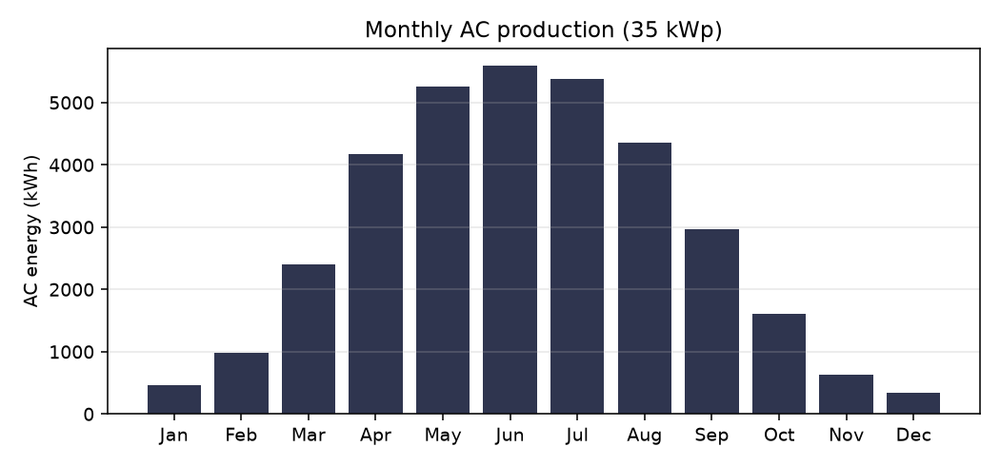

# Floating solar farm — Feasibility study

DTU Risø, Roskilde Fjord · Sunlit Sea technology

Prepared: 2026-11-04 · Prepared by: Sunlit Sea AS · Status: Preliminary estimate

Irradiation data: PVGIS 5.2, typical meteorological year

## Headline figures

| Panel count | Installed capacity | POA irradiation (tilted plane) |
|---|---|---|
| **47 panels** | **0.035 MWp DC** | **1 063 kWh/m²/year** |

| Performance Ratio | Estimated production | Specific yield |
|---|---|---|
| **90.0 %** | **34.2 MWh/year** | **976 kWh/kWp/year** |

## 1 Panel configuration and area

Installed capacity is provided directly as 35 kWp DC. Panel configuration and area derivation are not performed (no `--area` supplied).

| Parameter | Value | Unit | Note |
|---|---|---|---|
| Installed DC capacity | 35 | kWp | Supplied directly |
| Assumed panel power | 740 | Wp | Default |
| Panel count (derived) | ~47 | panels | 35 × 1 000 ÷ 740 |

## 2 Solar irradiation and POA analysis

At 2° south-facing tilt the panels capture slightly more irradiation than a horizontal plane. POA is taken from PVGIS 5.2 (Perez model).

| Parameter | Value | Unit | Note |
|---|---|---|---|
| GHI (horizontal reference) | 1 045 | kWh/m²/year | PVGIS MRcalc, 2005–2020 |
| POA at 2° (tilted plane) | 1 063 | kWh/m²/year | PVGIS PVcalc |
| Tilt angle | 2 | ° | Facing south |
| Gain vs horizontal plane | +1.8 | % | POA ÷ GHI – 1 |

## 3 Loss budget — PR decomposition

| Loss component | Loss (%) | Note |
|---|---|---|
| Temperature coefficient | 3.0 | |
| Inverter efficiency | 2.0 | |
| DC cable loss | 1.0 | |
| AC cable loss | 0.5 | |
| Mismatch | 0.5 | |
| Soiling | 0.5 | |
| LID (light-induced degradation) | 0.5 | |
| Availability / downtime | 1.0 | |
| Transformer loss | 1.0 | |
| **Total loss** | **10.0** | |
| **Performance Ratio (PR)** | **90.0 %** | 100 − Σ |

PVGIS reference value (crystSi model with internal temperature and spectral derating, no external losses): 34.4 MWh/year, implied PR 92.3 %. The component sum is likely conservative compared with the PVGIS model.

## 4 Energy production

| Parameter | Value | Unit | Calculation |
|---|---|---|---|
| Installed DC capacity (P_peak) | 35 | kWp | |
| POA irradiation (H) | 1 063 | kWh/m²/year | |
| Performance Ratio (PR) | 0.90 | — | 100 − Σ losses (from loss budget) |
| **Estimated production (E)** | **34.2** | MWh/year | P × H × PR, plus 2 % FPV cooling benefit |
| Specific yield | 976 | kWh/kWp/year | E ÷ P |
| Equivalent operating hours | 976 | h/year | = specific yield numerically |
| Capacity factor | 11.1 | % | E ÷ (P × 8 760 h) |

`E = 35 kWp x 1 063 kWh/m2/yr x 0.90 x 1.02 = 34.2 MWh/yr`

## 5 Sensitivity analysis

| Scenario | GHI deviation | PR deviation | Production (MWh/year) |
|---|---|---|---|
| Low | −5 % | −3 pp | 31.4 |
| **Base** | — | — | **34.2** |
| High | +5 % | +2 pp | 36.7 |

Production range: 31.4 – 36.7 MWh/year (spread ±8 % around the base value).

## 6 Key assumptions and limitations

| Topic | Assumption / limitation | Recommended next step |
|---|---|---|
| Solar irradiation | PVGIS 5.2 (SARAH), regional statistic. No site-specific measurement. | Obtain local pyranometer data from a nearby installation or weather service. |
| PVGIS lookup point | PVGIS rejected the input coordinates as over-sea; the nearest land grid cell (55.6865, 12.0809) was used. Irradiation data varies little over this distance. | — |
| POA / tilt | 2° tilt assumed. The actual angle is confirmed against the Sunlit Sea design specification at design freeze. | Confirm against the construction drawing. |
| Area | kWp supplied directly; no area dependency. | Fix the net available area after walkways, anchor points and buffer zones. |
| Panel specification | 740 Wp per panel, 2384 × 1303 mm. | Obtain updated product specification at tender time. |
| Performance Ratio | PR = 90.0 % computed from the component sum. The temperature term may be conservative for floating installations. | Measure the cooling effect at a pilot installation; adjust the FPV cooling bonus parameter. |
| FPV cooling bonus | 2 % DC uplift assumed (literature-based, conservative). | Replace with measurements from a Sunlit Sea pilot installation when available. |
| Albedo | Water albedo (~6 %) not explicitly modelled; the contribution to flat panels is small. | Can be included as a sensitivity parameter for bifacial panels. |
| Grid / inverter | AC capacity (MWac) not fixed. DC/AC ratio not defined. | Fix the DC/AC ratio (typical 1.10–1.20 for floating solar). |
| Regulatory | Regulatory framework for floating solar not assessed in this report. | Initiate regulatory screening for the specific site. |

---

**Calculation method:** E = P_peak × H × PR × (1 + FPV cooling bonus). Standard method per IEC 61724.

**Irradiation basis:** POA = 1 063 kWh/m²/year from PVGIS 5.2 (PVGIS 5.2, typical meteorological year), tilted 2° facing azimuth 180° (compass).

*This is a preliminary estimate. The results should not be used for investment decisions without further technical due diligence.*
