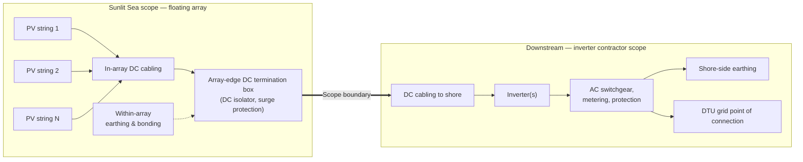

## Addressees and references

Submitted to:

- Morten Frøkjær Petersen, COWI A/S — mfpn@cowi.com
- Emma García, COWI A/S — emga@cowi.com
- Martin Bartholomäus, DTU — mabart@dtu.dk
- Peter Behrensdorff Poulsen, DTU — ppou@dtu.dk

Submitted by:

- Sunlit Sea AS, Grønnegata 10, 0350 Oslo, Norway. Organisasjonsnummer 922 633 924.
- Point of contact: Eirik Larsen, eirik@sunlitsea.no.

Tender reference: COWI project A252319, document FPV Research-RFP, version 1.0, 23 October 2026.
Proposal validity: 90 days from the date of this document.
Pricing basis: EUR, exclusive of VAT, delivered DAP DTU Risø (Incoterms 2020) unless amended at contract.

## 2 Technical proposal (RFP §4.1)

### 2.1 Proposed solution and key design assumptions

- Floating platform: Sunlit Sea CONNECT. Rigid array of CONNECT modules coupled through polyurethane-foam connector rods on all four sides of each module. The connector rods act as structural interconnection and as buoyancy elements.
- PV module: standard commercial 710–740 Wp glass–glass monofacial module, 2384 × 1303 mm, dropped into the cast PU frame at deployment. Preferred module brand to be confirmed at contract based on then-current supply conditions; the frame geometry accepts any module in the stated size and power class.
- Float body: cast polyurethane structure bonded to the panel edge, with a load-distributing bottom plate on the underside. The current base case is a flat 0.8 mm aluminium 5083-H111 plate; the final material and geometry for the shipping configuration are confirmed at design freeze.
- Fixed geometry: the CONNECT hinge geometry sets a small fixed tilt and leaves the panel resting slightly above water. Specific tilt angle and freeboard values are confirmed at design freeze. Neither is customisable per installation.
- DC design: modules strung in series within the array, string count and inverter interface sized to the inverter selected on the DTU/COWI side. Earthing and bonding of exposed metallic parts provided within the array; termination at the array edge handed over to the inverter contractor.
- Design life: stated at design freeze against the DNV ST-C108 framework (May 2026). The operative commercial commitment is the floating-platform workmanship warranty in Section 2.11.
- Design reference: the DNV FPV framework — RP-0584 (recommended practice) together with the ST-C108 (flytstruktur) and ST-E309 (mooring) standards released May 2026 — is the reference frame for the CONNECT design. Sunlit Sea's Gen 1 product carries DNV RP-0584 verification (2022).
- Natura 2000 location: the cast polyurethane structure and the bottom plate are the two material classes in direct water contact. Marine-grade PU is selected for low leaching in continuous water contact; Sunlit Sea's operating Gen 1 fleet (Mannheim, Germany since 2023 and Skiftestjørna, Norway since autumn 2024) carries the same PU-plus-metal material system in water. No copper or zinc is exposed to seawater; no sacrificial anodes are used. The materials dossier is issued with the design basis prior to construction.

{width=5.5in}

### 2.2 Preliminary layout

- Reference system size: 35 kWp (RFP financial-proposal basis).
- Module count: 48–50 CONNECT modules at 710–740 Wp, giving 34.1–37.0 kWp installed depending on the final module selected.
- Array footprint for a 7 × 7 layout: approximately 16.7 m × 9.1 m (152 m²). Final layout, including walkway/access provisions and any bridge-side alignment, will be issued as a controlled drawing within the design-basis package after contract award.
- Inverter location(s), cable routes and connection to shore are shown as interface points on the layout; the physical equipment selection and installation on those interface points sit with the inverter contractor.

### 2.3 Equipment schedule

| Item | Manufacturer / class | Model | Quantity | Key ratings |
|:-------------------|:---------------|:-------------------|:--------|:-------------------|
| PV module | Tier-1 glass–glass, 710–740 Wp class | To confirm at contract | 48–50 | 710–740 Wp, 2384 × 1303 mm, monofacial |
| Floating platform (CONNECT module) | Sunlit Sea | Sunlit Sea CONNECT | 48–50 | Small fixed tilt, panel resting slightly above water, calm-to-moderate sea states |
| Inter-module connectors (PU-foam rods) | Sunlit Sea | CONNECT connector rod | — | One rod per module side, buoyant, salt-water fatigue resistant |
| DC string cabling, connectors, grounding (within array) | Standard PV accessories | To confirm at contract | As designed | 1500 V DC class |
| Mooring, anchoring, inverters, AC balance, SCADA, shore-side electrical | Not in Sunlit Sea scope | — | — | See Section 4 |

### 2.4 PV module, inverter and floating-system datasheets

A Sunlit Sea CONNECT datasheet reflecting the current design state is available on request. Design values on the datasheet are subject to revision as the design is finalised at design freeze.

Candidate PV-module datasheets in the 710–740 Wp glass–glass class will be issued at contract. The inverter datasheet is issued by the party supplying the inverter.

### 2.5 Mooring and anchoring concept, and required site data

Mooring and anchoring are not supplied by Sunlit Sea. The array is delivered with a continuous perimeter rope running 360° around its outline; a mooring contractor on DTU/COWI's side attaches mooring lines to that rope anywhere along the perimeter and designs and installs the mooring to fit the site, the permit and any existing infrastructure. Sunlit Sea does not design discrete attachment points or perform coupled mooring-hydrodynamic analysis.

For a typical Danish fjord deployment at this scale the concept is a ring of compliant lines (polyester/HMPE) distributed around the array — pier and harbour bulkhead on the Risø peninsula side where structures can take the loads, bottom anchors or existing marine infrastructure on the open-water sides. The exact mix is the mooring contractor's call based on site data and the permit.

What Sunlit Sea supplies to the mooring contractor: per-float dry mass and mass distribution, static draft and freeboard, submerged shape per float, above-water projected area for wind load, perimeter-rope spec (type, rated capacity, route), PU material properties at the rope interface. Mass moment of inertia, inter-float hinge displacement limits and array-level in-plane stiffness firm up through Gen 2 TRL maturation and are released as they become available.

Site data expected from DTU/COWI: bathymetry of array and mooring footprint (0.5 m resolution); bottom composition at anchoring points; water-level variation (astronomical + surge) and ice conditions; any restrictions on anchoring near the pier, harbour bulkhead or floating-bridge extension.

### 2.6 Preliminary electrical single-line diagram

A preliminary single-line diagram at proposal level is shown below. The diagram ends at the array-edge DC termination. Downstream of that point — DC-to-inverter cabling, inverter(s), AC distribution, metering, protection and grid interface — is shown as a schematic interface only and is the responsibility of the inverter contractor to detail.

### 2.7 Electrical boundary

- Sunlit Sea supplies DC up to and including the array-edge DC termination box on the floating platform.
- Sunlit Sea supplies the inverter hardware DAP Risø (Table 3 line 5).
- Installation of the inverter at the shore-side location, DC-to-inverter cabling, string combiners if required, AC switchgear, transformers, metering, protection settings, SCADA, communications and shore-side connection to the DTU grid — are outside Sunlit Sea's scope and sit with DTU/COWI's electrical contractor.
- Earthing and bonding of exposed metallic parts is provided within the array; the shore-side earthing scheme is agreed at design-basis stage with the electrical contractor.

### 2.8 Energy-yield estimate

Preliminary annual-production estimate for a 35 kWp CONNECT array at the DTU Risø site, 55.6915 °N / 12.0809 °E. Methodology: PVGIS 5.2 (EU JRC) for irradiation, a nine-component loss decomposition yielding PR = 90 %, and a 2 % FPV cooling bonus vs a land-mounted reference. The estimate is refined with a site-specific simulation at contract once the PV module brand, inverter model and precise array orientation are confirmed.

| Headline | Value |
|---|---|
| Installed DC capacity | 35 kWp |
| POA irradiation (2° south-facing) | 1 063 kWh/m²/year |
| Performance Ratio | 90.0 % |
| FPV cooling bonus (vs land reference) | +2 % |
| Annual AC yield | 34.2 MWh/year |
| Specific yield | 976 kWh/kWp/year |
| Capacity factor (DC nameplate) | 11.1 % |

Irradiation source: PVGIS 5.2 TMY. Horizontal GHI at the site is 1 045 kWh/m²/year; tilting to 2° south adds a +1.7 % plane-of-array gain. PVGIS rejected the input coordinates as over-sea (the array sits in the fjord) and the lookup was moved to the nearest land grid cell at 55.6865 °N / 12.0809 °E, ~550 m south of the input point and within one PVGIS grid cell. Irradiation varies negligibly over that distance.

PR decomposition (sum 10 %, yielding PR = 90 %): temperature coefficient 3.0 %, inverter 2.0 %, DC cable 1.0 %, AC cable 0.5 %, mismatch 0.5 %, soiling 0.5 %, LID 0.5 %, availability 1.0 %, transformer 1.0 %. PVGIS's own crystSi model at these conditions gives an implied PR of 92.3 %, so the nine-component list is marginally conservative relative to PVGIS. The 2 % FPV cooling bonus is a conservative default drawn from published FPV field studies; a site-measured value is not available and will be refined once Sunlit Sea's own pilot thermal measurements land.

Scenario range (GHI ±5 %, PR −3/+2 percentage points):

| Scenario | Annual AC yield |
|---|---|
| Low | 31.4 MWh/year |
| Base | 34.2 MWh/year |
| High | 36.7 MWh/year |

Key assumptions and limitations: PVGIS regional satellite irradiation, no site-specific pyranometer measurement; tilt fixed at 2° per the CONNECT architecture; monofacial modules; no bathymetry-dependent albedo; no shading from local obstructions beyond PVGIS horizon masking; grid-connection availability matched to DTU operating hours; FPV cooling bonus uniform month-on-month.

### 2.9 Construction and commissioning methodology

Sunlit Sea supplies the floating platform as a factory-finished product (CONNECT frames with PV modules installed and factory-side DC string wiring terminated at the array-edge DC box). On-site installation is carried out by a contractor appointed by DTU/COWI. Recommended on-site sequence for a 35 kWp CONNECT delivery at Risø:

- Receiving, staging and launch: CONNECT modules received at the Risø harbour quayside, pre-assembled into 7–8 module strings, launched from the harbour slip or floating bridge, towed into position and hinge-coupled on water. Mooring installation runs in parallel with array assembly.
- Array-edge DC termination to the DC-to-inverter cable supplied by the inverter contractor, at the interface in §2.7.
- Pre-commissioning and commissioning: visual inspection, torque-check records, insulation and polarity checks on each string, mooring tension verification, joint functional test with the inverter contractor at the agreed point of connection.
- Handover: punch-list closure, as-built drawings, O&M manual for the Sunlit Sea scope, warranty documents.

Indicative duration from mobilisation to handover: four weeks. Window on signing 1 December 2026: 5 May – 2 June 2027, first kWh early June (§3.1). Sunlit Sea can supervise the launch, hinge-coupling, mooring interface and commissioning on an hourly basis — see Table 4.

### 2.10 Subcontractors and key suppliers

- Polyurethane casting: via Sunlit Sea's qualified casting partner, with a parallel Norwegian in-house casting line. Casting allocation for this delivery is confirmed at contract.
- Bottom-plate material (base case: aluminium 5083-H111 from a European mill): subject to final design-freeze selection and supply agreement.
- PV module: Tier-1 Chinese or European supplier in the 710–740 Wp glass–glass class.
- Inverter: Tier-1 European manufacturer in the ~30 kWac 3-phase string class (Fronius or SMA), supplied by Sunlit Sea DAP Risø. Final model confirmed at contract.
- On-site installation of the floating array: outside Sunlit Sea scope — to be contracted locally by DTU/COWI with a Danish marine or civil-works contractor (Sunlit Sea can suggest candidates).
- Mooring, electrical balance of system beyond the array edge, inverter installation at the shore-side: outside Sunlit Sea scope — to be contracted locally by DTU/COWI (Sunlit Sea can suggest Danish marine- and electrical-contractor candidates if useful).

### 2.11 Warranties

- Sunlit Sea scope (CONNECT module incl. cast PU structure, bottom plate, hinge hardware and inter-module PU-foam connector rods): 10-year workmanship warranty against defects in materials and manufacture. This is the operative commercial commitment; design-life figures against DNV ST-C108 are stated in the design-basis package at design freeze.
- Pass-through manufacturer warranties on supplied third-party items (PV modules typically 12-year product / 25-year linear performance for Tier-1 glass–glass; inverter per the selected manufacturer).
- A plant-level availability or production guarantee is not offered: the generation side depends on the inverter and shore-side scope outside Sunlit Sea's full control.

Recommended spare stock for an early-series CONNECT deployment: ten PV panels of the same module brand and class, held on site by DTU/COWI to support swap-in testing and cover first-year operational adjustments without supplier lead time. Priced in Table 4 line 20.

### 2.12 Preventive maintenance and optional O&M

Recommended preventive maintenance activities for the float side:

- Underside inspection for biofouling and biological growth: three times in the first year of operation, then annually. The first-year frequency reflects uncertainty in the local biofouling rate at Roskilde Fjord; the subsequent interval is confirmed from the first-year findings.
- Soiling inspection monthly, with cleaning triggered only when soiling is measurably affecting output. Bird droppings are removed regardless of overall soiling level — localised droppings can shade a single cell into reverse bias and create a module hotspot.
- Visual inspection of the PU frame, panel seals and hinge connectors: carried out at the monthly soiling inspection.
- Torque-check records on mechanical connections: first inspection at 6 months, then annually.
- Mooring-line condition check: performed by the mooring contractor on their own interval.

Fixed-camera video surveillance of the array is recommended. Remote inspection shortens the interval between a problem (growth, soiling, loose component, weather damage, animal interaction, vandalism) and detection, and reduces the number of boat-based inspection visits needed over the plant's life.

An annual float-side O&M visit is offered as an optional service, priced in Table 4 line 19. Monthly soiling inspections can be delegated to local staff on short training; video review can be handled remotely by Sunlit Sea if a camera stream is made available.

### 2.13 Notifications, permits and approvals

Facility permit and grid connection are handled by DTU/COWI (RFP §3.5). No additional permits are expected to fall on Sunlit Sea's scope. Any Natura 2000 compliance documentation related to the float materials will be issued by Sunlit Sea on request.

### 2.14 Dependencies on DTU, COWI or third parties

- Facility permit, grid connection, construction access and laydown areas: DTU/COWI.
- Mooring design and installation: local marine contractor engaged by DTU/COWI.
- Inverter installation at shore-side, AC switchgear, SCADA, shore-side electrical works: inverter contractor engaged by DTU/COWI.
- PV module and inverter procurement: Sunlit Sea, final brand/model confirmed at contract.
- Site data per §2.5: DTU/COWI.

### 2.15 Access, workboats, launch areas, waste management

- Access via the Risø harbour slip and the floating bridge referenced in RFP §2.1.
- Workboats and cranes: Sunlit Sea does not provide installation plant. We recommend a 2–5 t crane on the pier or harbour quay for module staging, and one small workboat with a two-person crew for on-water hinge coupling and mooring-line connection — procured and operated by the installation contractor appointed by DTU/COWI.
- Launch area: harbour quayside immediately west of the Risø campus. Temporary storage ~50 m² covered or weather-protected at the harbour for staged PU frames and PV modules.
- Waste: packaging materials (wood pallets, cardboard, plastic strapping) estimated at 1–2 m³ for the full 35 kWp delivery; disposed of via the DTU/COWI site waste scheme.

## 3 Commercial proposal (RFP §4.2)

### 3.1 Delivery programme

Delivery dates are expressed as weeks from contract signature. Absolute calendar dates below assume signature on 1 December 2026; if signature slips, downstream dates slip by the same amount.

| Milestone | Weeks from signature | Indicative date (signing 1 Dec 2026) |
|:-------------------------------------|:---------|:----------------------|
| Design freeze and factory procurement release | 4 | ~ 1 January 2027 |
| PU casting completion for the delivery | 18 | ~ early April 2027 |
| PV modules delivered to the staging port | 20 | ~ mid-April 2027 |
| Site mobilisation (factory-finished product DAP Risø) | 22 | ~ 5 May 2027 |
| Array assembly and launch (DTU/COWI's installation contractor; §2.9) | 22–25 | ~ 5 May – 24 May 2027 |
| Pre-commissioning and handover | 25–26 | ~ 25 May – 2 June 2027 |
| First kWh (after DTU grid-tie) | 27 | ~ early June 2027 |

The RFP's original 5 April – 3 May 2027 construction window is achievable if signature lands in early-to-mid November 2026.

Sunlit Sea does not carry schedule risk for delays caused by late contract signature, late fulfilment of agreed commercial pre-conditions (e.g. advance payment, if agreed), or late DTU/COWI-side inputs — in those cases all downstream dates shift by the same amount. If Sunlit Sea misses a commitment through causes inside its control (casting supplier, in-house assembly, documentation), Sunlit Sea covers the schedule-recovery cost within §3.3 limits.

Procurement lead time on the PV modules (10–14 weeks DAP Europe from Tier-1 Chinese suppliers) is the primary Sunlit-Sea-side schedule driver.

### 3.2 Procurement constraints

- PV module lead time from Tier-1 Chinese suppliers typically 10–14 weeks DAP Europe. Earlier contract signature improves the schedule buffer.
- Polyurethane casting capacity is allocated against Sunlit Sea's broader project pipeline; a parallel Norwegian in-house casting line provides schedule resilience. Allocation for this delivery is confirmed at contract.

### 3.3 Commercial and contractual assumptions

- Quotation validity: 90 days from the date of this document.
- Payment milestones (indicative, open to discussion): 40 % at contract signature (covers the inverter and 20 % of the floating-platform scope, both funded early), 40 % at factory release of CONNECT and PV modules, 10 % at delivery to Risø, 10 % at handover. If DTU procurement rules preclude a 40 % upfront, alternatives available (letter of credit against factory release, back-weighted progress payments). The specific split is negotiable.
- Commercial baseline: EUR, prices exclude VAT (Danish VAT treatment confirmed at contract), Incoterms DAP DTU Risø (2020). A parent-company guarantee can be issued against an agreed advance/progress-payment structure if required.
- Liability: Sunlit Sea's total aggregate liability under the contract is capped at the contract price. Consequential losses (loss of revenue, production, use) are excluded.
- Delivery dates: expressed in weeks from contract signature (§3.1); no absolute-date commitment ahead of signature. No liquidated damages offered; a mutual schedule-slip notification and re-plan mechanism with a 30-day joint resolution window is proposed instead. Delays outside Sunlit Sea's control (module supply, PU casting, port/customs, DTU/COWI-side permit or grid-connection slippage, late pre-condition fulfilment, force majeure) shift delivery dates by the same amount without penalty.

### 3.4 Relevant floating-PV experience

- Mannheim Cablepark, Germany — 60 kWp Sunlit Sea Gen 1 array in operation since 2023 for Rixen Cableway. Reference contact details on request.
- Skiftestjørna, Haugaland Næringspark, Tysvær, Norway — 105 kWp Sunlit Sea Gen 1 array in operation since autumn 2024, operated under a PPA to EV PowerCharge AS.
- SUREWAVE (Horizon Europe GA 101083342) — Sunlit Sea is the FPV floater partner in the SINTEF-coordinated consortium; FPV wave-tank testing completed within the project informs the CONNECT design.
- SuRE (Horizon Europe GA 101135567) — Sunlit Sea leads WP6 (FPV model chain) in the IFE-coordinated consortium; D6.1 submitted, D6.2 in preparation.

Reference contact details on request, subject to the respective customer's consent.

## 4 Reservation list and deviations (RFP §4.3)

All deviations and exclusions are consolidated here. Where an RFP item is not listed below, this proposal is intended to comply with the RFP requirements.

### 4.1 Scope deviations from RFP §3.1

- On-site installation of the floating array (RFP §3.1.3): not supplied by Sunlit Sea. To be contracted separately by DTU/COWI with a local marine or civil-works contractor. Sunlit Sea supplies the factory-finished product (CONNECT frames with modules installed and factory-side DC string wiring terminated at the array-edge DC box), the recommended installation sequence (§2.9), and — optionally, on an hourly basis — on-site supervision of the launch, hinge-coupling, mooring interface and commissioning sequence.
- Mooring and anchoring (RFP §3.1.1, §3.1.2, §3.1.3): not supplied by Sunlit Sea. Design and installation to be contracted separately by DTU/COWI with a local marine contractor. Sunlit Sea supplies the floating-body data package to the mooring contractor as set out in §2.5; coupled mooring and hydrodynamic analysis is the mooring contractor's scope.
- Inverter supply (RFP §3.1.2): following COWI's clarification, inverter hardware is supplied by Sunlit Sea inside the base proposal at Table 3 line 5. Reference model: a Tier-1 European-market 3-phase string inverter in the ~30 kWac 400 V class (Fronius Tauro, Huawei SUN2000-33KTL-A or SMA Sunny Tripower X-25). Final model is selected at design freeze on the basis of DC/AC ratio (target 1.17 against the 35 kWp reference), MPPT count, European-regional service support and the agreed grid-connection parameters at Risø. Inverter *installation* at the shore-side location (mounting, AC termination, protection and grid-tie) remains with DTU/COWI's electrical contractor.

    *Commercial note.* Inverter supply is not Sunlit Sea's core business. The line 5 price carries a handling margin and is not competitive with direct procurement from the inverter manufacturer or a Danish wholesaler. If DTU/COWI procures the inverter through its own channels, the base scope reverts to Table 4 line 16 (€61 000) at better unit economics. We recommend benchmarking line 5 against two or three Danish wholesaler quotes before confirming inverter supply by Sunlit Sea.
- Electrical balance of system beyond the array edge, including DC-to-inverter cabling, string combiners, AC switchgear, transformers, metering, protection, SCADA and communications (RFP §3.1.2, §3.1.4): not supplied by Sunlit Sea.
- Civil / shore-side works (RFP §3.1.3): not supplied by Sunlit Sea.
- Shore-side earthing scheme: not supplied by Sunlit Sea; the array-side earthing is in scope and interfaces at the array edge.
- O&M manual: supplied for the Sunlit Sea scope (floating platform) only; the full-plant O&M manual aggregating all contractors' documentation is the responsibility of the main contractor or project engineer.
- Site marking (navigation buoys and shore-side warning signage per Søfartsstyrelsen rules): outside Sunlit Sea scope. Sunlit Sea supplies electrical-hazard labelling on the array itself (ISO 7010 pictograms + Danish/English text) as part of factory assembly.
- Construction window (RFP §2 Table 1): Sunlit Sea does not commit to absolute calendar dates ahead of contract signature. The delivery programme in §3.1 is expressed in weeks from signature. Indicative on signing 1 December 2026: mobilisation ~ 5 May 2027, handover ~ 2 June 2027, first kWh ~ early June 2027. The RFP's original April – May 2027 window is achievable if signature lands in early-to-mid November 2026.

### 4.2 Design-fixed items

- PV module class is fixed at 710–740 Wp glass–glass monofacial, 2384 × 1303 mm. Customer-supplied modules or alternative module geometries are not supported.
- The CONNECT hinge geometry fixes the module tilt (small, indicatively around 2°; the exact value is confirmed at design freeze). Custom tilts and adjustable-tilt variants are not available.
- Freeboard: the panel rests slightly above water with the specific freeboard set by the CONNECT geometry; not customisable per installation.
- The float geometry is not customisable per installation.

### 4.3 Optional second configuration (RFP §1)

Sunlit Sea offers one floating-system configuration (Sunlit Sea CONNECT). The RFP's option of a second, sufficiently different configuration is not offered in this proposal. The optional-price line 17 (discount for two different floating systems) is therefore marked not applicable.

### 4.4 Plant availability / production guarantee

Not offered on this proposal because the generation side depends on the inverter, SCADA and shore-side scope outside Sunlit Sea's contract (see Section 2.11).

## 5 Financial proposal and price breakdown (RFP §4.4)

Prices below are in EUR, exclusive of VAT, delivered DAP DTU Risø, for the 35 kWp reference system (48–50 CONNECT modules). Unit prices are given in EUR/kWp against the 35 kWp reference.

All prices in this section are indicative order-of-magnitude estimates for a first-of-kind pilot delivery from Norway to Denmark. Final commercial terms are confirmed at contract and may vary by up to ±20 % depending on module-market conditions, FX and the installation-contractor interface detail agreed at design freeze.

### Table 3 — Mandatory price breakdown

Columns: quantity, unit price (EUR per unit), EUR/kWp (line total ÷ 35 kWp per RFP §4.4), total (EUR). EUR/kWp is not summable across lines — line 14 computes 71 000 ÷ 35.

| # | Item | Quantity | Unit price (EUR) | EUR/kWp | Total (EUR) |
|:---|:------------------------------------------------|:----------|:-----------------|:--------|:-----------|
| 1 | Engineering, project management, transport and logistics, site mobilisation and temporary work (Sunlit Sea scope only) | lump sum | 8 000 | 229 | 8 000 |
| 2 | PV modules (glass–glass, ~740 Wp class, Tier-1 supplier) | 48 panels | 146 | 200 | 7 000 |
| 3 | Floating platform / mounting system (Sunlit Sea CONNECT: cast PU structures, bottom plates, inter-module PU-foam connector rods) | 48 modules | 625 | 857 | 30 000 |
| 4 | Mooring and anchoring system | — | Not in scope — see §4.1 | — | — |
| 5 | Inverter (Tier-1 European-market 3-phase string inverter, ~30 kWac class at 400 V; reference model: Fronius Tauro, Huawei SUN2000-33KTL-A or SMA Sunny Tripower X-25; final model confirmed at contract). Hardware supplied DAP Risø including documentation and manufacturer warranty. Installation at the shore-side location by DTU/COWI's electrical contractor. **See §4.1 for an important commercial note on this line.** | 1 unit | 10 000 | 286 | 10 000 |
| 6 | Electrical balance of system (array-side DC: string cabling and array-edge DC termination box, factory-installed) | 1 system | 5 000 | 143 | 5 000 |
| 7 | Monitoring / communications / SCADA | — | Not in scope — see §4.1 | — | — |
| 8 | Mechanical and Electrical installation (on-site) | — | Not in scope — see §4.1; factory-side DC termination included in line 6; optional on-site supervision in Table 4 line 18 | — | — |
| 9 | Civil / shore-side works | — | Not in scope — see §4.1 | — | — |
| 10 | Testing and commissioning, documentation and training (Sunlit Sea scope: pre-commissioning checks, as-built documentation, O&M manual for the Sunlit Sea scope) | 1 package | 3 500 | 100 | 3 500 |
| 11 | Initial spare parts and special tools (Sunlit Sea scope) | 1 kit | 1 500 | 43 | 1 500 |
| 12 | End-of-life removal and disposal costs (indicative, 25-year horizon, net of material recovery) | 1 system | 4 000 | 114 | 4 000 |
| 13 | Other costs (contingency, documentation, electrical-hazard labels on the array, miscellaneous) | lump sum | 2 000 | 57 | 2 000 |
| 14 | **TOTAL (Sunlit Sea scope only — excludes items 4, 7, 8, 9 and the downstream portion of item 6)** | — | n/a (sum not meaningful on unit prices) | **2 029** | **71 000** |

Note on terminology: the RFP's "TOTAL TURNKEY PRICE" line assumes a single contractor delivers all items 1–13. Sunlit Sea's proposal does not supply mooring, SCADA, civil works or on-site installation; line 14 is therefore the Sunlit Sea scope total (inclusive of the inverter following COWI's clarification), not a full-plant turnkey figure.

### Table 4 — Optional and alternative-view prices (per RFP §4.4.1)

Lines 15–17 are inherited from the RFP §4.4.1 template. Line 16 shows the base total with the inverter removed (the inverter is now in Table 3 line 5). Lines 18–20 are Sunlit Sea's own optional add-ons.

| # | Item | Quantity | Unit price (EUR) | EUR/kWp | Total (EUR) |
|:---|:------------------------------------------------|:----------|:-----------------|:--------|:-----------|
| 15 | Bridge / Pontoon for access to all floating systems | — | Not offered — see §4.1 (civil/shore-side works) | — | — |
| 16 | Total price excluding inverter procurement and supply (floating platform scope only, inverter stripped from line 14). Supplied per RFP §4.4.1 to normalise comparison against bids that do not include the inverter. | 1 system | 61 000 | 1 743 | 61 000 |
| 17 | Discount for proposals including two different floating systems (of 35 kWp each) | — | Not applicable — see §4.3 | — | — |
| 18 | On-site installation supervision by a Sunlit Sea engineer — base scope: one site mobilisation from Oslo (round-trip flight, up to four hotel nights, ground transport), up to three on-site days (staging kick-off, launch supervision, commissioning witnessing), remote design-support hours during the install sequence, and a written commissioning report delivered within two weeks of handover. Additional on-site days billed at €1 000 /day (engineering + accommodation + per diem). Additional remote engineering hours billed at €120 /h. Weather standby on site at €800 /day. A second site mobilisation (phased install or commissioning slip) is quoted at approximately €3 500 per trip at the time it is needed. | 1 base mobilisation | 7 000 | 200 | 7 000 |
| 19 | Annual float-side O&M visit — base scope: one Sunlit Sea engineer, round-trip travel from Oslo (flight, one hotel night, ground transport), up to one day on site (visual inspection of PU structure, hinges, seals and connectors; torque-check records; photo documentation) and a written inspection report delivered within two weeks of the visit. Additional on-site time billed at the line 18 hourly rate (€120 /h). Replacement parts (e.g. PV panel swap from the line 20 reserve), underwater biofouling cleaning requiring a diver, follow-up visits, and any remedial work are agreed and quoted separately. | 1 base visit/year | 4 000 | 114 /year | 4 000 /year |
| 20 | Recommended spare panel reserve for the early-series deployment (held on site by DTU/COWI for swap-in testing and first-year operational cover) | 10 panels | 150 | 43 | 1 500 |

### 5.1 Pricing notes

- Prices assume access to the Risø harbour slip, the floating bridge and a 2–5 t crane on the pier (§2.15). Crane and workboat are procured by the installation contractor appointed by DTU/COWI (§2.9, §4.1).
- Prices assume contract signature on or around 1 December 2026; signature slippage shifts delivery dates by the same amount (§3.1). Signature beyond mid-January 2027 may trigger a re-quote on PV-module pricing.
- Recurring and hourly prices (Table 4 lines 18 and 19) are quoted in 2026 EUR and escalate at 3 % per year from year 2 onwards, compounded. Travel components in the base fees are adjusted to then-current market rates at each visit. Eurozone HICP with a 2 % floor is available as an alternative convention on request.

---

Submitted on behalf of Sunlit Sea AS,

Eirik Larsen  
Board member, technical lead  
eirik@sunlitsea.no
