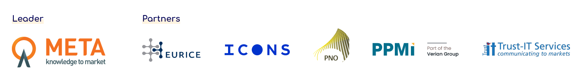

# G2M Exploitation Pillars training — SUREWAVE

Horizon Results Booster G2M-A training webinar delivered 2026-10-23 by Raluca Cibu-Buzac (META Group, `booster@meta-group.com`). Slide 23 contains the mentor's written feedback on Sunlit Sea's KER (Generation 2 FPV platform) as submitted in the 2026-10-18 Exploitation Intentions Table. Remaining slides are generic HRB training content on Dissemination vs Exploitation, KER definitions, direct/indirect use and the Horizon Europe Article 39 best-efforts obligation.

## G2M Exploitation Pillars training 23/10/2026 {#slide-1}

Raluca CIBU-BUZAC

An initiative 

of the

## Agenda for today {#slide-2}

2

14.00-14.10 -  Ice breaking -- Welcome : presenting the webinar

14.10-14.30  -  Bridging results to the market:  the role of D&E, general definitions

14.30-14.50 -  Reviewing Key Exploitable Results:  review of Exploitation intentions table, final list of KERs

14.50-15.10 -  Planning the next steps:  introducing Market Definition Canvas and Value Proposition Canvas

15.10-15.20 -  Wrap-up -- Q&A  

## Exploitation Pillars training general objectives {#slide-3}

3

- Aligning on the main concept of  KERs , " use/adoption " of KERs and  impact  generation
- Identification/selection of KERs
- Discuss issues connected to exploitation
- Guide "next" activities

## Slide 4

4

Definitions

## The Scenario {#slide-5}

Transforming project results into concrete benefits for the society,  maximising the scientific, social, economic, technological and policy value of the Framework Programmes ,  is a must .

This transformation passes through the successful implementation of Dissemination and Exploitation (D&E) activities. 

5

## Make a difference -- make an impact! {#slide-6}

What is impact?

Growth and societal benefits  generated by an investment in  R&D !

6

## Impact:  it is linked to  KERs  and their  use {#slide-7}

The  planet  is the  " destination "  (economic, societal, etc. ) with its  "players" (adopters, beneficiaries)

The  meteorite  is the  " key exploitable result "  (KER)

The  "outcome"  is the first " effect " of D&E

" Impact "  is the  " benefit "   for the beneficiaries due to the  USE   of the  KER

7

## Slide 8

The players  

::: {.smartart .IconCircleLabelList layout="IconCircleLabelList"}
:::

ADOPTERS

END-USERS CUSTOMERS 

BENEFICIARIES

They can be the same player!  (e.g. for a baker, people buying bread  are adopters, end-users and beneficiaries are the same time)

## Slide 9

- Responding to  specific  needs  of a well-defined group, the " adopters " 
- Solving their need/s much  better  than " state of the art "
- Chosen by partner/s for  USE   and/or "market"   introduction

<!-- -->

- A product or process...
- A format for new service...
- New standard...
- New training courses...
- Input for a new project...

<!-- -->

- Not a patent ...

What is a KER?

9

Not just a  result,  but a  "special"  result:    

## What   is   USE? {#slide-10}

Is the action made by adopters to make the KER available to users

 

USE can be 

commercial (for profit)  or  not for profit,

(improving a  policy   action   or  public knowledge )

Partners can:

exploit  results themselves  (direct)

or

facilitate  use by third parties  (indirect)

10

## Direct  and  indirect  use {#slide-11}

Exploiting by themselves -  Direct :

- Background in  further research  activities ( low   TRLs ) (exploitation plan);
- developing and  commercialising  a product or process ( high   TRLs ) (business plan);
- Providing  services (consultancy --  contract research );
- Using results in  standardisation  activities (exploitation plan);
- New  policy  measure (if the  partner is a policy maker )

Facilitating use to third parties  -  Indirect : 

- Transfer  of results;
- Licensing ;

A  spin-off  is always linked to an indirect use

11

## Slide 12

IT IS

how to  mobilise  outcomes and achieve  impact   thanks to long term sustainability

IS NOT

Exploitation

12

## Exploitation   - make use of -- a  sustainable  « value »  driven   process {#slide-13}

"Value"   can have different meanings:

- Revenues  ( commercial  use with  customers ready to pay);
- Fulfilling an existing gap  ( not for profit , better services, improved delivery processes, policies);
- 
- Increase of the  intangible assets  in the organization/commu nity  (distinctive skill set, standards, etc.)

13

## Dissemination vs Exploitation {#slide-14}

  Dissemination                                                                                                                  Exploitation
  ------------------------------------------------------------------------------------------------------------------------------ --------------------------------------------------------------------------------------------------------------------------------------------------------------
  Describing  and  making available results  so that they can be used                                                            Making use of  results , for scientific, societal or economic purposes
  Audiences  that  may make use  of results                                                                                      Groups and  entities  that   are making concrete use of results 
  All  results which are not restricted due to the protection of intellectual property, security rules or legitimate interests   All results generated during project Participant shall make best efforts to exploit the results it owns, or to have them exploited by another legal entity  

Making results available	Facilitating further use of results	    Making use of results

Patent 

Spin-off/ Start-up 

Data Management plan

Manufacturing

Innovation  management

Scientific/Technical publications

Policy brief/marketing  materials

Workshops,  demonstrations

IP Management

Further R&D

Online repository/ portals

PhD thesis/ post

Trade  fairs

Business plan

Demonstration  plants

Licensing

Service provision/training

Educational activities

Direct sales

Policy making

14

## Communication  vs Dissemination {#slide-15}

Press release

Informing about project	            Informing about results              Making results available for use

Project website

Scientific/Technical  publications

Social media

Project factsheet, brochures

Exhibitions/open days/guided visits

Event presentation

Policy brief/roadmap

Sharing results on online repository

Newsletter

Videos, interviews

Workshops demonstration

Articles in magazines

Project website

  Communication                                                                       Dissemination
  ----------------------------------------------------------------------------------- --------------------------------------------------------------------------------------------------------------------------------------------------------------------------------------------------
  About the  project   and   results                                                  About  results only
  Multiple  audiences Beyond the project's community (include media and the public)   Audiences that may  use the results  in their own work, e.g. peers (scientific of the project´s own community), industry and other commercial actors, professional organisations, policy makers 
  Inform  and  reach out to society , show the benefits of research                   Enable use  and  uptake of results

Participation to trade fairs

15

## In a  nutshell  (from  the  EC) {#slide-16}

## Exploitation and dissemination in  HE {#slide-17}

17

T he  Horizon Europe  Regulation focuses on  impact of research results

According to the  art.39 , 'the beneficiaries shall update the plan for the exploitation and dissemination of the results  during and after the end of the action , in accordance with the grant agreement'.

The Model Grant Agreement  maintains the obligatory period of 4 years  after the end of the project for the beneficiaries  to exploit their results .

' If, despite a beneficiary's best efforts, the results are not exploited within one year after the end of the action, the  beneficiaries must  (unless otherwise agreed in writing with the granting authority)  use the Horizon Results Platform  to find interested parties to exploit the results ".

The  D&E Strategy and related action plan  identify further pro-active continuous monitoring as a possible solution to fully use  dissemination and exploitation data  available throughout the lifecycle of the project not only to follow-up on the uptake of the research results but also to  support beneficiaries in D&E actions .

## CAREFUL ! {#slide-18}

«AMAZING» PROJECT RESULTS

 ≠ 

«AMAZING» IMPACT

18

## Slide 19

No use  

No impact!

19

## Slide 20

20

Any question?

## Slide 21

21

Reviewing KERs

## What we will discuss together {#slide-22}

- KER owner
- competitive advantages
- use model
- early adopters
- problem addressed and alternative  solutions
- unique value proposition
- description of the KER

## Sunlit Sea Offshore Floating Photovoltaic Platform (Generation 2) {#slide-23}

23

- 

  Is it responding to  specific  needs/problems  of a well-defined target (" adopters " and/or "end-users")?   Yes   The customer segments are clearly defined. Is there a market analysis describing the profiles of these segments? Which are their main 3-5 problems that the KER will solve for them? In terms of geography, do you potentially aim for other markets beyond the two areas listed? Very relevant: intersection with the floating-wind (i.e., distinct market analysis for this segment). Recommendation: check the new cohort of the  Blueinvest  ( https://blueinvest-community.converve.io/ ).
  ------------------------------------------------------------------------------------------------------------ ----- -------------------------------------------------------------------------------------------------------------------------------------------------------------------------------------------------------------------------------------------------------------------------------------------------------------------------------------------------------------------------------------------------------------------------------------------------------------------------------------------------
  Is it solving their need/s much  better  than " state of the art "?                                          Yes   The main competitive advantage is sharply presented, and backed by the technology's features. Looking at the above tope 3-5 problems at adopters/end-users level, would you add any other differentiators? Which are your main needs, to move forward with the development and commercialisation. Please share a pitch deck, if available. 
  Is it chosen by any partner/s for direct or indirect  USE?                                                   Yes   The use model is fit for the KER's exploitation, with licensing as a relevant pathway (even primary, alongside with the manufacturing and distribution of the product). This is linked with the IP management, as to be licensed, the «intellectual assets» need to be individualised and protected. It is excellent that you secured funding for TRL6. Beside EIC Transition, do you envisage other funding?  Are VCs also an option for next funding?

First of all: is the KER clearly described?

## Slide 24

24

Now we have the final list of KERs.

Any question?

## Slide 25

Raluca CIBU-BUZAC

booster@meta-group.com

www.horizonresultsbooster.eu

Copyrights: The images used in this presentation are for illustrative purposes only and may not represent the actual product or service. All images are either publicly available or used with permission from their respective owners. Sources:  Unsplash ,  Pexels

Funded by the European Union. Views and opinions expressed are however those of the author(s) only and do not necessarily reflect those of the European Union or DG RTD. Neither the European Union nor the granting authority can be held responsible for them.
