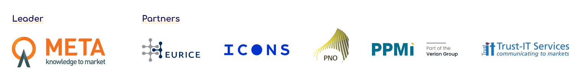
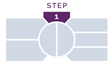
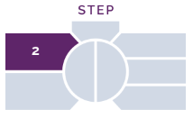
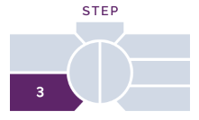
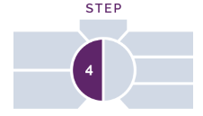
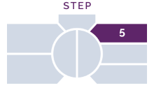
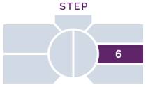
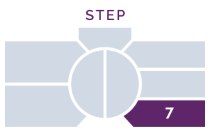
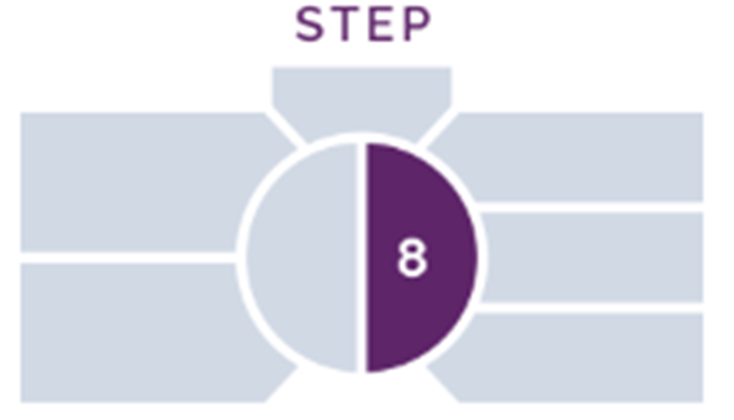
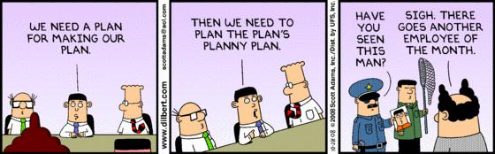

Slides from the SUREWAVE Horizon Results Booster G2M-B UVP workshop, 6 November 2026, presented by Raluca Cibu-Buzac (META Group). Slides 12-20 review Sunlit Sea's Market Definition Canvas; slides 29-38 review the Value Proposition Canvas; slide 44 holds the Unique Value Proposition statement agreed in the session.

## G2M UVP workshop 06 /11/2026 {#slide-1}

Raluca CIBU-BUZAC

An initiative 

of the

## Agenda for today {#slide-2}

2

14.30-14.40 -  Ice breaking -- Welcome : presenting the webinar, expert's insights

14.40-15.00  -  Working together: The Market Definition Canvas :  identifying the market

15.00-15.30 -  Working together: The Value Proposition Canvas:  identifying the competitive advantages

15.30-15.40-  Presenting the UVP:  Showcasing the KER for the HRP 

15.40-15.50 -  A quick look at IP

15.50-16.00 -  Planning next steps:  presenting the new tools

16.00-16.15 -  Wrap-up

## UVP workshop general objectives {#slide-3}

3

- Identifying the most appropriate market and your customers
- Defining the competitive advantages
- Discussing potential issues related to IP
- Be prepared for effective use of the HRP

## The go-to-market  journey {#slide-4}

4

A and C could be your adopters/customers

The market  does not change ! It is crucial to well identify it.

Your  exploitation strategy  (and your adopters/customers)  changes  based on the journey you select. 

## Quick recall: what is a competitive advantage? {#slide-5}

5

It is a statement describing  how much better  does your KER solve the end-users\'/customers'  needs/problems  compared to  alternative solutions

## Key elements for the competitive advantage? {#slide-6}

6

Who are your end-users/customers?

What are their needs/problems?

How are they solving their problems now?

What are you offering them as a solution?

Why is your solution better?

## Slide 7

7

Let's work on your KER

The Market Definition Canvas

A tool to answers the first 2 questions

## Defining  the market in a demand- driven   approach {#slide-8}

8

Your goal is to define the  product-market fit.

This means finding the right course towards your destination:  the market.

It is extremely difficult and resource-consuming finding the right course if your destination is unclear or changes.

Your destination (the market) must be defined and validated before moving to needs discovery and product definition.

You  don't create markets ; you can create products to  serve markets!

## Defining  the market in a demand- driven   approach {#slide-9}

9

Do not use the lens of  what you are doing

Use the lens of  what the customers is trying to get done

## Defining  the market in a demand- driven   approach {#slide-10}

10

Why people buy/adopt products and services?

People buy products and services to get a "job" done .

" Job ": a  task people are trying to accomplish , a goal or objective they are trying to achieve, a problem they are trying to resolve, something they are trying to avoid, or anything else they are trying to accomplish. 

\" Market \" :  a group of people and the job they are trying to get done .

How should a market be defined?

## Defining  the market in a demand- driven   approach {#slide-11}

11

With such definition:

- a market  does not change  during your "iterations"
- it is easier to discover the  "customers'" needs/problems
- "new" and disruptive markets  can be better defined 
- 

An example:

- Traditional  (technology-centric): the cryptocurrency market. It seems to be a "new" market!
- with this approach : consumers (a group of people) trying to intermediate the storage and exchange of value over time (the job-to-be-done). Is it a "new" market ?

## Sunlit Sea Offshore Floating Photovoltaic Platform (Generation 2) {#slide-12}

12

Traditional market definition

Sunlit Sea CONNECT offshore floating photovoltaic platform (Generation 2). Aluminium 

bottom plate plus cast polyurethane frame carrying a standard commercial 710-740 Wp 

glass-glass panel; panels are decoupled from float manufacture and dropped in 

at deployment. Floats connect along the full edge through Generation-3 polyurethane hinges validated under SUREWAVE (Grant Agreement 101083342). Deployed standalone or behind a floating breakwater.

- Is the product, service clearly described?
- Is it possible to visualize it?
- Does it include too many technical elements?

## Sunlit Sea Offshore Floating Photovoltaic Platform (Generation 2) {#slide-13}

13

2. Job executor determination

- Project development managers at utility-scale renewable developers and IPPs 

(1-10 MW offshore photovoltaic).

- Asset managers at offshore wind farms evaluating in-lease solar co-location.

- Energy and sustainability directors at coastal industrial off-takers.

- EPC technical leads at marine contractors.

- Investment committees and lender technical due diligence.

- Are the category of people clearly identified?
- Are they those who will use the solution?
- Keep in mind, we are focused here on stating the job executors, not on influencers, economic buyers, etc.

## Sunlit Sea Offshore Floating Photovoltaic Platform (Generation 2) {#slide-14}

14

3. Abstracted job executor

Offshore renewable energy project developers

- Is there an overarching term that can be used to classify all the categories of people using the product to get a job done?
- Has an all-inclusive term (higher-level, generic term) used that encapsulates all job executors
- job executors are often referred to simply as "consumers"

## Sunlit Sea Offshore Floating Photovoltaic Platform (Generation 2) {#slide-15}

15

4. Job executor

They are the  reason why the market exists .

What is your final choice?

Identify some representatives of this group to be involved in the next steps.

They (and  they alone!),  will tell you the way they define the job they are trying to get done.

## Sunlit Sea Offshore Floating Photovoltaic Platform (Generation 2) {#slide-16}

16

5. Function of the product

Primary:

Generate utility-scale electricity from solar irradiance on European coastal water surfaces 

(1-10 MW first generation, scaling to 50+ MW by 2033).

Secondary:

- Co-locate with offshore wind leases, sharing substation, grid connection and mooring corridors.

- Provide platform-integrated structural health monitoring data for condition-based maintenance.

- Does the "job" refer to what a group of people does? Products don't have jobs-to-be-done---people do. 
- Is it clear what the product/service "does" from a functional perspective?
- Are the job statements formulated as \[verb\] + \[object\] + \[clarifier\] optional
- Have they asked directly to the group of people?
- Has the job executor perspective been respected? Or is it just the participant perspective?

## Slide 17

17

5. Function of the product

Do  not   forget !

Ask  the job  executors   directly   about   their  jobs! 

Interview  them .

## Sunlit Sea Offshore Floating Photovoltaic Platform (Generation 2) {#slide-18}

18

6. Other products used and the functions

- Offshore wind turbines: offshore wind electricity (complementary).

- Onshore utility photovoltaic: land-based solar (substitute when land is available).

- Grid connection infrastructure: transmit offshore electricity to shore.

- Mooring and anchoring: hold floating structures in position.

- Floating breakwaters (SUREWAVE KER3, Clement Germany): attenuate waves at exposed sites.

- Structural health monitoring platforms (SUREWAVE KER6,  Ceit ): condition data for maintenance.

- Power purchase agreements and offtake contracts:  monetise  the generated electricity.

- Are the listed products used immediately before, while, and immediately after using the KER? 
- Do all of them follow the job statements: \[verb\] + \[object\] + \[clarifier\] optional?
- Have they asked directly to the group of people?
- Has the job executor perspective been respected? Or is it just the participant perspective?

## Sunlit Sea Offshore Floating Photovoltaic Platform (Generation 2) {#slide-19}

19

7. Abstracted job statement

Grow offshore renewable capacity where onshore solar is blocked.

- Are they looking at the market through the job executor's eyes?
- Does the described job resume the use of all products/services in points 5 and 6?
- Is the proposed KER part of a job done?

## Sunlit Sea Offshore Floating Photovoltaic Platform (Generation 2) {#slide-20}

20

8. Customer's Job-to-be-Done

Now that the job-to-be-done is defined, you have the  target market for your solution , defined as: 

a  group of people  (job executor) which does  the job-to-be-done

## Slide 21

21

Any question?

## Slide 22

22

## Slide 23

23

Let's work on your KER

The Value Proposition Canvas

## ad-lib VALUE   P R OPO S I T I O N   TEMPLATE {#slide-24}

Strategyzer.com/vpd

24

What we want to get? A Unique Value Proposition sentence

ad- lib

VALUE   P R OPO S I T I O N   TEMPLATE

## Slide 25

#1   Mistake

For start-ups and R&D Teams willing to go to market

Developing   Something  Nobody Wants

25

## Solving Problems = Building route to use {#slide-26}

Not  every solution has a problem

Not  every problem has a customer

Every  customer  has a  problem , every problem has a  solution

26

## Need  for a  better  approach   for  creating  value  for   \" customers \"   &   lowering   risk  of   failure! {#slide-27}

27

May, 2020                                                      ©META Group, All Rights Reserved

## The   Value Proposition Canvas (VPC) {#slide-28}

28

Value   Map

gain   creators

pain  relievers

products   &  services

Customer   Profile

jobs

pains

gains

## Sunlit Sea Offshore Floating Photovoltaic Platform (Generation 2) {#slide-29}

29

Utility-scale renewable energy developers and independent power producers 

1--10 MW offshore photovoltaic in European coastal waters, 2027--2030 commercial window.

## Sunlit Sea Offshore Floating Photovoltaic Platform (Generation 2) {#slide-30}

30

Meet offtake-price benchmarks

Operate 20+ years at predictable OPEX

2. Add solar to offshore wind portfolios

2. Customer Jobs

What customers are trying to get done?

Is the provided list relevant? 

Is it complete?

Do jobs refer to what customers do?

1. Grow renewables where onshore land is blocked

Clear investment-grade due diligence

Position as offshore-renewables technology leader

## Sunlit Sea Offshore Floating Photovoltaic Platform (Generation 2) {#slide-31}

1. CAPEX per watt high; economics close only in specific sea basins

OPEX uncertain; no condition-based-maintenance track record

Supply chain immature; single-vendor dependency is a procurement flag

Site development slow: marine spatial planning, EIA, grid, permits

31

3. Customer Pains

What annoys the customer before, during & after getting job done ?

Is the provided list relevant? 

Is it complete?

Do pains refer to what customers feel?

No bankable design basis; underwriters price risk conservatively

No credible offshore floating-PV product at commercial scale

## Sunlit Sea Offshore Floating Photovoltaic Platform (Generation 2) {#slide-32}

1. Design basis the TDD team can accept, independently tested

2. Reference sites + demonstrator evidence for investment committee

Maintenance model fits existing offshore-asset operations

3. Portfolio diversification: solar complements wind, lifts firm capacity

32

4. Customer Gains

What outcomes & benefits customers want?

Is the provided list relevant? 

Is it complete?

Do gains refer to what customers feel?

Supplier scales to multiple projects per year

Cost case below €70/MWh LCOE at Mediterranean 10 MW scale

## Sunlit Sea Offshore Floating Photovoltaic Platform (Generation 2) {#slide-33}

Job 1

Job 4

Job 3

Pain 1

Pain 2

Pain 4

Pain 3

Gain 2

Gain 1

Gain 3

Gain 4

Job 2

Ranking

What is the customer priority?

Ranked

Ranked

Ranked

33

## Test assumptions -- the role of the pilot/use cases {#slide-34}

- Validate   assumptions on jobs, pains and gains with the customers you identified.
- Tests  need to  be in  real  time -  during development  of the  product /service ( WPs on pilot/demo ).
- This  learning  experience  will  help  to shape your solution on  customers' needs; 
- Testing in real time  help to ensure/validate  an  optimal uses of  resources  (i.e. funding,  HR, budget allocation,   etc.).
- 
- 

Your perspective  might be very different from your  customers perspective

34

## Sunlit Sea Offshore Floating Photovoltaic Platform (Generation 2) {#slide-35}

35

• Sunlit Sea CONNECT platform

• Site engineering and system integration

• SUREWAVE-validated model chain

•  Ceit  SHMS integrated subsystem

• Gen 1 reference fleet (Mannheim,  Skiftestjørna )

Products & Services

What you  offer   customers

## Sunlit Sea Offshore Floating Photovoltaic Platform (Generation 2) {#slide-36}

Sunlit Sea Platform

Mediterranean 10 MW: LCOE €0.062/kWh, 8-year payback (D7.4)

Standard glass-glass panels; mainstream supply chain

SuRE  follow-on scaling Gen 2 prototypes 4 and 5

36

SHMS data product for condition-based maintenance

Pain Relievers

How exactly your products and services  alleviate specific customer pains

Is the provided list relevant? 

Is it complete?

Gen-3 hinge load capacity 14 → 37  kN  (SINTEF-tested)

SUREWAVE-validated model chain at TRL 4--5; DNV-aligned

## Sunlit Sea Offshore Floating Photovoltaic Platform (Generation 2) {#slide-37}

Sunlit Sea Platform

Cast-PU +  aluminium  scales 3D-printed  moulds  → industrial casting

Serviceable Gen-3 hinge replacement without array recovery

European strategic-autonomy case on heavy components

37

Gain Creators

How your products and services create customer gains

Is the provided list relevant? 

Is it complete?

Floating-wind co-location ready (shared substation, mooring)

Decoupled standard panels ride mainstream PV price reduction

Commissioning from standard quays; no specialist offshore vessel

## Ranked {#slide-38}

Your  solution

Pain  reliever  4

Pain  reliever  2

Pain  reliever  3

                   Gain creator 1                       
  ---------------- ---------------- ---------------- -- --
                   Gain creator 2                       
  Gain creator 3                                        
                                    Gain creator 4      

Pain  reliever  1

Ranking

What is the  your  priority?

## Make the  fit {#slide-39}

Taxi   S m ar tphon e   App

No   Cash

Ass i g ne d   driver

Cost   S y st em

Save   Time

Professional   drivers

Visual   Map

Rating   System

Find   Taxi

Give   d i r e c t i on s

Pay

Wait  a   long   time

Compete  with  other  customers

O v e r c h a rg e d   by  Taxi

Uns a f e   driver

Easy

payment

Fair  price

Arrive  on  time

professional

Call   Taxi

Instant   b o o k i ng

39

## Test Your  Assumptions  with Customer {#slide-40}

40

Best   Fit

wrong   a ss u m p t i on s!

C u st o m e r

## Adjust &  Redesign {#slide-41}

41

## Best Fit {#slide-42}

42

1

2

n

## Slide 43

Strategyzer.com/vpd

43

The final Unique Value Proposition statement --  let's fill it out!

ad- lib

VALUE   P R OPO S I T I O N   TEMPLATE

## Value Proposition statement {#slide-44}

Our SUREWAVE-validated nearshore floating PV platform helps utility-scale renewable developers who want to grow renewables where onshore land is blocked, by providing site-matched design --- breakwater and structure sized to the actual wave conditions --- and by driving LCOE down.

44

## Slide 45

45

Any question?

## Slide 46

Raluca CIBU-BUZAC

booster@meta-group.com

www.horizonresultsbooster.eu

Copyrights: The images used in this presentation are for illustrative purposes only and may not represent the actual product or service. All images are either publicly available or used with permission from their respective owners. Sources:  Unsplash ,  Pexels

Funded by the European Union. Views and opinions expressed are however those of the author(s) only and do not necessarily reflect those of the European Union or DG RTD. Neither the European Union nor the granting authority can be held responsible for them.
