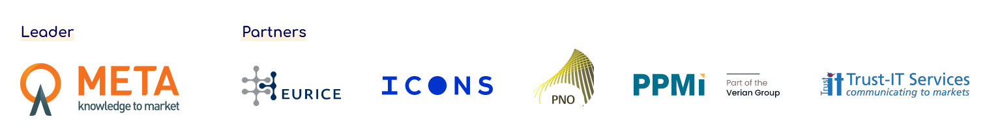

*Slides from the Horizon Results Booster G2M Module D Business Planning workshop, 13 November 2026, presented by Raluca Cibu-Buzac (META Group).*

## G2M – Module D Business Planning 13 / 11 /202 6

Raluca CIBU-BUZAC

An initiative 

of the

## Agenda for today

2

1 5 .00-1 5 .10  -  Introducing the day : welcome, presenting the webinar, quick feedback on  the BOSAT, and draft Business Plan 

1 5 . 10-1 5 . 3 0  -  Introducing Business Planning:  p resenting how to approach and prepare for Business planning 

1 5 . 3 0-1 5 . 50  -  Working together: Assembling the Business Plan  –  Reviewing and discussing draft business plans 

1 5 . 50 -1 6 . 10   -  Wrap-up  – Q&A 

## Business planning is a  journey

## Business  p lan :  a journey

It   is  the  follow up plan to  foster  exploitation/ uptake   of  a KER.

- The plan  should provide  a  map   of  actions  to  be   executed.
- It  needs  to remain  iterative  and  flexible   in   its  execution.

4

Recommendation : Do  not  replicate  processes / frameworks set  in   large,  established companies . 

## Requirements  of a  Business Plan

Financial  sustainability

Consistency

Reliability

Success

The  pillars  of a good  business   plan

## Requirements of a Business Plan

Financial  sustainability

The pillars of a good business   plan

Succes s

- In the target period, the cash flows (net profit + depreciation) at least cover the absorption of working capital and the net replacement/maintenance investments, while the use of further debt capital and/or of risk should occur to partially or totally address investments aimed at growth.

<!-- -->

- Availability of financing sources. More specifically, it is necessary that the financing choices through debt capital are coherent with the debt capacity.

<!-- -->

- It must be considered in relation to the quality and quantity of the needed financing sources

## Requirements of a Business Plan

Co nsistency

Success

The pillars of a good business   plan

- It is  an "internal"  dimension of the BP. All components (implementation strategy and  starting  point of the company, strategic intentions, action plan, economic-financial forecast hypotheses) have to be consistent with each other.

<!-- -->

- Strategic  choices   must be reflected in the planned implementation actions and the latter must be reflected in the trend of the prospective financial data.

<!-- -->

- Coherence of the planned actions with the proposed timing and with the current and future resources that the company has/will have .

## Requirements of a Business Plan

Reliability

Success

The pillars of a good business   plan

A BP is reliable if it is based on realistic and justifiable assumptions, and it reports achievable expected results.

Assumptions must be verified considering:

- market dynamics : trends in demand and market shares; ongoing trends in consumer needs; competitor behavior;  structure and changes in distribution channels and supply relationships; regulatory context;
- historical results : the more the expected results differ from historical ones (i.e. the more ambitious are the objectives of the BP), the more it is necessary to provide elements for their credibility;
- demonstrability  of forecast data;
- sensitivity analysis  – use the “what-if” approach to anticipate what can go wrong if conditions change

## How to:

1. Start with a vision

2. Test assumptions

3. Distinguish yourself with the UVP

5.  Organise  your team

4. Cater the innovation to customers

7. Financial plan

6. Revenue: the driver for sustainability

8. Secure resources

## 1.  s tart with a vision

- What  is  a  problem   from the   customer’s   perspective in  today’s  situation ?
- How   is  today’s  situation  in  the  segment  you intend to   enter ( alternative solutions )?
- How   is  your product / service designed/performing  to  help  solve the  identified   problem  better than others ?
- 

Tips  &  Tricks

- Collect  figures from  pilots/use cases   to  get an insight on problems
- Identify  trends and opportunities  within the   segment  ( early adopters ) 
- Discuss   substitutes  and  competitive   barriers   (alternative  solutions )
- Do  focus  on  customers , not on the  technology

Note: a   Business Plan should be  easily  understood by anyone  with  some business   acumen.

10

## 2. Test assumptions – the role of the pilot/use cases

- Validate   use/ business  model’s  assumptions – test  markets,  customers,  channels,   pricing.
- Tests  need to  be in  real  time -  during development  of the  product /service ( WPs on pilot/demo ).
- This  learning  experience  will  help  to shape your solution on  customers’ needs; thereby defining the   product’s  Unique  Value   Proposition  (see next) .
- Testing in real time  help to ensure /validate  an  optimal uses of  resources  (i.e. funding,  HR, budget allocation,   etc.).

C u s t om e r   D isco v e ry

Customer   V a li d a t i on

C u s t om e r   Creation

C o m p a n y  Building

11

EXECUTION  – after  the  project end

TESTING

## 3. Distinguish yourself with a Unique Value  Propos ition  – UVP

- The UVP provides an  insight on  the  difference(s) of your product  and  why it’s worth buying   instead of your competitors’ ones – within a clear message.
- It is the  focal point  for the use model.
- It needs to be both understandable and compelling, it   ought to be short and backed with  facts and data .

Tips and Tricks

- Start looking back at what  early adopters  valued  during the validation in the   “Testing” phase .
- What  were  the top  problems ?  What   does the  product offer  that  competitors  can’t  or  won’t?  What does  it   better ?  What  is  the  product’s  impact on problems?
- The message should be  simple  and crispy to  grab   customer’s   attention  (and   wallet).

12

## 4. Catering  the  solution  to customers  – no use no impact (1/2)

Select the appropriate   “sales”  channel

- Pick  the  distribution  channel  with   the  greatest  potential  and  focus  on   it .
- Distribution channels  and  pricing decision  are interrelated  –  consider whether  the  product  “fits”  the   channel.
- Do  not try  to overreach  on initial channels  efforts.  The objective  is  to  test  the  different  assumptions  and  focus   on   learning .

Assess :

- whether  there  are  established  buying habits  in  the   segments,
- whether the  used channel  strengthen  the  sales  process   and,
- what are the  complexity associated  with  the elected  sales   channel .

13

Tips  and  Tricks

- Always describe  how  the  product /service is  catered   to  your   client
- Always present  «customers’»  feedback , if your  solution is  already  tested   by some early adopters

## 4. Catering products / services to customers  -   no use no impact (2/2)

E xample

| Physical  distribution   channel |  | Web-based  distribution   channel |  |
|----|----|----|----|
| Direct  Sales   Rep | (+)  oversight   &   control,   dedicated   to   the   company’s   success (-)  Expensive,  talent management  and   retention | Aggregator | (+) Fast  way to get national  distribution  at variable cost   with   ltd  upfront   costs (-)  hard to get  visibility, promotion  and   marketing |
| Resellers | (+) Efficient  to get nationwide coverage; ltd  upfront  cost (-)  not loyal to the company, require immense   effort and   feeding  (commercial effort,  training,  incentives,   etc.) | Mobile-app   commerce | (+)  massive reach in  fast  growing  segments (e.g.   games,  software,   etc.) (-) costly  intermediaries, payment challenges,   presenation  challenges, operational complexity,   etc. |
| Dealer | (+)  Provide personal attention  and promote  the   product   they   like (-)  Hard and  costly  to  build  new  businesses using   dealers | Dedicated   e-commerce | (+)  easy to create  and  complete control over   price,   inventory,  product   presentation (-) visibility,  all costs and challenges assumed  by   the  company |

14

Select the appropriate  sales channel

## 5.	 Organise  your team

15

Introduce  key members  of the team (qualifications, specializations, experience) including previous positions. It is important to briefly indicate the successes achieved.

Describe the  functional responsibilities  of the team (list the various functions, responsibilities, expected future changes). 

Specify the functions  still to be assigned , or if there are important functional areas still vacant, then indicate the measures to be undertaken and the expected times.

Describe the management and  decision-making process  of the (future)  organisation .

Include here also any relevant partnership. 

## 6 . Revenue : the  driver for  cost coverage,  debt redemption and dividend payout

Quantity

- Consider   market size  &  market  share  and  translate  them  into anticipated   number  of   clients
- Bring  in  sales  channel  hypothesis ,  along  with estimates of  their  respective   impact  on volume potentials  /   costs
- Pay  attention  to  the  costs  of using  a  distribution  channel  as you  would perceive  the  net revenue (i.e. revenue  generated  by the  sales  minus   distribution   costs)

| Pricing |  |
|----|----|
| Cost  of  doing   business | How  much  will  be   charged? |
| C osts   associated with  production, sales,  shipping,   etc. Total  cost  of operations (e.g.  electricity  bill,  rental  costs,   etc.) | Different  pricing   model s : Competition-based   pricing Value-based   pricing Subscription-based pricing Razor/razor blade   pricing Etc. |

Revenue   validation:

Use-b usiness   Model

Different  sources of  revenues streams are  available  based on  the  use- business  model   (e.g. subscription,  pay-   per-use,  referral revenues, revenues,   etc.)

16

- Is the  product / service  profitable  (i.e. does  it  cover  all the  associated   costs?)
- Is  there  an  attractive   growth   potential ?
- Would  profitability  increase  as  revenues   grow?

## Using the Lean Canvas to retrive information for the BP

Market  definition

Marketing

Competitors

Products/services

Operative plan

Financial plan

BUSINESS PLAN

## Slide 18

18

- maximum length: 20–30 pages.
- include the most relevant information about the company and the goals to be achieved in economic/financial terms (presented clearly and concisely)
- 3–5 years projections (a dynamic document that evolves continuously based on market/sector changes and developments, projections, etc.)
- clear outline of the strategies the company and management intend to pursue  
- the proposed objectives must be aligned with the available resources 
- credibility of analyses/projections (e.g., from accredited sources) 
- adopt a professional style with a positive and confident tone
- Enrich it with tables, graphs and illustrative tables
- Sources of the data must be indicated
- Use an "attractive" graphic design
- 

 Some suggestions

## Slide 19

19

Any question?

## Slide 20

“You do not really understand something unless you can explain it to your grandmother.” -  Albert Einstein

## Slide 21

21

## Let’s work on your KER:   the  Business Plan Structure

22

## The market

Describe the market and the sector your will target. 

Specify the size, stage of development and competitive nature of the sector. Describe the barriers to entry and development in the sector, the role that innovation and technological change play in the sector, how the sector is affected by political and regulatory events.

Here you have to include a market analysis (if available), describing the  behaviours  and needs of your customers and end-users and your competitors (actual and potential).

Specify here also your unique value proposition.

23

You can retrieve  information from:

- Characterisation  table
- Market Definition Canvas
- Lean Canvas

## The market:  analyse   your  industrial  sector

- A sector is a  group of sellers  who offer  alternative products/services  and compete among each other 
  Explain why your products/services will give your organization a competitive advantage, analyzing the critical success factors and the main threats.

What questions should we answer?

- What is the size, stage of development and competitive nature of the industry? 
- What are the barriers to entry and development of the sector? 
- What role do innovation and technological change play in the sector? 
- How is the sector affected by political and regulatory events?

A useful tool: “Porter’s 5 forces model".

## The market:  your  competitive  advantage

What advantage does your  organisation  have (to be defended!) over competitors?

- differentiation: the proposed product/service is better than those offered by competitors;
  cost advantages;
  both advantages.

How can you defend your advantage?

- Intellectual/industrial property;
  Investments in continuous innovation;
  Strong integration with customers and/or suppliers;
  Realization of economies of scale or scope;
  Flexibility;
  Investments in brand identity and visual identity;
  Highly specialized know-how and human resources.

## The market  analysis

- It is crucial to understand the context in which you are going to operate.
  It includes the acquisition and in-depth elaboration of data useful for the design of the environment in which you are going to offer your product/service
  Focuses on analyzing the key drivers for business decisions.

Two main approaches to market research:

- Market Size
  Market  analysis 
  Industry  Assessment

Secondary   Searches

- Value Proposition
  Customer needs
  Customer segments

Primary  Research - field  research

## The market  analysis

- Small sample size
  Survey of market behavior

Qualitative  research

- Large samples
  Determination of market numerical values
  Tabular representation

Quantitative  research

- Focus group observation
  In-depth interviews
- Experimental methods
-  Trade fairs

Telephone interviews

Postal interviews 

Panel
 Questionnaires

## Slide 28

28

Any question?

## The product/service

Description of the products/services offered by your  organisation , their in-depth illustration and plans for the future. 

Specify whether the products/services are already existing and marketed, ready to be placed on the market (indicating the launch date). In case the products/services are being developed, indicate the time to market.

Make a clear indication of the current products/services and the future products/services.

29

You can retrieve  information from:

- Characterisation  table
- Lean Canvas
- Value Proposition Canvas
- Market Definition Canvas

## The product/service

- What are the characteristics of the product (type of materials, technology used)?
  Is it covered by a patent? 
- How does it differ from those of the competition?
- What advantages does it offer to the customer?
- What are the strengths and weaknesses? 
- Selling prices?
- How is the current customer portfolio composed? 
- What are the distinctive features of the product and the sources of advantage? 
- What is the value chain of our offer?

Existing  products/services

- What is the stage of development? (Idea, model, prototype, product being introduced to the market, etc.?) 
- What is the type of product/service and what is it for?
- How does it meet the needs of the market/customer?
- How do you develop the operational process for the creation of the product/service? Describe the main phases and identify the necessary investments for each phase. 
- What makes the product/service attractive? 
- What are the main characteristics that differentiate the service/product?

Prod ucts /services to be  developed

## Slide 31

31

Any question?

## The business model and go to market strategy

Describe here how you are planning to make money out of your business, specifying all different actors involved.

The marketing strategy should include an in-depth analysis of the methods of distribution of products/services and the definition of the guidelines along which you would like to proceed in the medium-long term to achieve your objectives.

You should be able to explain why you selected a specific market segment, why you decided to target some early adopters. The marketing strategy includes also your pricing strategy, the sales and promotion channels you are going to use, the amount you intend to invest in advertising.

32

You can retrieve  information from:

- Exploitation intentions table
- Characterisation  table
- Use Options tool
- Lean Canvas

## The marketing plan

- Describes the organization’s strategies and links its products/services to the market to identify opportunities. 
- It should be an “attractive” document, to be used  to "sell" the business as an opportunity that brings benefits to potential financiers.

A marketing plan must contain:

- The definition of the market and opportunities for entrance;
- Competition and endogenous factors;
- Marketing strategies;
- Market research;
- Sales forecasts;
- Supporting material.

## The marketing strategy

Includes an in-depth analysis of the distribution channels of products/services and the definition of the guidelines for your organization to achieve the set objectives.

Key questions to address are:

- What is the target market (by segment)? Geographical area - sector - type of buyer;
- Which market segment is the most suitable for your  organisation's  characteristics?
- Which are your customer groups?
- What are the geographical advantages and disadvantages of the company?
- What is the pricing strategy?
- Which sales and promotion channels will you use? 
- How much do you plan to invest in advertising? What will be the preferred channels for this type of investment?

## The Executive Summary

Prepared at the end but it is the first section

This is the introductory and most important section of the Business Plan, as it provides a summary of the future entrepreneurial project.

It clearly, logically, and concisely presents the most relevant information about the company, the goals to be achieved, and the sustainability of your business idea.

Recommended length: 1-3 pages.

35

It is advisable to draft  this section last , once each chapter has been thoroughly completed and  analysed  in all its parts. Provide the most important elements of each chapter.

## Slide 36

36

Any question?

## Next steps

At the next workshop:

- Conclusion of the discussion with operations and financials
- Deepening on 

<!-- -->

- (Option 1) the financial plan
- (Option 2) the  Monetisation  plan for intellectual assets
- (Option 3) the  Commercialisation  plan

<!-- -->

- Training on Innovation management
- 

Which option shall we work on?

## Slide 38

Raluca CIBU-BUZAC

booster@meta-group.com

www.horizonresultsbooster.eu

Copyrights: The images used in this presentation are for illustrative purposes only and may not represent the actual product or service. All images are either publicly available or used with permission from their respective owners. Sources:  Unsplash ,  Pexels

Funded by the European Union. Views and opinions expressed are however those of the author(s) only and do not necessarily reflect those of the European Union or DG RTD. Neither the European Union nor the granting authority can be held responsible for them.
