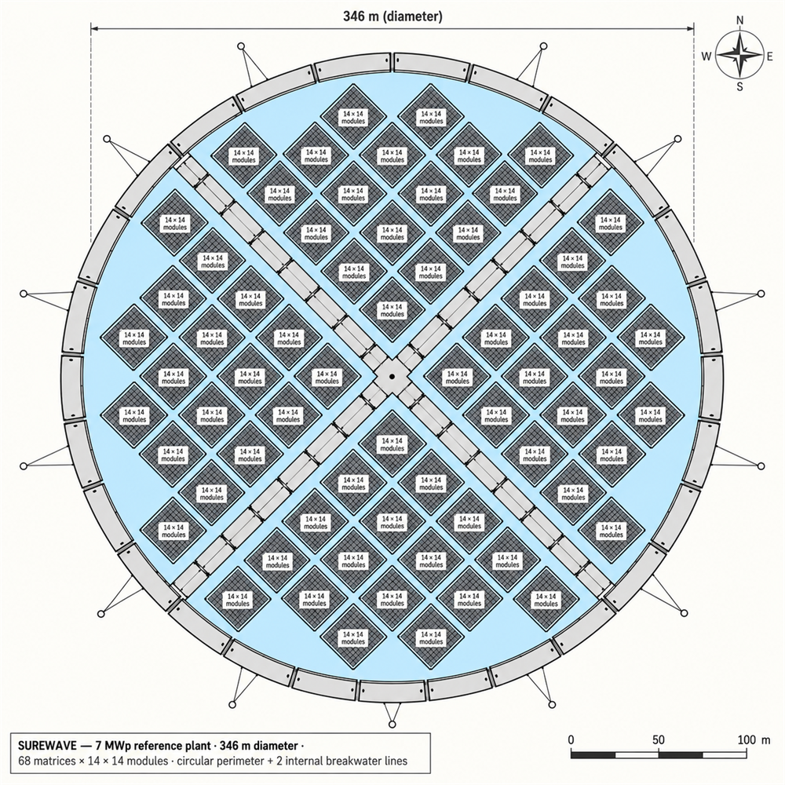
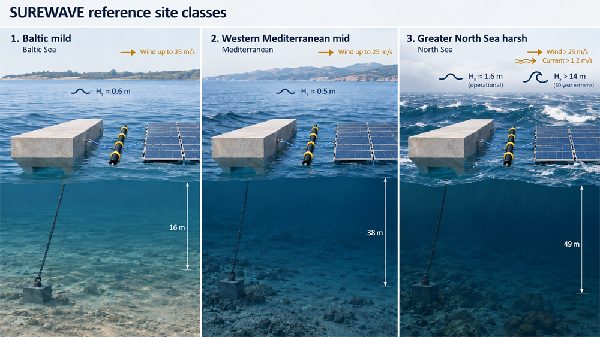
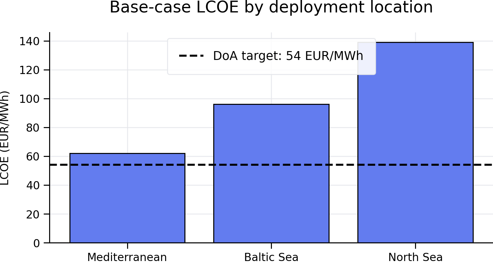
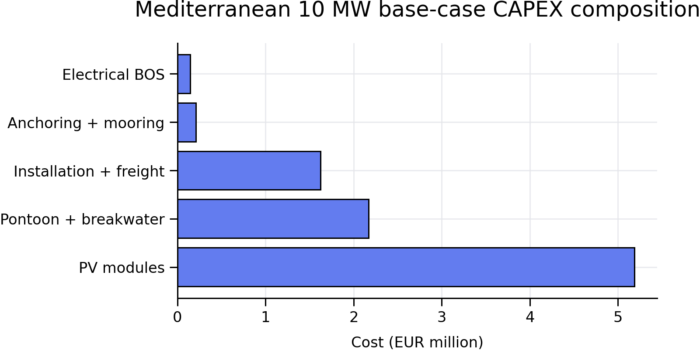
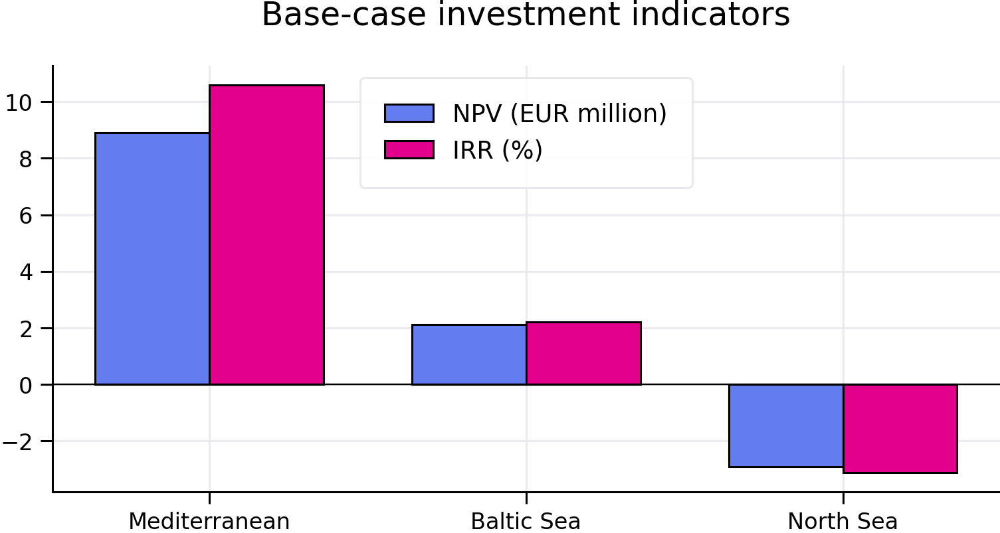
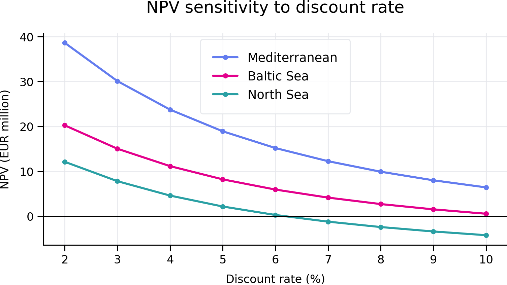
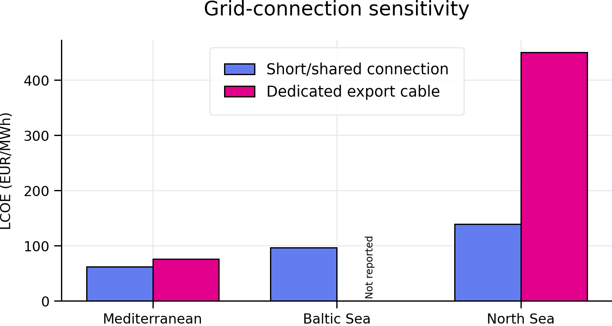

> Journal article manuscript draft (MDPI format), "Techno-Economic Assessment of Breakwater-Protected Offshore Floating Photovoltaics Across Three European Sea Basins", by Eirik Larsen (Sunlit Sea) and Balram Panjwani (SINTEF Industry). Draft state as of 2026-11-19 (last edited by B. Panjwani). Builds on the SUREWAVE D7.4 economic assessment; financial model published on Zenodo (record 17534609).

Article

Techno-Economic Assessment of Breakwater-Protected Offshore Floating Photovoltaics Across Three European Sea Basins

Eirik Larsen¹, and Balram Panjwani²\*

¹ Sunlit Sea, Norway\
² SINTEF Industry, 7034 Trondheim, Norway\
\* Correspondence: balram.panjwani@sintef.no

**Abstract**

Offshore floating photovoltaic systems can expand solar generation without additional land use, but their economic viability depends on site conditions, system scale, grid connection and financing. This study presents a bottom-up techno-economic assessment of a floating-breakwater-protected FPV concept across the Mediterranean Sea, Baltic Sea and North Sea. The model evaluated **27 cases**, combining three locations, three configurations and three financial scenarios over a 50-year assessment period, with replacement of the PV generation layer after 25 years.

For the single 10 MW base cases, the Mediterranean configuration achieved the strongest performance, with an estimated LCOE of **€62.2/MWh**, NPV of **€8.98 million**, IRR of **10.8%** and an eight-year discounted payback period. The Baltic Sea case showed conditional potential at approximately **€96/MWh**, while the stand-alone North Sea case was not attractive under the base assumptions at approximately **€139/MWh**. A dedicated export cable increased the Mediterranean LCOE to approximately **€76/MWh** and reduced the IRR to **6.2%**, demonstrating that access to nearby or shared offshore electrical infrastructure is a major determinant of viability.

The findings indicate that early commercial deployment should prioritise high-irradiance locations with moderate metocean conditions, sufficient scale and short grid connections. The results constitute a **TRL 5 business case** based on validated engineering evidence rather than measured commercial-project costs. Detailed results for all 27 cases are provided in the accompanying public financial-model workbook.

**Keywords:** offshore floating photovoltaics; techno-economic analysis; LCOE; breakwater; offshore solar; investment appraisal; marine energy; grid connection

1\. Introduction

Floating photovoltaic (FPV) technology has developed rapidly as an alternative to land-based solar generation, particularly on reservoirs, quarry lakes, irrigation ponds and hydropower basins. The principal advantages include reduced competition for land, potential use of existing electrical infrastructure and, in some climates, lower module temperatures than comparable ground-mounted systems. Nevertheless, most commercial experience and published performance data continue to come from sheltered inland waters, where waves, currents, corrosion, marine growth and offshore installation requirements are comparatively limited \[1--4\].

Extending FPV into near-shore and offshore environments could substantially increase the area available for solar-energy deployment, particularly in densely populated coastal regions, islands and countries with limited available land. Offshore FPV may also be co-located with wind farms, substations, aquaculture facilities, oil and gas platforms or other marine infrastructure. Such integration can reduce electrical-connection distances, improve utilisation of offshore assets and create complementary renewable-generation profiles\[5--7\]. However, marine deployment introduces additional technical and economic requirements, including resistance to waves, wind and currents; robust mooring and anchoring; marine-grade electrical systems; corrosion and biofouling management; restricted maintenance access; specialised vessels; and weather-dependent installation and repair operations \[5,8\].

The economics of FPV are therefore strongly location- and configuration-dependent. Reviews of floating-solar projects report a wide range of levelised cost of electricity values because studies differ substantially in solar resource, technology, water-body type, system scale, financing assumptions, grid connection and treatment of installation and maintenance costs. One recent review reported values ranging from approximately **€28/MWh to more than €1,700/MWh** across floating-solar and hybrid applications, illustrating that generic cost benchmarks have limited value without clearly defined system boundaries and deployment conditions \[7\]. Lifecycle-based reviews have similarly emphasised that reliable feasibility assessment requires integrated consideration of technical performance, economic assumptions, environmental impacts, degradation and social factors rather than first-cost analysis alone \[4\].

The smaller body of literature dealing specifically with offshore FPV shows similarly wide economic outcomes. A design study for an offshore FPV system serving Lampedusa combined hydrostatic, dynamic and techno-economic analyses and concluded that offshore FPV could be competitive with other marine renewable technologies despite remaining more expensive than land-based solar \[9\]. A battery-integrated FPV system proposed for an offshore oil platform in Abu Dhabi achieved a calculated LCOE of approximately **USD 261/MWh** and a discounted payback period of **9.5 years**, demonstrating the potential value of FPV where the alternative is expensive offshore generation rather than grid electricity \[6\].

More recent analyses have begun to improve the transparency and reproducibility of offshore FPV cost assessment. Park et al. developed deterministic and probabilistic LCOE models for a modular 0.5 MW offshore FPV platform, integrating component-level CAPEX and OPEX, route-specific logistics, degradation and financing uncertainty. Their optimised deterministic case produced an LCOE of approximately **USD 85.6/MWh**, while a 100,000-trial Monte Carlo analysis produced a mean of approximately **USD 119.4/MWh** and a P10--P90 range of approximately **USD 91.6--150.2/MWh**. Capacity factor was the dominant cost driver, followed by CAPEX, and the study cautioned against interpreting route-specific logistics savings as universal installation-cost reductions \[10\]

A global assessment by Rodríguez-Gallegos et al. evaluated the technical potential, cost competitiveness and deployment pathway of offshore FPV and highlighted the importance of maritime-zone availability, solar resource, environmental exposure, technology maturity and distance to infrastructure \[11\]. These studies collectively indicate that offshore FPV cannot be assessed using a single representative LCOE. Bankability depends on the interaction between energy yield, platform and breakwater design, metocean conditions, deployment scale, installation strategy, availability, financing and grid-connection distance.

Breakwater-protected FPV represents a distinct offshore configuration. An external floating breakwater can reduce the wave energy reaching lightweight photovoltaic modules, thereby limiting module motions, connector loads and potential wave-induced electrical mismatch. Wave-basin testing of a multi-body FPV array protected by a floating breakwater demonstrated reductions in short-wave energy and associated hinge loading, while also showing that the breakwater, internal array, mooring and connections must be treated as an integrated dynamic system \[12\]. Aerodynamic simulations have likewise shown that the breakwater can reduce wind-induced lift and drag on the protected array, although the effectiveness depends on breakwater geometry, wind direction, panel inclination and separation distance \[13\]. These protective functions may reduce structural demand and support availability, but the breakwater also adds concrete, mooring, installation and maintenance costs that must be included explicitly in the economic assessment.

Existing offshore FPV studies commonly focus on one platform, one location or a comparatively short project lifetime. Grid-connection assumptions are also inconsistent. Some analyses include a dedicated submarine cable to shore, while others assume connection to a nearby platform or offshore substation. This distinction can dominate project economics because the generating platform may be relatively inexpensive compared with a long marine export connection. Similarly, many assessments represent the FPV system as a single asset with one lifetime, although photovoltaic modules and inverters generally require replacement sooner than concrete breakwaters, pontoons, mooring systems and other marine infrastructure. Treating these components separately allows the economic value of structural reuse and installation of a second generation of PV modules to be assessed.

Further uncertainty arises from the technology-readiness level. Early-stage assessments often combine supplier quotations, engineering estimates, literature values and assumptions derived from mature terrestrial PV or offshore-wind projects. Such studies are useful for prioritising development pathways, but their outputs should not be interpreted as measured commercial-project costs. Transparent reporting of system boundaries, discount rates, energy-price assumptions, degradation, downtime, component replacement, decommissioning and uncertainty is therefore essential.

This study addresses these gaps through a bottom-up techno-economic assessment of a modular offshore FPV concept protected by a floating concrete breakwater. The assessment evaluates **27 cases**, combining three representative European sea basins, three system configurations and base, optimistic and pessimistic financial scenarios. The Mediterranean Sea, Baltic Sea and North Sea represent progressively more demanding combinations of solar resource, water depth, wave climate, installation access and electrical-connection requirements. The system configurations comprise a 2 MW demonstrator, five modular 2 MW units and a single 10 MW installation. The financial model evaluated **27 cases**, combining three deployment locations, three system configurations and three financial scenarios. To maintain clarity, the main text presents detailed results only for the **single 10 MW base-case configurations** in the Mediterranean Sea, Baltic Sea and North Sea. It also reports the CAPEX breakdown and grid-connection sensitivity for the Mediterranean 10 MW base case, together with discount-rate sensitivity for the three locations. Detailed inputs, formulas and results for all 27 cases are provided in the accompanying Zenodo workbook: https://zenodo.org/records/17534609.

The economic model uses a **50-year structural lifetime**, with replacement of the photovoltaic generation layer after 25 years and continued use of the breakwater, pontoons, mooring and principal electrical infrastructure where feasible. It incorporates component-level CAPEX, site-specific OPEX, energy yield, degradation, wave-induced mismatch, installation logistics, financing, component replacement and decommissioning assumptions. The effects of discount rate, deployment scale, breakwater material and grid-connection strategy are assessed explicitly.

The objectives of the study are to:

1.  quantify LCOE, NPV, IRR and payback for representative offshore FPV configurations;

2.  identify the principal technical, financial and site-specific cost drivers;

3.  determine how deployment scale and financing affect economic viability;

4.  evaluate the economic value of structural reuse and photovoltaic-module reinstallation;

5.  quantify the sensitivity of the business case to short, shared and dedicated export connections; and

6.  identify the deployment conditions under which breakwater-protected offshore FPV can provide a credible pathway towards commercial implementation.

The principal contribution is a transparent TRL 5 economic framework linking engineering design and site-specific environmental requirements to lifecycle financial performance. Rather than presenting one universal offshore FPV cost, the study identifies the combinations of solar resource, scale, grid connection, financing and infrastructure reuse that determine whether a project is economically credible.

2\. Materials and Methods

**2.1. Study Design and Assessment Framework**

SUREWAVE is an integrated offshore FPV system in which four subsystems operate together. An external floating breakwater made from circular concrete formulations attenuates incoming waves before they reach the photovoltaic array. Flexible transition elements connect the breakwater to the internal FPV system while accommodating differences in their motions. The FPV array consists of marine-grade aluminium modules joined by polyurethane hinges to form large, flexible matrices, while a catenary mooring and anchoring system maintains the complete installation on station under mild to harsh European sea conditions (see Figure-1).

A bottom-up techno-economic model was developed to evaluate a breakwater-protected offshore floating photovoltaic system across different environmental, technical and financial conditions. The assessment combined component-level capital and operating costs, site-specific electricity production, financing assumptions, component replacement, infrastructure reuse and end-of-life expenditure.

The analysis comprised 27 cases, obtained by combining:

- three representative deployment locations;

- three system configurations; and

- three financial scenarios.

The evaluated locations represented progressively more demanding offshore conditions (Figure 2):

1.  Mediterranean Sea, representing relatively favourable solar resources and moderate metocean conditions;

2.  Baltic Sea, representing lower solar yield and comparatively mild wave conditions; and

3.  North Sea, representing harsh waves, greater installation complexity and more demanding structural requirements.

{width="4.010600393700788in" height="3.798091644794401in"}

Figure 1. Reference single-ring commercial configuration used in the economic assessment*.*

The three system configurations were:

- a nominal 2 MW pilot or demonstrator;

- a modular 10 MW installation composed of five 2 MW units; and

- a single-ring 10 MW commercial configuration.

Each location and configuration was evaluated under base, optimistic and pessimistic financial assumptions. The assessment period was 50 years, corresponding to the design life of the principal marine infrastructure. The PV modules and selected electrical components were assumed to have a shorter service life and were replaced after **25 years**, while the breakwater, pontoons, mooring system and reusable electrical infrastructure remained in service where technically feasible.

The analysis was performed from the project-owner perspective and included project cash flows before taxation. Unless otherwise specified, costs are reported in euros and electricity costs in EUR/MWh.

**2.2. Functional Unit and System Boundary**

The functional unit was defined as **one megawatt-hour of net electricity delivered by the offshore FPV installation over the assessment period**. The economic system boundary covered the PV modules and support structures, FPV pontoons and hinges, floating concrete breakwaters, transition connections, mooring lines and anchors, electrical balance-of-system components, transport, port-side assembly, towing, offshore installation and commissioning. It also included routine inspections, planned and corrective maintenance, component replacement, reinstallation of the PV generation layer after 25 years, decommissioning and removal, and the residual value or reuse of long-life infrastructure where applicable. The base assessment excluded a dedicated long-distance export cable and offshore substation and instead assumed an approximately **300 m connection to nearby offshore electrical infrastructure**. Dedicated submarine export cables were evaluated separately through sensitivity analysis. Insurance, corporate taxation, electricity-price escalation, curtailment payments and market-price volatility were not modelled explicitly. The resulting indicators should therefore be interpreted as project-level engineering-economic estimates rather than as complete financing models for a bankable commercial development.

**2.3. Reference Locations and Environmental Inputs**

The three reference locations were selected to represent mild, moderate and harsh European offshore environments. The metocean conditions were derived from the common project design basis and used consistently in the technical, environmental and economic assessments.

*Table 1. Site conditions and initial specific yield used in the economic model.*

  -------------------------------------------------------------------------------------------------------------------------------------------------------------
     **Location**      **Representative water depth**   **Extreme significant wave height**   **Peak period**   **Initial specific energy yield** kWh/kWp/year
  ------------------- -------------------------------- ------------------------------------- ----------------- ------------------------------------------------
   Mediterranean Sea                38 m                               7.0 m                      11.7 s                            1,306

      Baltic Sea                    16 m                               4.4 m                       9.6 s                             927

       North Sea                    49 m                              12.3 m                      14.8 s                             898
  -------------------------------------------------------------------------------------------------------------------------------------------------------------

The initial energy yield differed between locations because of variations in solar irradiation, temperature, weather conditions and system losses. Environmental severity also affected breakwater size, mooring and anchoring requirements, installation procedures, vessel use and maintenance access.

{width="4.404166666666667in" height="2.4795450568678916in"}

Figure 2: Three reference site classes --- Baltic (mild), Western Mediterranean (mid) and Greater North Sea (harsh), with wave height and water depth to scale (Not to the scale).

The model did not treat the three sites as identical systems exposed to different solar resources. Site-specific technical configurations and cost inputs were applied where the environmental conditions required different structures, moorings, installation methods or maintenance assumptions.

**2.4. Technical Configurations**

**Two-megawatt configuration:** The 2 MW configuration represented a pilot or early commercial demonstrator. It included the FPV modules, modular floating structures, a protective breakwater, station-keeping system, electrical collection equipment and installation activities. This configuration was expected to have higher specific costs because engineering, mobilisation, vessels, offshore operations and electrical equipment were distributed over fewer installed kilowatts.

**Modular five-by-two-megawatt configuration:** The modular 10 MW configuration comprised five nominal 2 MW units. The configuration retained independent breakwater and station-keeping arrangements for each unit while benefiting from repeated manufacturing and installation procedures. The modular design offered potential operational advantages, including staged deployment; isolation of individual units; improved maintenance access; reduced consequences of local failure; and the possibility of phased investment.

These benefits were not fully monetised in the base economic model because long-term operational evidence was unavailable.

**Single 10 MW configuration:** The single-ring 10 MW configuration placed the full FPV capacity within one breakwater system. Compared with five independent 2 MW units, the design reduced the breakwater perimeter, number of mooring components and repeated balance-of-system requirements per installed kilowatt. This configuration was therefore used as the principal commercial-scale reference. The final detailed system capacity could differ from the nominal 10 MW because space was required for transition elements, access corridors and electrical infrastructure. Economic results were normalised using the installed capacity associated with each detailed design.

**2.5. Capital Expenditure Model**

Capital expenditure was estimated using a bottom-up component model:

$$C_{CAPEX} = C_{PV} + C_{float} + C_{BW} + C_{moor} + C_{elec} + C_{T\text{\&}I} + C_{eng}
$$

where:

- $C_{PV}$is the cost of PV modules;

- $C_{float}$is the cost of FPV pontoons, frames and hinges;

- $C_{BW}$is the floating-breakwater cost;

- $C_{moor}$is the mooring and anchoring cost;

- $C_{elec}$is the electrical balance-of-system cost;

- $C_{T\text{\&}I}$is the transport and installation cost; and

- $C_{eng}$represents applicable engineering and integration expenditure.

For the Mediterranean 10 MW base case, the estimated CAPEX excluding the dedicated medium-voltage export cable was approximately **€9.44 million**, equivalent to approximately **€909.86/kWp**.

*Table 2. Mediterranean 10 MW base-case CAPEX.*

  -----------------------------------------------------------------------------------------
  Component                                          Base-case cost       Specific cost
  -------------------------------------------------- -------------------- -----------------
  PV modules and floating-module production          €5.187 million       €500.00/kWp

  Pontoon and floating breakwater                    €2.119 million       €204.24/kWp

  Anchoring and mooring                              €0.209 million       €20.11/kWp

  Installation                                       €1.624 million       €156.53/kWp

  Freight                                            €0.074 million       €7.11/kWp

  Electrical balance of system                       €0.145 million       €13.94/kWp

  Transition elements, including PVC pipe and rope   €0.082 million       €7.93/kWp

  Total excluding dedicated export cable             **€9.440 million**   **€909.86/kWp**
  -----------------------------------------------------------------------------------------

Component prices were derived from project engineering, supplier and partner information, material quantities, manufacturing assumptions and relevant literature. Where commercial quotations were unavailable, engineering cost estimates were applied.

All costs should be converted to a consistent price year before final publication. If the underlying workbook contains inputs from different years, the manuscript should state the inflation index and base year used for normalisation.

**2.6. Breakwater and Structural-Infrastructure Costs**

The breakwater cost was calculated from the required quantities of concrete, reinforcement, lightweight core material, moulds, fittings and connections, together with the labour and manufacturing operations associated with the selected design. The evaluated material options included conventional concrete, high-performance concrete, lightweight aggregate concrete, cellular concrete and hybrid shell-core configurations. All alternatives were compared against common functional requirements for buoyancy, structural resistance and marine durability. Initial manufacturing cost was assessed separately from potential lifecycle benefits; therefore, an advanced material was considered economically preferable only where its additional cost was offset by a quantified reduction in maintenance, an extended service life, infrastructure reuse or another measurable benefit. The principal marine infrastructure, including the breakwater, pontoons and station-keeping system, was assumed to remain serviceable for **50 years**, allowing the same structures to support two successive **25-year PV-generation cycles**.

**2.7. Mooring, Anchoring and Installation Costs**

Mooring and anchoring costs included the lines or chains, connectors, associated hardware, anchors or driven piles, fabrication, transport, vessel mobilisation and offshore installation labour. Chain and anchor dimensions were specified separately for each location to account for differences in water depth, wave climate and environmental loading. Transport and installation costs covered delivery of modules and other components to the assembly port, port-side assembly and breakwater manufacture, towing or barge transport, anchor and mooring installation, offshore connection, electrical commissioning and vessel mobilisation. The internal FPV array was assumed to be connected directly to the external breakwater through flexible transition elements; consequently, separate seabed anchors were not assigned to individual FPV matrices, and the primary station-keeping system was associated with the breakwater. Mooring-mass reductions obtained through optimisation were incorporated only where reflected in the final component quantities. They were not converted directly into equivalent installed-cost reductions because anchor, vessel, mobilisation, labour and offshore-operation costs do not vary proportionally with chain mass.

**2.8. Operating Expenditure**

Annual operating expenditure was represented as:

$$C_{OPEX,t} = C_{inspect,t} + C_{maint,t} + C_{vessel,t} + C_{monitor,t} + C_{replace,t}
$$where:

- $C_{inspect,t}$is scheduled inspection expenditure;

- $C_{maint,t}$is routine and corrective maintenance;

- $C_{vessel,t}$is vessel and offshore-access cost;

- $C_{monitor,t}$is monitoring and data-management cost; and

- $C_{replace,t}$is the cost of components replaced during year $t$.

Location-specific OPEX values reflected: distance from port; available weather windows; vessel requirements; environmental severity; expected marine growth; inspection requirements; and accessibility of the system.

Potential reductions in inspection, vessel use and unplanned intervention were not credited unless represented explicitly in the scenario assumptions. Insurance costs were not modelled as a separate base-case line item.

**2.9. Energy-Yield Model**

Annual net electricity generation was calculated as:

$$E_{t} = P_{inst}Y_{0}(1 - d)^{t - 1}\left( 1 - L_{elec} \right)\left( 1 - L_{wave} \right)A_{t}
$$

where:

- $E_{t}$is net electricity generation in year $t$;

- $P_{inst}$is installed capacity in kWp;

- $Y_{0}$is the initial site-specific yield in kWh/kWp/year;

- $d$is the annual PV degradation rate;

- $L_{elec}$is the electrical-loss fraction;

- $L_{wave}$is the wave-induced mismatch or motion-related loss fraction; and

- $A_{t}$is the operational-availability factor.

The model used initial specific yields of:

- **1,306 kWh/kWp/year** for the Mediterranean Sea;

- **927 kWh/kWp/year** for the Baltic Sea; and

- **898 kWh/kWp/year** for the North Sea.

Electrical losses were represented in the range of approximately **2--3%**, while wave-induced mismatch was represented using location- or scenario-dependent assumptions. Annual degradation varied between the optimistic, base and pessimistic scenarios.

The base model did not apply a generic **20% offshore-production uplift** or a separate **5% cooling gain**, because these benefits were not confirmed through long-term energy-production measurements.

**2.10. Availability and Downtime**

Availability represented the fraction of potential generation during which the system was operational:

$$A_{t} = 1 - D_{t}
$$

where $D_{t}$is the fraction of annual energy-production time lost to: scheduled maintenance; component failure; weather-related access restrictions; repair activities; and electrical outages.

Availability assumptions were incorporated in the location-specific yield and OPEX calculations. The project's wave-basin testing, connection redesign and monitoring developments supported improved resilience. No stochastic reliability model was used in the base case. Availability should therefore be interpreted as an engineering scenario input rather than an empirically derived offshore FPV failure distribution.

**2.11. Component Replacement and Structural Reuse**

The PV generation layer was assumed to have an operating life of **25 years**, while the principal marine infrastructure was designed for a **50-year service period**. At the end of year 25, the PV modules and selected inverters and electrical components were replaced, and the associated removal, installation and recommissioning costs were incurred. The second generation of PV modules reused the existing breakwater, pontoons, mooring system and other long-life infrastructure. The year-25 replacement expenditure, $C_{reinstall,25}$, was calculated as the sum of the replacement PV modules, electrical equipment, removal activities and installation costs:

$$C_{reinstall,25} = C_{PV,25} + C_{electrical,25} + C_{removal,25} + C_{installation,25}
$$

The economic value of structural reuse was assessed by comparing the cost and electricity generation of the second PV cycle with a case in which the marine infrastructure would need to be reconstructed. Year-25 replacement costs were entered on the same price basis as the other model inputs, with any assumed cost reduction or escalation applied consistently through the selected scenario. Any production interruption associated with replacement should be included in the corresponding year's electricity generation or identified as a model limitation.

**2.12. Decommissioning and Residual Value**

End-of-life expenditure included the disconnection and removal of PV modules, recovery or removal of the floating structures, removal of mooring lines and anchors where required, vessel operations, transport to port, dismantling, recycling and controlled disposal of non-recoverable materials. The net decommissioning cost was calculated as:

$$C_{decom,net} = C_{removal} + C_{transport} + C_{processing} - V_{recovery}
$$

where $V_{recovery}$represents the estimated residual value of recovered aluminium, steel, copper and other recyclable materials. Where residual material value was not included explicitly in a particular scenario, $V_{recovery}$was set to zero. Decommissioning expenditure was assigned to the final year of the 50-year assessment period and discounted accordingly.

**2.13. Revenue Model**

Annual electricity revenue was calculated from the net electricity delivered by the installation and the assumed electricity sale price:

$$R_{t} = E_{t}p_{t}
$$

where $R_{t}$is the revenue in year $t$, $E_{t}$is the net annual electricity generation and $p_{t}$is the electricity sale price. The base case assumed a constant real electricity price of:

$$p_{t} = 0.12\text{~}EUR/kWh
$$

Electricity-price escalation, capture-price effects, curtailment compensation, subsidies, guarantees of origin and capacity-market revenues were not included. The revenue model therefore isolates the economic performance of the physical system under a fixed-price assumption rather than attempting to reproduce a complete future electricity-market structure.

**2.14. Discounted Cash-Flow Analysis**

The annual net cash flow was calculated as the difference between electricity revenue and the capital, operating, replacement and decommissioning expenditure occurring in each year:

$$CF_{t} = R_{t} - C_{CAPEX,t} - C_{OPEX,t} - C_{replacement,t} - C_{decommissioning,t}
$$

Net present value was then calculated by discounting the annual cash flows over the 50-year assessment period:

$$NPV = \sum_{t = 0}^{T}\frac{CF_{t}}{(1 + r)^{t}}
$$

where $T$is the 50-year assessment period and $r$is the real discount rate. The base case used a discount rate of **8.5%**, while the optimistic and pessimistic scenarios used approximately **8.16% and 8.84%**, respectively. A wider range was considered in the sensitivity analysis. The internal rate of return, $r^{*}$, was defined as the discount rate at which NPV equals zero:

$$0 = \sum_{t = 0}^{T}\frac{CF_{t}}{\left( 1 + r^{*} \right)^{t}}
$$

The discounted payback period was defined as the first year in which the cumulative discounted cash flow became non-negative.

**2.15. Levelized Cost of Electricity**

The levelized cost of electricity was calculated as the ratio between the discounted lifecycle expenditure and the discounted net electricity generation:

$$LCOE = \frac{\sum_{t = 0}^{T}\frac{C_{CAPEX,t} + C_{OPEX,t} + C_{replacement,t} + C_{decommissioning,t}}{(1 + r)^{t}}}{\sum_{t = 1}^{T}\frac{E_{t}}{(1 + r)^{t}}}
$$

Initial CAPEX was entered at $t = 0$and was therefore not discounted. PV reinstallation expenditure was entered in year 25, while decommissioning expenditure was entered at the end of the assessment period. LCOE was initially obtained in EUR/kWh and converted to EUR/MWh using:

$$1\text{~}EUR/kWh = 1000\text{~}EUR/MWh
$$

All expenditure, revenue and discount-rate assumptions were applied on a consistent price basis. The manuscript should specify whether the workbook uses constant real euros or nominal euros and confirm that the selected discount rate is consistent with that basis.

**2.16. Return on Investment**

Return on investment was calculated as the ratio of net present value to initial capital expenditure:

$$ROI = \frac{NPV}{C_{CAPEX,0}} \times 100
$$

ROI was used as a supporting economic indicator. NPV and IRR were treated as the primary investment metrics because they account more appropriately for the timing of costs and revenues over the project lifetime.

**2.17. Financial Scenarios**

Three financial scenarios were evaluated to represent central, favourable and unfavourable project conditions. The **base case** used the consortium's central assumptions, including an approximately **8.5% discount rate**, site-specific initial energy yield, central degradation values, expected installation and O&M expenditure, a 50-year structural lifetime, replacement of the PV generation layer after 25 years and a fixed electricity price of **€0.12/kWh**. The **optimistic scenario** combined approximately 5% higher energy yield, lower degradation, 10--15% lower installation expenditure, approximately 15% lower O&M costs, a lower discount rate and improved manufacturing and installation efficiency. The **pessimistic scenario** combined approximately 10% lower energy yield, higher degradation, 15--25% higher installation expenditure, approximately 20% higher O&M costs, a higher discount rate and more conservative operational assumptions. Parameters were varied together to create internally consistent scenarios rather than being assigned individual probabilities.

**2.18. Sensitivity Analysis**

Sensitivity analyses were conducted for the parameters expected to have the greatest influence on project economics, including discount rate, installed capacity and configuration, annual energy yield, degradation, installation expenditure, O&M expenditure, breakwater material, PV reinstallation cost, electrical-connection arrangement and distance to the grid connection. The discount rate was varied over an extended range of approximately **2--10%** to identify the financing conditions under which NPV became positive or negative. Grid-connection sensitivity compared a short or shared floating cable to nearby offshore infrastructure with a dedicated submarine export cable to shore. For the Mediterranean case, inclusion of the dedicated export cable increased LCOE from approximately **€62/MWh to €76/MWh** and reduced IRR from approximately **10.7% to 6.2%**. For the assessed North Sea case, the long export route increased LCOE to more than **€450/MWh**, demonstrating the importance of co-location and shared offshore electrical infrastructure.

**2.19. Calculation Implementation and Quality Control**

The economic model was implemented in a Microsoft Excel workbook containing the input data, system and location parameters, component-level CAPEX, annual OPEX, energy-yield calculations, replacement and decommissioning cash flows, scenario definitions and summary financial indicators. Quality control included consistent units across all worksheets, separation of input and calculated cells, explicit year-by-year cash flows, verification that initial CAPEX was not discounted, checks of installed capacity and annual generation, reconciliation of component costs with total CAPEX, verification of the EUR/kWh-to-EUR/MWh conversion, comparison of NPV and IRR results across scenarios and sensitivity testing of key assumptions. To support reproducibility, the archived workbook retains the formulas rather than values only, distinguishes input cells from calculated cells and identifies the source and price year of external assumptions.

**2.20. Methodological Limitations**

The economic results are based **on TRL 5 engineering, testing and prototype evidence** and should not be interpreted as contractual prices, bankable financial projections or measured expenditure from a commercial offshore FPV project. The main uncertainties arise from the absence of full-scale offshore installation and operating-cost data, limited insurance and financing quotations, and the use of engineering estimates for selected components and activities. Long-term availability, failure rates, weather-related delays and vessel access were represented through simplified assumptions, while stochastic electricity prices, detailed taxation, project-specific financing structures, permitting costs and seabed-lease fees were excluded where reliable data were unavailable. The assessment also assumed that the principal marine infrastructure would remain serviceable for 50 years and that the PV generation layer could be replaced after 25 years, while the potential economic benefits of modularity, redundancy and structural-health monitoring were not fully monetised. These uncertainties were addressed through base, optimistic and pessimistic scenarios and sensitivity analyses. The model is therefore intended to support technology comparison, site and configuration selection, demonstration planning and identification of cost-reduction priorities rather than a final investment decision.

**3. Results**

**3.1. Economic Performance Across the Three Deployment Locations**

The economic assessment covered 27 **cases**, combining three offshore locations, three system configurations and three financial scenarios. The clearest differences were associated with deployment location, primarily because of variations in solar yield, environmental severity, installation requirements and grid-connection assumptions. In this publication, only for the **single 10 MW base-case configurations** in the Mediterranean Sea, Baltic Sea and North Sea are presented. Detailed inputs, formulas and results for all 27 cases are provided in the accompanying Zenodo workbook: <https://zenodo.org/records/17534609>.

For the single 10 MW configurations under base-case assumptions, the Mediterranean Sea achieved the strongest economic performance, with an estimated LCOE of **€62/MWh**, NPV of approximately **€8.90 million**, IRR of **10.6%** and discounted payback period of approximately **eight years**. The Baltic Sea case produced an LCOE of **€96/MWh**, a positive but substantially lower NPV of approximately **€2.11 million**, an IRR of **2.21%** and a payback period of approximately **16 years**. The North Sea case reached an LCOE of **€139/MWh**, with a negative NPV and IRR and no payback within the assessment period.

**Table 3. Base-case economic performance of the single 10 MW configurations.**

  --------------------------------------------------------------------------------------------------------------------
  Location            Initial yield (kWh/kWp/year)   LCOE (€/MWh)   NPV (€ million)   IRR (%)     Discounted payback
  ------------------- ------------------------------ -------------- ----------------- ----------- --------------------
  Mediterranean Sea   1,306                          **62**         **8.90**          **10.6**    **8 years**

  Baltic Sea          927                            **96**         **2.11**          **2.21**    **16 years**

  North Sea           898                            **139**        **−2.91**         **−3.11**   No payback
  --------------------------------------------------------------------------------------------------------------------

result indicates that the North Sea cost disadvantage was driven mainly by the more demanding structural, installation, mooring and electrical requirements rather than by solar yield alone.

The Mediterranean result is consistent with the broader literature showing that offshore FPV economics depend strongly on irradiance, water depth, environmental conditions and infrastructure proximity. A recent global assessment identified favourable irradiance and bathymetry as central determinants of offshore FPV cost competitiveness and reported that early deployment opportunities are concentrated in locations where these conditions coincide with manageable infrastructure requirements. \[11\]

{width="5.837865266841645in" height="3.114443350831146in"}

**Figure 3. Base-case LCOE for the single 10 MW Mediterranean, Baltic Sea and North Sea configurations. The dashed line indicates the original project target of €54/MWh.**

The Mediterranean result remained approximately **14.8% above** the project target of €54/MWh:

$$\begin{matrix}
 & \frac{62 - 54}{54} \times 100 = 14.8\%. & & \text{(1)}
\end{matrix}
$$

Nevertheless, the €62/MWh estimate indicates that offshore FPV could approach competitive renewable-energy costs under favourable site and infrastructure assumptions. Published offshore FPV results vary widely because of differences in platform technology, deployment context, financing and grid connection. For example, a 2026 modular offshore FPV analysis reported an optimised deterministic LCOE of **USD 85.56/MWh**, while its probabilistic mean was **USD 119.42/MWh**. A broader review reported FPV LCOEs ranging from approximately **€28/MWh to more than €1,700/MWh**, demonstrating that direct comparison is meaningful only when system boundaries and assumptions are aligned\[7,10\].

**3.2. Capital-Cost Composition**

For the Mediterranean 10 MW base case, total initial CAPEX excluding the dedicated medium-voltage export cable was approximately **€9.44 million**, equivalent to approximately **€909/kWp**. PV modules represented the largest individual cost category, followed by the pontoon and breakwater system and installation and freight.

**Table 3. CAPEX composition of the Mediterranean 10 MW base case.**

  ------------------------------------------------------------------------------------------------------------------------------------
  **Component**                                      **Cost (€ million)**   **Share of total CAPEX (%)**   **Specific cost (€/kWp)**
  -------------------------------------------------- ---------------------- ------------------------------ ---------------------------
  PV modules and floating-module production          5.187                  55.0                           500.00

  Pontoon and floating breakwater                    2.119                  22.4                           204.24

  Installation                                       1.624                  17.2                           156.53

  Anchoring and mooring                              0.209                  2.2                            20.11

  Electrical balance of system                       0.145                  1.5                            13.94

  Transition elements, including PVC pipe and rope   0.082                  0.9                            7.93

  Freight                                            0.074                  0.8                            7.11

  **Total excluding dedicated export cable**         **9.440**              **100.0**                      **909.86**
  ------------------------------------------------------------------------------------------------------------------------------------

PV modules accounted for approximately **56%** of the initial expenditure. The pontoon and breakwater accounted for approximately **23%**, while installation and freight contributed approximately **17%**. Anchoring, mooring and the internal electrical balance of system represented smaller shares of initial CAPEX, although their cost increased for the environmentally more demanding locations.

{width="4.932965879265092in" height="2.4741863517060367in"}

**Figure 4. CAPEX composition of the Mediterranean 10 MW base case.**

The dominance of the PV generation layer supports the assumed two-cycle lifecycle strategy. Retaining the breakwater, pontoons and station-keeping system for a second 25-year PV generation distributes their initial cost over a larger quantity of lifetime electricity. However, this benefit depends on the long-life infrastructure remaining suitable for continued operation and on the year-25 replacement campaign being achievable without major reconstruction.

**3.3. Influence of System Scale and Configuration**

The 2 MW configurations produced higher specific costs and LCOEs than the 10 MW alternatives because engineering, mobilisation, installation vessels, electrical equipment and station-keeping activities were distributed over fewer installed kilowatts. The single 10 MW ring generally produced the lowest specific costs because it reduced the breakwater perimeter, repeated mooring equipment and balance-of-system requirements relative to five separate 2 MW units.

The modular five-by-two-megawatt arrangement retained higher capital and infrastructure requirements than the single-ring alternative. However, it offered potential advantages in staged investment, unit isolation, installation sequencing and maintenance access. Since the economic model did not monetise improved fault isolation or reduced consequences of local failure, the results favour the single 10 MW configuration primarily through initial cost and scale effects.

This scale dependence agrees with recent offshore FPV literature. Park et al. identified CAPEX and capacity factor as the most influential LCOE variables and showed that modular transport and port assembly can reduce specific logistics expenditure, while cautioning that route-specific logistics savings should not be interpreted as universal reductions in total installation cost\[10\].

The results therefore indicate a trade-off between **economic scale** and **operational modularity**. For first-of-a-kind deployment, a smaller or modular demonstrator may reduce investment exposure and facilitate staged validation, even if its LCOE is higher. For mature commercial deployment, the single large configuration is economically preferable where the installation and maintenance strategy can be managed safely.

**3.4. Sensitivity to Discount Rate**

Discount rate had a strong influence on NPV because of the high initial capital expenditure and the long assessment period. The Mediterranean configuration retained a positive NPV throughout the evaluated **2--10%** range. The Baltic configuration also remained positive but became increasingly marginal at higher rates. The North Sea case became negative at discount rates above approximately **6%**.

{width="6.141666666666667in" height="3.276519028871391in"}

**Figure 5. NPV sensitivity to discount rate for the Mediterranean, Baltic Sea and North Sea 10 MW configurations.**

At a 2% discount rate, the Mediterranean NPV was approximately **€38.6 million**, compared with approximately **€20.3 million** for the Baltic Sea and **€12.1 million** for the North Sea. At the 8.5% base rate, the results declined to approximately €8.9 million, €2.1 million and −€2.9 million, respectively. These differences show that financing conditions can change the viability classification of marginal cases even when the technical design and energy production remain unchanged.

The sensitivity is consistent with other offshore FPV research. Probabilistic analysis of a modular offshore system found that financing uncertainty contributed materially to the spread in LCOE and that bankability depended on the combined effects of CAPEX, capacity factor, O&M and discount-rate assumptions\[10\].

For early projects, public guarantees, concessional finance or blended finance may therefore be economically significant, particularly for the Baltic and North Sea configurations. The Mediterranean case was more resilient to the financing assumptions because its higher energy yield and stronger operating cash flow provided a larger project margin.

{width="5.445810367454068in" height="3.0648523622047246in"}

**Figure 6. NPV sensitivity to discount rate for the 10 MW configurations.**

**3.5. Grid-Connection Sensitivity**

Grid-connection strategy had a substantial effect on project economics. The base Mediterranean assessment assumed an approximately **300 m floating-cable connection** to nearby offshore electrical infrastructure. Replacing this short or shared connection with a dedicated submarine export cable increased LCOE from approximately **€62/MWh to €76/MWh**:

$$\begin{matrix}
 & \frac{76 - 62}{62} \times 100 = 22.6\%. & & \text{(2)}
\end{matrix}
$$

The corresponding IRR decreased from approximately **10.7% to 6.2%**. For the assessed North Sea case, the long export route increased LCOE to more than **€450/MWh**, making the stand-alone project economically unattractive.

**Table 4. Effect of electrical-connection configuration on the Mediterranean base case.**

  --------------------------------------------------------------------------------------------------------------------------------
  Connection configuration                          LCOE (€/MWh)   IRR (%)    Interpretation
  ------------------------------------------------- -------------- ---------- ----------------------------------------------------
  Approximately 300 m shared or nearby connection   **62**         **10.7**   Strongest commercial case

  Dedicated submarine export cable                  **76**         **6.2**    Reduced but still potentially positive performance
  --------------------------------------------------------------------------------------------------------------------------------

The results identify grid proximity as one of the most important site-selection criteria. Co-location with offshore wind farms, substations, aquaculture facilities, industrial islands or other offshore electricity users could avoid a large share of export-infrastructure expenditure. The global assessment by Rodríguez-Gallegos et al. similarly identified geographic and infrastructure conditions as central to offshore FPV deployment pathways and cost competitiveness\[11\].

{width="6.141666666666667in" height="3.276519028871391in"}

**Figure 7. Sensitivity of LCOE to short/shared and dedicated export-cable configurations.**

The effect also explains why apparently favourable offshore solar resources do not automatically produce an attractive project. A remote location may offer sufficient irradiation but still be uneconomic if a dedicated substation and long marine export cable are required.

**3.6. Influence of Breakwater Material**

Conventional concrete produced the lowest initial breakwater cost under the assessed material-price assumptions. High-performance concrete, lightweight aggregate concrete, cellular concrete and hybrid shell-core alternatives did not reduce initial CAPEX sufficiently to become the lowest-cost options in the economic model.

This result does not imply that circular or advanced concrete materials provide no economic value. The initial-cost comparison did not fully monetise potential benefits from lower structural mass, increased durability, reduced chloride ingress, longer inspection intervals, material recovery or reduced environmental impact. An advanced material becomes economically preferable only when one or more of these benefits is quantified and exceeds the additional manufacturing cost.

Because the breakwater represented approximately **23%** of Mediterranean initial CAPEX, material optimisation could affect the project business case, but its influence remained smaller than the combined effects of energy yield, financing and grid connection. The result supports evaluating breakwater materials using lifecycle cost and durability evidence rather than initial material price alone.

**3.7. Effect of Structural Reuse and PV Reinstallation**

The 50-year analysis assumed replacement of the PV generation layer after 25 years while retaining the breakwater, pontoons, mooring and principal marine infrastructure. This approach distributed the marine-infrastructure cost across two PV-generation cycles.

The economic benefit arose because the second PV generation did not require replication of the complete initial infrastructure. The year-25 expenditure was therefore concentrated on replacement modules, selected electrical equipment, removal of the original generation layer, installation and recommissioning.

The benefit of structural reuse was strongest for configurations with comparatively high breakwater and station-keeping expenditure. However, the result depended on three assumptions:

1.  the principal infrastructure remained technically serviceable for 50 years;

2.  PV replacement could be completed without prolonged production interruption; and

3.  year-25 installation and replacement costs remained within the modelled range.

The reuse strategy therefore improves lifecycle economics but introduces long-term asset-management requirements. Its commercial value should eventually be supported by inspection, certification and remaining-life assessment of the marine infrastructure before the second PV generation is installed.

**3.8. Financial-Scenario Results**

The optimistic and pessimistic scenarios demonstrated the combined effect of energy yield, degradation, installation expenditure, O&M and financing. The optimistic cases improved LCOE and investment returns through higher yield, lower degradation, reduced installation costs and a lower discount rate. The pessimistic cases increased LCOE through lower yield, higher degradation, increased O&M and installation expenditure and a higher discount rate.

The Mediterranean configuration remained the strongest option across the scenario range because it combined the highest initial energy yield with moderate environmental requirements. The Baltic case was more sensitive to adverse financing and yield assumptions, while the North Sea remained dependent on major cost reductions, shared infrastructure or an alternative revenue context.

This result is consistent with the wide ranges in published FPV economic assessments. A 2025 review found FPV LCOEs from approximately **€28.47/MWh to €1,737/MWh**, with even wider values for some hybrid applications, largely because of differences in geography, system design and analytical boundaries. Similarly, an offshore FPV system proposed for an oil platform achieved an LCOE of approximately **USD 261/MWh** and a discounted payback period of 9.5 years, illustrating that offshore FPV may still be attractive where the displaced electricity source is expensive local generation\[7\].

**3.9. Comparison with Published Offshore FPV Assessments**

**Table 5. Contextual comparison with selected published offshore and floating-PV economic assessments.**

  ---------------------------------------------------------------------------------------------------------------------------------------------------------------------------------------------------------------------------------------------------------------------------------------
  **Study**                          **Configuration**                                                  **Reported economic result**                                                                       **Relevance to the present analysis**
  ---------------------------------- ------------------------------------------------------------------ -------------------------------------------------------------------------------------------------- ------------------------------------------------------------------------------
  Present study                      Breakwater-protected 10 MW offshore FPV, Mediterranean base case   **€62/MWh; IRR 10.6%; eight-year payback**                                                         Bottom-up TRL 5 assessment with 50-year infrastructure reuse

  Park et al.\[10\]                  Modular 0.5 MW offshore FPV                                        Optimised deterministic LCOE **USD 85.56/MWh**; probabilistic mean **USD 119.42/MWh**              Demonstrates financing and logistics uncertainty \[10\]

  Srinivasan et al. \[6\]            Battery-integrated FPV for an offshore oil platform                **USD 261/MWh**; 9.5-year discounted payback                                                       High-value isolated offshore load rather than grid export \[6\]

  Ghigo et al. \[9\]                 Offshore FPV for Lampedusa                                         Higher than land PV but competitive with selected offshore marine technologies                     Site-specific island application and integrated dynamic design \[9\]

  Rodríguez-Gallegos et al. \[11\]   Global offshore FPV assessment                                     53% of assessed regions could meet electricity-demand area requirements at **below USD 150/MWh**   Global screening based on geographic, climatic and economic conditions\[11\]
  ---------------------------------------------------------------------------------------------------------------------------------------------------------------------------------------------------------------------------------------------------------------------------------------

The comparison indicates that the Mediterranean estimate is plausible within the emerging offshore FPV literature but represents a favourable case. The result is supported by high solar yield, scale, infrastructure reuse and a short electrical connection. It should not be interpreted as a universal offshore FPV cost.

Differences among studies also reflect dissimilar project boundaries. Some assessments include batteries, dedicated export cables or isolated offshore loads, whereas others assume direct connection to nearby infrastructure. Project lifetime, replacement assumptions, financing and O&M treatment also vary. For this reason, Table 9 provides context but not a strict ranking.

**3.10. Economic Deployment Classification**

Based on the combined LCOE, NPV, IRR and payback results, the locations were classified as follows:

1.  **Mediterranean Sea:** preferred for the first pilot and commercial-scale projects because of strong solar yield, positive NPV, double-digit IRR and short payback.

2.  **Baltic Sea:** conditionally viable, particularly where financing is favourable and grid infrastructure is nearby.

3.  **North Sea:** not economically attractive as a stand-alone base-case installation, but potentially relevant for shared-infrastructure, hybrid or strategic demonstration projects.

The results indicate that offshore FPV deployment should proceed selectively rather than through a uniform technology configuration. Site selection, installation scale and electrical integration should be considered jointly at the earliest development stage.

**3.11. Principal Economic Drivers**

The results identify the following hierarchy of economic drivers:

- **Energy yield and capacity factor**, determining lifetime electricity production;

- **Grid-connection distance and architecture**, particularly the need for a dedicated export cable;

- **Installed scale**, determining the distribution of fixed engineering and offshore costs;

- **Financing conditions**, represented by the discount rate;

- **PV-module and floating-system CAPEX**;

- **Installation and vessel expenditure**;

- **O&M and accessibility**; and

- **structural reuse and year-25 PV replacement**.

This ranking agrees with recent probabilistic offshore FPV work identifying capacity factor as the dominant LCOE driver, followed by CAPEX, while also demonstrating the importance of financing and validated O&M assumptions.

The results therefore support a development strategy that prioritises energy-rich sites with accessible ports, short grid connections and opportunities for shared offshore infrastructure. Advanced material or component optimisation remains beneficial, but it is unlikely to overcome an unfavourable site or export-cable requirement by itself.

4\. Discussion

The results support the working hypothesis that breakwater-protected offshore FPV can achieve competitive lifecycle economics when high solar yield, moderate metocean conditions, sufficient deployment scale and access to nearby electrical infrastructure occur together. However, the results do not support a single representative cost for offshore FPV. Economic feasibility varies substantially with location and system configuration.

The Mediterranean configuration performed most strongly because relatively high electricity generation was combined with moderate structural, installation and maintenance requirements. In contrast, the North Sea configuration required more demanding breakwater, mooring, anchoring and installation solutions. These additional requirements outweighed the relatively small difference in energy yield between the North Sea and Baltic Sea cases.

This finding is consistent with previous offshore FPV assessments identifying solar irradiation, water depth, environmental exposure and proximity to infrastructure as principal determinants of cost competitiveness. The global assessment by Rodríguez-Gallegos et al. similarly concluded that offshore FPV potential is geographically concentrated and that favourable maritime conditions are necessary for economically attractive deployment.

The Mediterranean estimate is within the lower range of recently published offshore FPV results. Park et al. reported an optimised deterministic LCOE of approximately USD 85.6/MWh for a modular 0.5 MW offshore FPV system, while the mean result from their probabilistic analysis was approximately USD 119.4/MWh. The lower value obtained in the present study reflects the larger 10 MW scale, assumed reuse of long-life marine infrastructure and availability of a short electrical connection.

Other studies have considered applications where offshore FPV replaces expensive local generation rather than competing directly with large grid-connected renewable projects. A battery-integrated FPV system proposed for an offshore oil platform produced an estimated LCOE of approximately USD 261/MWh but remained potentially attractive relative to offshore combustion-based electricity. Similarly, the Lampedusa study found offshore FPV more expensive than land-based PV but potentially competitive with selected marine renewable-energy alternatives.

These comparisons demonstrate that the appropriate economic benchmark depends on the intended application. Grid-connected Mediterranean projects must compete with utility-scale renewable generation, whereas offshore platforms, islands and remote coastal systems may be compared with diesel generation, long submarine cables or other marine renewable-energy technologies.

The results therefore support an initial deployment strategy focused on locations combining: high annual solar yield; mild-to-moderate environmental loading; suitable water depth and seabed conditions; access to manufacturing and assembly ports; short towing and maintenance distances; and proximity to existing offshore electrical infrastructure.

**4.2. Scale, Modularity, Grid Connection and Infrastructure Reuse**

The single-ring 10 MW configuration benefited from economies of scale because engineering, vessel mobilisation, installation and electrical costs were distributed over a larger installed capacity. The configuration also reduced the breakwater perimeter, repeated mooring equipment and balance-of-system requirements compared with five independent 2 MW units.

Nevertheless, the lowest calculated LCOE does not automatically identify the most suitable first deployment. The modular five-by-two-megawatt arrangement offers staged investment, improved maintenance access, isolation of individual units and reduced consequences of local failure. These benefits were not fully monetised because operational data were unavailable for failure frequency, repair duration, production losses and vessel requirements.

A practical commercialisation pathway may therefore begin with a smaller modular demonstrator, despite its higher specific cost. Once installation procedures, reliability and O&M expenditure have been verified, larger integrated systems can exploit stronger scale economies. Future economic assessments should quantify the value of modularity through availability modelling, expected-energy-not-served calculations, repair duration and failure-consequence analysis.

Grid connection was an equally important economic driver. The strongest Mediterranean case assumed an approximately 300 m connection to nearby offshore infrastructure. Replacing this connection with a dedicated submarine export cable increased LCOE from approximately €62/MWh to €76/MWh and reduced IRR from approximately 10.7% to 6.2%. In the North Sea case, the long export route increased LCOE to more than €450/MWh.

The results therefore support co-location with offshore wind farms, existing substations, industrial islands, ports, aquaculture facilities or offshore electricity users. Shared infrastructure could reduce cable expenditure, electrical losses, permitting requirements and vessel mobilisation. Future economic studies should report export-cable and substation costs separately, because distance to the grid can otherwise be incorrectly interpreted as a difference in FPV technology performance.

The assumed reuse of marine infrastructure also contributed to the economic results. The breakwater, pontoons and station-keeping system were assumed to remain in service for 50 years and support two successive 25-year PV-generation cycles. This distributes the initial marine-infrastructure expenditure across a larger quantity of lifetime electricity.

The value of this strategy depends on the infrastructure remaining inspectable, repairable and suitable for continued operation. Structural-health monitoring, corrosion assessment, fatigue evaluation and replaceable connections are therefore economic enablers as well as technical features. Future models should include an explicit decision point at year 25, considering continued use, repair and life extension, partial replacement or complete decommissioning.

**4.3. Financing, Material Selection and Interpretation at TRL 5**

The strong sensitivity to discount rate reflects the current maturity of offshore FPV. At TRL 5, uncertainty remains regarding installation productivity, component reliability, weather delays, certification, insurance and long-term O&M. These uncertainties increase financing costs and can make otherwise technically feasible projects economically unattractive.

The Mediterranean case remained positive across the evaluated discount-rate range because of its higher energy yield and stronger operating margin. The Baltic and North Sea cases were more sensitive to financing assumptions. Early projects may therefore require concessional finance, public guarantees, Contracts for Difference, long-term power-purchase agreements or shared-risk demonstration programmes. Such support would reduce the risk premium during progression from validated engineering to certified offshore operation.

Conventional concrete produced the lowest initial breakwater cost under the assessed assumptions. Advanced HPC, LWAC, cellular concrete and hybrid shell-core solutions did not provide an immediate CAPEX advantage. This does not demonstrate that circular or advanced materials lack economic value. Their benefits may arise through reduced mass, improved durability, lower chloride ingress, longer service intervals, infrastructure reuse or improved end-of-life recovery.

These benefits were not fully monetised because long-term marine evidence was unavailable. Material alternatives should therefore be compared using lifecycle cost rather than initial manufacturing cost alone. Future work should quantify changes in repair frequency, corrosion development, inspection requirements, transport and lifting demand, service-life extension and residual material value.

The assessment should be interpreted as a **TRL 5 business case**, not as a final investment-grade estimate. Cost inputs were informed by system design, supplier and partner data, laboratory testing, wave-basin validation and prototype manufacture, but they were not measured during commercial-scale installation and operation. The results are therefore suitable for: selecting priority markets; comparing system configurations; identifying critical economic assumptions; defining demonstration requirements; and supporting early investment and policy discussions.

The Mediterranean case identifies a credible priority market, the Baltic case identifies conditions under which a marginal project could become viable, and the North Sea case identifies the cost reductions and infrastructure-sharing measures required for deployment.

**4.4. Implications and Future Research**

The results support a geographically differentiated deployment strategy. Offshore FPV should initially be demonstrated where environmental, logistical and grid conditions are favourable rather than being required to prove immediate suitability across all European sea basins.

For policymakers, support should focus on high-irradiance sites with nearby ports and electrical infrastructure, projects with clear replication pathways, component certification and collection of open installation and operational data. For developers and investors, the dominant value drivers are system scale, energy yield, grid access and financing conditions rather than relatively small differences in individual component prices. For technology suppliers, priorities include repeatable manufacturing, efficient port-side assembly, qualified connections and reduced offshore intervention.

The next research phase should replace the main assumed economic inputs with measurements from a grid-connected open-sea demonstrator. Priority data include port-assembly time and labour; towing and installation duration; vessel type, fuel use and mobilisation; weather-window delays; annual electricity generation and availability; wave-induced mismatch and module cooling; component failure and replacement rates; inspection and maintenance frequency; biofouling-related O&M; insurance and financing conditions; and export-cable installation expenditure.

Future work should also extend the deterministic scenario assessment using Monte Carlo simulation. Probability distributions could be assigned to CAPEX, energy yield, degradation, availability, vessel costs, weather delays, O&M and discount rate, producing P10, P50 and P90 estimates for LCOE and NPV.

Hybrid business models should also be evaluated, including co-location with offshore wind, direct supply to offshore industrial loads, hydrogen production and shared-port infrastructure. These applications may create value beyond electricity sales and improve the viability of locations that are unattractive for stand-alone FPV export.

Overall, the working hypothesis was supported for favourable Mediterranean conditions but not universally across all offshore environments. Breakwater-protected offshore FPV becomes economically credible when the protective infrastructure creates sufficient lifecycle value through environmental shielding, structural reuse and shared infrastructure. Harsh environmental requirements and dedicated long-distance export connections can outweigh these benefits. Competitiveness therefore depends primarily on selecting the appropriate location, scale, financing structure and infrastructure-integration strategy.

5\. Conclusions

This study developed a bottom-up techno-economic assessment of a breakwater-protected offshore FPV system across representative Mediterranean Sea, Baltic Sea and North Sea conditions. Twenty-seven cases were evaluated by combining three locations, three system configurations and three financial scenarios over a 50-year assessment period.

The **Mediterranean 10 MW configuration** produced the strongest economic performance, with an estimated LCOE of **€62/MWh**, NPV of **€8.9 million**, IRR of **10.6%** and discounted payback period of approximately **eight years**. The Baltic Sea case showed conditional economic potential at approximately **€96/MWh**, whereas the stand-alone North Sea case was not attractive under the base assumptions, with an LCOE of approximately **€139/MWh**.

The results show that offshore FPV economics depend mainly on solar yield, environmental severity, deployment scale, financing and grid connection. The single-ring 10 MW configuration benefited from economies of scale, although modular systems may offer operational advantages through staged investment, improved access and unit isolation. Grid connection was particularly influential. Replacing the short connection assumed in the Mediterranean base case with a dedicated submarine export cable increased LCOE from **€62/MWh to €76/MWh** and reduced IRR from approximately **10.7% to 6.2%**. Co-location with offshore wind farms, substations or other marine-energy infrastructure is therefore an important condition for competitive deployment.

Reusing the breakwater, pontoons, mooring system and principal electrical infrastructure for two successive 25-year PV generations improved lifecycle economics. Conventional concrete provided the lowest initial breakwater cost, while the potential durability, environmental and end-of-life benefits of circular and lightweight concretes were not fully monetised.

Overall, the findings support a credible economic pathway for breakwater-protected offshore FPV under favourable conditions. The most promising early applications combine high solar irradiation, moderate metocean loading, sufficient deployment scale, port access, short maintenance distances and shared electrical infrastructure.

The assessment represents a **TRL 5 business case** based on validated engineering designs, component testing, wave-basin experiments, prototype manufacture and marine demonstration. The Mediterranean Sea should therefore be prioritised for the first grid-connected open-sea demonstrator. Baltic deployment may become viable under favourable financing and grid conditions, while North Sea deployment is more likely to require hybridisation or shared offshore infrastructure.

Further development should focus on industrial-scale manufacturing, component certification and collection of measured installation, energy-production, availability and O&M data. These activities will support progression towards TRL 6 and provide the evidence required for an investment-grade commercial assessment.

**Supplementary Materials:** The following supporting information can be downloaded at the website of this paper posted on Preprints.org.

**Author Contributions:** Conceptualization, E.L. and B.P.; methodology, E.L. and B.P.; software, E.L.; validation, E.L. and B.P.; formal analysis, E.L.; investigation, E.L.; resources, E.L. and B.P.; data curation, E.L.; writing---original draft preparation, E.L. and B.P.; writing---review and editing, E.L. and B.P.; visualization, E.L.; supervision, B.P.; project administration, B.P.; funding acquisition, B.P. All authors have read and agreed to the published version of the manuscript.

**Funding:** The present study is part of the SUREWAVE project, Funded by the European Union with GA No. 101083342. Views and opinions expressed are however those of the author(s) only and do not necessarily reflect those of the European Union. Neither the European Union nor the granting authority can be held responsible for them.

**Data Availability Statement:** The financial model supporting this study is publicly available as a Microsoft Excel workbook at https://zenodo.org/records/17534609. The workbook contains the input assumptions, component-level cost calculations, energy-production model, replacement costs, financial scenarios, sensitivity analyses and formulas used to generate the reported results. Values derived from commercially sensitive partner information are provided at the level authorised for public disclosure.

**Acknowledgments:** The authors acknowledge the SUREWAVE consortium partners for providing the design, cost, energy-yield, installation, maintenance and sustainability inputs supporting this study. The authors also thank the technical and administrative personnel who contributed to data collection, economic-model development and project coordination. During manuscript preparation, the authors used **Microsoft Copilot powered by GPT-5.6** for language editing and improvement of the manuscript structure. The economic calculations and interpretation of the results were performed and verified by the authors. The authors reviewed and edited the AI-assisted output and take full responsibility for the published content.

**Conflicts of Interest:** The authors participated in the SUREWAVE project and are affiliated with organisations involved in developing and evaluating the offshore FPV concept assessed in this study. The authors declare no personal financial conflicts of interest. The economic analysis was conducted using project-generated engineering and cost data, and the assumptions and methodological limitations are reported transparently in the manuscript. The funders had no role in the design of the study; in the collection, analysis or interpretation of data; in the writing of the manuscript; or in the decision to publish the results.

References

1\. Oliveira-Pinto, S.; Stokkermans, J. Assessment of the Potential of Different Floating Solar Technologies -- Overview and Analysis of Different Case Studies. *Energy Conversion and Management* **2020**, *211*, 112747, doi:10.1016/j.enconman.2020.112747.

2\. Niccolai, A.; Grimaccia, F.; Lorenzo, G.D.; Araneo, R.; Ughi, F.; Polenghi, M. A Review of Floating PV Systems With a Techno-Economic Analysis. *IEEE J. Photovoltaics* **2024**, *14*, 23--34, doi:10.1109/JPHOTOV.2023.3319601.

3\. Bhushan, S.; Pallavi, S.; Bhattacharya, S.; Goswami, A.; Sadhu, P.K. Technological Advancement of Floating Solar Photovoltaic System: Design, Efficiency and Environmental Effects. *Camb. prisms Energy transit.* **2025**, *1*, e6, doi:10.1017/etr.2025.10006.

4\. Kumar, N.M.; Islam, S.; Podder, A.K.; Selim, A.; Bajaj, M.; Kamel, S. Lifecycle-Based Feasibility Indicators for Floating Solar Photovoltaic Plants along with Implementable Energy Enhancement Strategies and Framework-Driven Assessment Approaches Leading to Advancements in the Simulation Tool. *Front. Energy Res.* **2023**, *11*, 1075384, doi:10.3389/fenrg.2023.1075384.

5\. Claus, R.; López, M. Key Issues in the Design of Floating Photovoltaic Structures for the Marine Environment. *Renewable and Sustainable Energy Reviews* **2022**, *164*, 112502, doi:10.1016/j.rser.2022.112502.

6\. Veliathur Chinnasamy Srinivasan, C.; Soori, P.K.; Ghaith, F.A. Techno-Economic Feasibility of the Use of Floating Solar PV Systems in Oil Platforms. *Sustainability* **2024**, *16*, 1039, doi:10.3390/su16031039.

7\. Manolache, M.; Manolache, A.I.; Andrei, G. Floating Solar Energy Systems: A Review of Economic Feasibility and Cross-Sector Integration with Marine Renewable Energy, Aquaculture and Hydrogen. *JMSE* **2025**, *13*, 1404, doi:10.3390/jmse13081404.

8\. Dai, J.; Wang, C.M.; Utsunomiya, T.; Duan, W. Review of Recent Research and Developments on Floating Breakwaters. *Ocean Engineering* **2018**, *158*, 132--151, doi:10.1016/j.oceaneng.2018.03.083.

9\. Ghigo, A.; Faraggiana, E.; Sirigu, M.; Mattiazzo, G.; Bracco, G. Design and Analysis of a Floating Photovoltaic System for Offshore Installation: The Case Study of Lampedusa. *Energies* **2022**, *15*, 8804, doi:10.3390/en15238804.

10\. Park, M.; Yoon, S.; Kim, M.; Lee, K.; Ruiz, S.; Sainz, O.; Lee, S.; Lee, D. Techno-Economic Assessment of Modular Offshore Floating Photovoltaic Systems Using Deterministic and Probabilistic LCOE Analysis. *Energies* **2026**, *19*, 4154, doi:10.3390/en19174154.

11\. Rodríguez-Gallegos, C.D.; Gandhi, O.; Sun, H.; Ting, S.A.; Hjetland, E.; Alcalay, A.; Selve, P.; Reinhardt, D.; Chochole, M.; Reindl, T. Global Assessment of Offshore Floating Photovoltaics: Technical Potential, Cost-Competitiveness, and Deployment Pathway. *Energy Environ. Sci.* **2025**, *18*, 10537--10562, doi:10.1039/D5EE04460J.

12\. Van Der Zanden, J.; Bunnik, T.; Cortés, A.; Delhaye, V.; Kegelart, G.; Pehlke, T.; Panjwani, B. Wave Basin Tests of a Multi-Body Floating PV System Sheltered by a Floating Breakwater. *Energies* **2024**, *17*, 2059, doi:10.3390/en17092059.

13\. Panjwani, B. Assessment of Breakwater as a Protection System against Aerodynamic Loads Acting on the Floating PV System. *Energies* **2024**, *17*, 4873, doi:10.3390/en17194873.

**Disclaimer/Publisher's Note:** The statements, opinions and data contained in all publications are solely those of the individual author(s) and contributor(s) and not of MDPI and/or the editor(s). MDPI and/or the editor(s) disclaim responsibility for any injury to people or property resulting from any ideas, methods, instructions or products referred to in the content.
