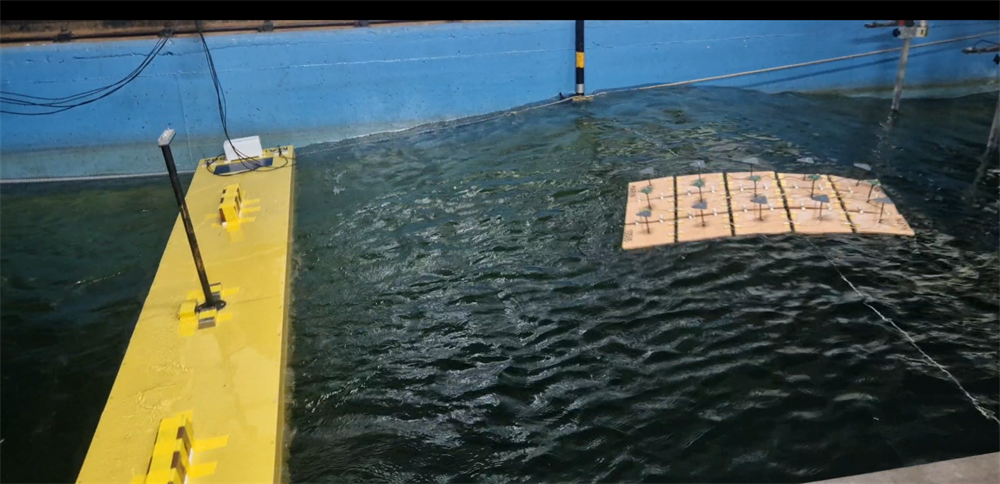
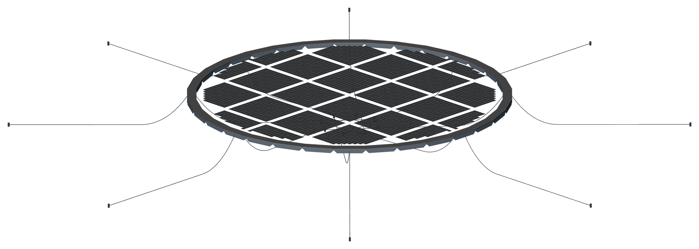

```{=latex}
\renewcommand{\nlfooter}{SUREWAVE $\cdot$ Newsletter III $\cdot$ November 2026}
\thispagestyle{fancy}
\begin{center}
{\fontsize{30pt}{34pt}\selectfont\bfseries\color{swblue}NEWSLETTER III}\\[0.4em]
{\large\bfseries SUREWAVE $\cdot$ Tested at scale $\cdot$ November 2026}\\[0.2em]
{\small\itshape Results from the SUREWAVE test and modelling campaigns, 2024--2026}\\[0.3em]
{\color{swblue}\rule{\linewidth}{0.6pt}}
\end{center}
\vspace{0.3em}
```

Welcome to the third SUREWAVE newsletter. Since our last issue, the project has moved from design to testing. This issue reports what the tests at scale showed: two wave-basin campaigns at MARIN, a redesigned hinge between the floating PV modules, strength tests on the connections between breakwater and solar array, and a simulation of a complete 2 MWp solar farm. Some results confirmed the design. Others forced a redesign, and we report those too.

```{=latex}
\begin{nlbox}
\small SUREWAVE develops and tests a floating photovoltaic (FPV) system for open-sea conditions, in which a ring of floating breakwaters made of circular concrete shields the solar array from waves. Partners: SINTEF (coordinator), Sunlit Sea, Ceit, MARIN, ACCIONA, Clement Germany and IFEU.
\end{nlbox}
```

# Two basin campaigns at MARIN

After preliminary tests on a string of six FPV floats at the Stadt Towing Tank in Norway, two system-level campaigns were run in the MARIN wave basin in Wageningen with a 1:10-scale model of the integrated system. The model included breakwater units, interconnected FPV modules, the polyurethane hinges between them, transition elements and the mooring. Both campaigns measured incoming and transmitted waves, the motions of breakwater and FPV modules, connection loads, mooring response and local slamming pressures, under representative operational and survival wave conditions.

The first campaign compared the FPV array with and without breakwater protection. The breakwater attenuated short-period wave energy, and in the relevant frequency range the motions of the protected FPV modules were reduced by factors of about 2 to 3. The highest local slamming pressure measured was about 126 kPa, and the structural assessment that followed found no threat to the breakwater's integrity.

The same campaign showed a weakness: the original polyurethane hinges buckled under compression and then snapped back under load. This matched what the component tests at SINTEF had found, and it led directly to a redesign. The second campaign tested the redesigned hinge under comparable wave conditions, and no measurable buckling or snap loading was observed. Data from the first campaign are openly available on Zenodo (see the list at the end of this issue).

{width=80%}

# A hinge that failed, and the one that replaced it

The FPV modules are joined by flexible polyurethane hinges, so the array can follow the waves. In SINTEF's laboratory tests, the first-generation hinge failed at about 3.5 kN in tension on average, below the 8 to 10 kN operational loads expected from the coupled hydrodynamic analysis, and it had little resistance to compression.

Sunlit Sea redesigned the hinge, and SINTEF tested it in a second round. The redesigned connection more than doubled the tensile capacity of the first generation, and its buckling strength rose to about 20 kN. For fatigue, SINTEF took the highest stress reached in the tests, about 11 MPa, as a conservative value; at that stress the extrapolated life is 2.5 × 10^11^ load cycles, against the 7.88 × 10^8^ cycles needed for 25 years of service. SINTEF describes this as a rough first estimate. Production is the remaining sensitivity: shrinkage during casting left gaps of 1 to 2 mm between the mating parts, which calls for strict quality control in series production.

For the complete hinge, finite-element analysis under 50-year design storms gives an ultimate limit state of 37 kN. That clears the design loads for the Baltic (34 kN) and the Mediterranean (33 kN). The North Sea design load (40 kN) is higher, so one more design iteration is needed before the hinge can be qualified for the North Sea. These loads were computed for a 2 MWp farm.

# Testing the connections to breaking point

Two further connection systems were tested to failure at SINTEF. The steel-wire connections between breakwater units failed at 402 kN on average, slightly below their rated capacity of 450 kN. The new connection between the breakwater and the FPV array, which is made with rope, failed at a mean of 41 kN, with very little scatter between tests, in line with its 42 kN strength requirement. In every test of this connection the rope was the part that failed, as expected for this design.

# A 2 MWp solar farm on a supercomputer

Basin tests can only cover a small part of a solar farm, so MARIN extended its wave-diffraction solver DIFFRAC to simulate a complete 2 MWp farm on a supercomputer: 3,660 FPV modules moored inside a ring of 32 interconnected floating breakwaters. The model was validated against the basin tests.

In steep irregular seas, the breakwater ring reduces the average axial loads on the FPV connectors by up to 20 %. For waves arriving at an angle to the array, it also reduces vertical loads and overturning moments on the connectors by up to 50 %. Inside the ring, standing waves can form, and at some wave frequencies they raise loads locally.

The authors conclude that the ring reduces fatigue and survival loads, and they also note that it is not evident that these reductions outweigh the extra cost of material, mooring, installation and decommissioning. Better estimates of damping inside the farm, and validation data from larger tests or field pilots, are the next steps. The study is published open access in *Energies* (see the list below).

{width=90%}

```{=latex}
\newpage
\begin{nlbox}
\small
\textsc{In numbers}\\[0.2em]
FPV module motions behind the breakwater: reduced by a factor of about 2 to 3 (basin tests)\\
Highest local slamming pressure on the breakwater: about 126~kPa\\
Redesigned hinge: ultimate limit state 37~kN; design loads 33~kN (Mediterranean), 34~kN (Baltic), 40~kN (North Sea)\\
Simulated farm: 3,660 FPV modules inside 32 floating breakwaters, 2~MWp
\end{nlbox}
```

# Open results from the tests

The test reports, data and papers behind this issue are public:

- Ultimate strength of the critical connections (deliverable D6.1): <https://doi.org/10.5281/zenodo.22830589>
- Basin test results (deliverable D6.2): <https://doi.org/10.5281/zenodo.22660916>
- Basin test data, first campaign: <https://doi.org/10.5281/zenodo.10960432>
- Wave basin tests of a multi-body floating PV system sheltered by a floating breakwater, *Energies* 17(9), 2059 (2024): <https://doi.org/10.3390/en17092059>
- Hydrodynamic analysis of a 2 MW offshore floating solar farm with breakwater protection, MARINE 2025: <https://doi.org/10.23967/marine.2025.163>
- Hydrodynamic simulations of a 2 MW offshore solar farm with floating breakwater protection, *Energies* 19(7), 1609 (2026): <https://doi.org/10.3390/en19071609>

```{=latex}
\vfill
\begin{nlbox}
\small
Project coordinator: Balram Panjwani, SINTEF $\cdot$ balram.panjwani@sintef.no\\
Communication: post@sunlitsea.no $\cdot$ www.surewave.eu $\cdot$ linkedin.com/company/surewave
\end{nlbox}
\vspace{0.5em}
\begin{minipage}{2.2cm}\euemblem{2cm}\end{minipage}%
\begin{minipage}{\dimexpr\linewidth-2.4cm\relax}\footnotesize
Funded by the European Union under grant agreement No.~101083342. Views and opinions expressed are however those of the author(s) only and do not necessarily reflect those of the European Union or CINEA. Neither the European Union nor the granting authority can be held responsible for them.
\end{minipage}
```
