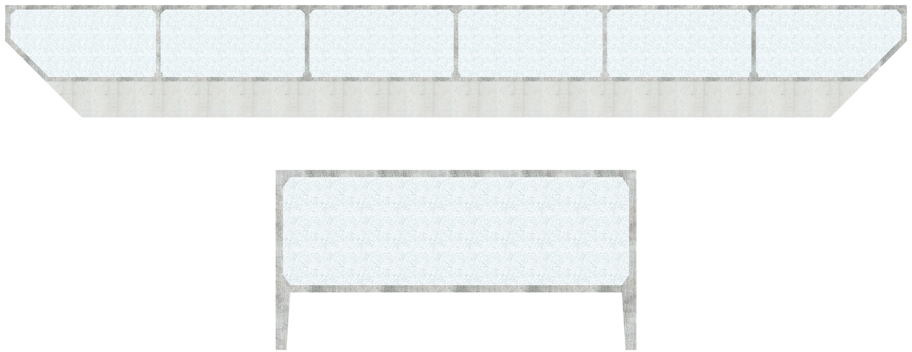
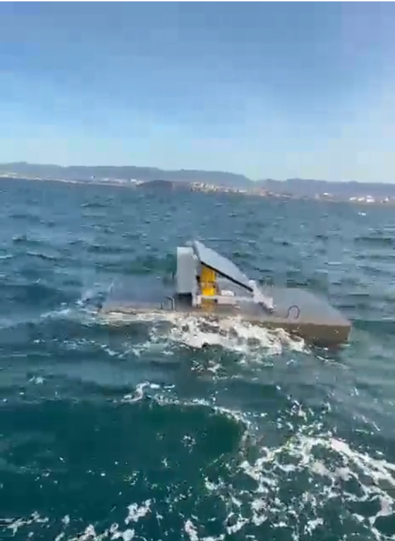

```{=latex}
\renewcommand{\nlfooter}{SUREWAVE $\cdot$ Newsletter IV $\cdot$ December 2026}
\thispagestyle{fancy}
\begin{center}
{\fontsize{30pt}{34pt}\selectfont\bfseries\color{swblue}NEWSLETTER IV}\\[0.4em]
{\large\bfseries SUREWAVE $\cdot$ From recycled concrete to the water $\cdot$ December 2026}\\[0.2em]
{\small\itshape Results from the SUREWAVE materials development and harbour exposure, 2023--2026}\\[0.3em]
{\color{swblue}\rule{\linewidth}{0.6pt}}
\end{center}
\vspace{0.3em}
```

Welcome to the fourth SUREWAVE newsletter. The floating breakwaters that shield the SUREWAVE solar array are made of concrete, and the project set out to make that concrete with recycled and secondary materials. This issue follows the material from the laboratory to the water: the mixes that were developed, how they performed in durability and strength tests, what nine months afloat in the port of Gijón showed, and how the condition of a concrete breakwater can be monitored over its life. The reports and papers behind this issue are listed at the end.

```{=latex}
\begin{nlbox}
\small SUREWAVE develops and tests a floating photovoltaic (FPV) system for open-sea conditions, in which a ring of floating breakwaters made of circular concrete shields the solar array from waves. Partners: SINTEF (coordinator), Sunlit Sea, Ceit, MARIN, ACCIONA, Clement Germany and IFEU.
\end{nlbox}
```

# Circular concrete that meets marine specifications

ACCIONA developed three concrete mixes for the breakwater, with recycled and by-product materials replacing part of the cement and aggregate.

- High-performance concrete for the structural shell reached 128 MPa in compression, against a target of 120 MPa. In this mix, 18 % of the cement is replaced by ground granulated blast-furnace slag and fly ash.
- Lightweight aggregate concrete, the alternative for the shell, uses a lightweight aggregate made from recycled glass in place of all natural lightweight aggregate, and recycled concrete in place of 20 % of the natural coarse aggregate. The mix that met all requirements reached 49 MPa; a version with a low-carbon cement, later used for the top slab of the prototype, reached 68 MPa at a higher density (approximately 1,900 kg/m^3^).
- Cellular lightweight concrete for the buoyant inner core reached a density of 365 kg/m^3^ against a target of about 300 kg/m^3^. It also uses recycled-glass aggregate, and it needs 80 % less cement than ordinary non-structural concrete.

{width=70%}

# Durability and strength in the laboratory

All the shell mixes showed high resistance to water and chloride penetration after 28 days of curing. No water penetrated the high-performance concrete. In the lightweight concrete, a waterproofing admixture cut the mean depth of water penetration from 8.2 mm to 0.6 mm and halved the chloride diffusion coefficient.

Sandwich beams, with a shell of high-performance or lightweight concrete over a cellular-concrete core, were tested in static and cyclic bending, pull-out and drop-tower impact. The high-performance shell was more than 55 % stronger in bending than the lightweight shell and about 50 % better in strength-to-weight ratio, and it also performed best under impact. Thermal cycling had a negligible effect. As expected, pull-out strength was low, because the cellular core itself is weak: it is a filler with no structural role. On this basis, high-performance concrete was chosen for the shell.

# Nine months afloat in the port of Gijón

A reduced-scale breakwater prototype, 3.40 m × 1.70 m × 1.05 m, was built at ACCIONA's workshop. It has a bottom slab and walls of high-performance concrete, a top slab of lightweight concrete, a cellular-concrete core and buoyancy blocks. The prototype was installed at ACCIONA's maritime demonstration site in El Musel port, Gijón, in September 2025, held by a four-line catenary mooring with gravity anchors, and stayed in the water until June 2026. The harbour site does not reproduce the most extreme open-sea design conditions, but it exposed the concrete to real waves, tides, seawater and marine growth.

{width=40%}

After nine months the inspection found:

- The prototype stayed in operation throughout the exposure.
- Marine growth covered more than 85 % of the surfaces, most heavily on the sides, with mussel-dominated zones up to 35 mm thick and 6.3 to 9.7 kg/m^2^ of wet biomass on the side surfaces. The thickest growth stayed within the 60 mm allowance used in sizing.
- Elsewhere in the structure, chloride content at the depth of the reinforcement was below 0.6 % by mass of cement, and the reinforcement in the high-performance concrete walls was in sound condition. Readings in the tidal and submerged zones that often indicate corrosion were explained by the concrete being saturated with water.
- Elevated chloride and possible local pitting, without measurable loss of rebar thickness, were found only in the lightweight top slab near the openings made for the monitoring electronics. This points to openings in the deck as the detail that most needs attention for the durability of floating concrete units.

# Monitoring the structure over its life

Ceit developed a structural health management system that combines finite-element stress fields, crack-growth models and degradation data. It compares materials for design, relates degradation to remaining capacity, identifies critical crack orientations and recommends inspection intervals: a four-year cycle plus checks after severe events. The current version runs on model-generated degradation data and is built to take real sensor data as it becomes available.

The degradation data are meant to come from a new eddy-current sensor that reads the condition of the reinforcement through the concrete cover. In laboratory tests with simulated material loss it resolved about 0.17 mm. At Gijón its signal was strongly affected by temperature, moisture and wetting and drying; after compensation it stayed stable, consistent with no corrosion. Whether it can detect corrosion in the field remains to be demonstrated. The accelerometers on the prototype worked reliably, and their dominant 0.35 to 0.45 Hz response matched the estimated natural frequencies.

```{=latex}
\begin{nlbox}
\small
\textsc{In numbers}\\[0.2em]
High-performance concrete: 128~MPa (target 120~MPa), 18~\% of the cement replaced by slag and fly ash\\
Cellular core concrete: 365~kg/m\textsuperscript{3}, 80~\% less cement than ordinary non-structural concrete\\
Prototype in the water: 3.40~m $\times$ 1.70~m $\times$ 1.05~m, September 2025 to June 2026\\
Marine growth: more than 85~\% coverage, up to 35~mm thick, within the 60~mm design allowance\\
Corrosion sensor: about 0.17~mm resolution in the laboratory
\end{nlbox}
```

# Open results from the materials work

The reports, papers and data behind this issue are public:

- Breakwater prototype (deliverable D4.3): <https://doi.org/10.5281/zenodo.22830370>
- Resonant eddy-current sensor design for corrosion detection of reinforcing steel, *Sensors* 24(13), 4211 (2024): <https://doi.org/10.3390/s24134211>
- UWB-based accelerometer sensor nodes for low-power applications in offshore platforms, *Electronics* 13(22), 4485 (2024): <https://doi.org/10.3390/electronics13224485>
- Numerical generation of mode I stress intensity factors for narrow elliptical cracks in round bars, *Fatigue & Fracture of Engineering Materials & Structures* (2026): <https://doi.org/10.1111/ffe.70435>
- Crack-growth dataset: <https://doi.org/10.17632/sdxwvmrk3t.1>

```{=latex}
\vfill
\begin{nlbox}
\small
Project coordinator: Balram Panjwani, SINTEF $\cdot$ balram.panjwani@sintef.no\\
Communication: post@sunlitsea.no $\cdot$ www.surewave.eu $\cdot$ linkedin.com/company/surewave
\end{nlbox}
\vspace{0.5em}
\begin{minipage}{2.2cm}\euemblem{2cm}\end{minipage}%
\begin{minipage}{\dimexpr\linewidth-2.4cm\relax}\footnotesize
Funded by the European Union under grant agreement No.~101083342. Views and opinions expressed are however those of the author(s) only and do not necessarily reflect those of the European Union or CINEA. Neither the European Union nor the granting authority can be held responsible for them.
\end{minipage}
```
