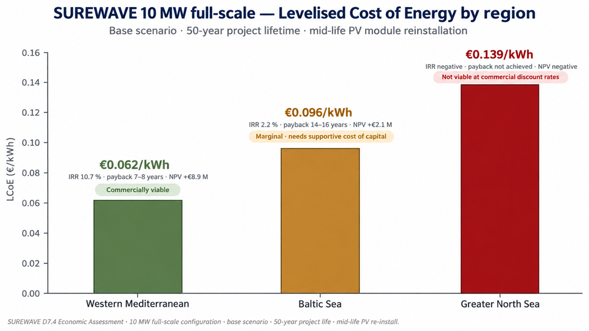

```{=latex}
\renewcommand{\nlfooter}{SUREWAVE $\cdot$ Newsletter V $\cdot$ December 2026}
\thispagestyle{fancy}
\begin{center}
{\fontsize{30pt}{34pt}\selectfont\bfseries\color{swblue}NEWSLETTER V}\\[0.4em]
{\large\bfseries SUREWAVE $\cdot$ Cost, carbon and what comes next $\cdot$ December 2026}\\[0.2em]
{\small\itshape Results from the SUREWAVE economic, environmental and social assessments, 2025--2026}\\[0.3em]
{\color{swblue}\rule{\linewidth}{0.6pt}}
\end{center}
\vspace{0.3em}
```

Welcome to the fifth and final SUREWAVE newsletter. The project ends on 31 December 2026. This issue looks at what a wave-shielded offshore solar plant would cost, where it makes economic sense, what it means for the climate and for the people in its supply chain, and what has to happen between the results of SUREWAVE and a first commercial plant.

```{=latex}
\begin{nlbox}
\small SUREWAVE develops and tests a floating photovoltaic (FPV) system for open-sea conditions, in which a ring of floating breakwaters made of circular concrete shields the solar array from waves. Partners: SINTEF (coordinator), Sunlit Sea, Ceit, MARIN, ACCIONA, Clement Germany and IFEU (Institute for Energy and Environmental Research Heidelberg).
\end{nlbox}
```

# Cost of energy by sea basin

Sunlit Sea led the economic assessment, which compared plant sizes, layouts and financial scenarios at three reference sites. The base case assumes electricity sold at €0.12/kWh, a discount rate of 8.5 %, a 50-year asset life with the solar modules replaced once at mid-life, and a short floating cable to a nearby offshore substation. For a 10 MW plant, the levelised cost of energy is:

- Mediterranean: €0.062/kWh, with a net present value of about €8.9 million. Viable, and the recommended location for a pilot and scale-up.
- Baltic Sea: €0.096/kWh. Viable under favourable conditions.
- North Sea: €0.139/kWh. Suited to hybrid sites or demonstration; not viable as a stand-alone plant at current costs.

Smaller plants of 2 MW, and a 10 MW plant split into five 2 MW units, came out clearly less viable than a single 10 MW plant.

{width=60%}

# The grid connection decides

The base case connects the plant to a nearby offshore substation with a floating cable of about 300 m. With a full submarine cable to shore instead, the cost of energy in the Mediterranean rises from €0.062 to €0.076/kWh, and in the North Sea it goes above €0.45/kWh.

The assessment therefore recommends connecting to nearby offshore substations, hybrid energy platforms or other offshore installations such as wind farms, or staying within about 15 km of the shore.

The breakwater material matters much less. Of the four concrete options assessed (conventional, hybrid, lightweight-aggregate and high-performance), conventional concrete gave the best economic result; high-performance concrete raised the investment cost with marginal or no improvement.

# Climate and environment

IFEU's life-cycle assessment modelled a 9 MWp plant. Even at the North Sea site, the least sunny of the three, it can save more than 160,000 to 180,000 t of CO~2~-equivalent over 25 years compared with electricity from coal, depending on the layout; sunnier sites save more. These results assume a durability that the components, in particular the hinges between the solar modules, have not yet shown in practice.

The quantities of vessel fuel used for installation, maintenance and dismantling dominate the plant's own impacts, followed by the solar panels, breakwaters and anchoring; the cable to shore becomes significant beyond about 50 km. Compared with the saving against fossil power, the choice between circular and conventional concrete for the breakwaters makes no relevant difference to greenhouse-gas emissions. Offshore floating solar can have higher impacts than solar on land and wind power, because it needs more material and vessel work, so it complements those sources to achieve a faster decarbonisation, rather than replacing them.

Locally, the main concerns are noise from piling anchors, shading of light-dependent habitats, anchor chains disturbing migratory fish and marine mammals, and cable routes through coastal habitats. The plant can also act as an artificial reef. These effects depend on the site and need case-by-case assessment.

# The people in the supply chain

IFEU's social life-cycle assessment found that purchased inputs carry most of the social risk, and the supply chain of the solar panels accounts for almost half of the total, mainly the solar cells. If key inputs come from countries with weaker labour standards, total social risk can more than triple. Work safety offshore and labour rights during construction, maintenance and dismantling also need managing.

# From research to a first plant

SUREWAVE has taken offshore floating solar with a breakwater from technology readiness level 2–3 to 4–5. The next steps are:

- an open-sea pilot in the kilowatt to low-megawatt range, to test the flexible hinges between the solar modules and the concrete breakwater over time;
- one more hinge design iteration to qualify for North Sea loads;
- live field data feeding the structural health monitoring software developed in the project;
- sites that can share offshore infrastructure, in particular grid connections;
- permits and stakeholder agreements at candidate sites, and independent technology qualification, which lenders typically require for first-of-kind offshore assets.

```{=latex}
\begin{nlbox}
\small
\textsc{In numbers}\\[0.2em]
Cost of energy, 10~MW plant: €0.062/kWh (Mediterranean), €0.096/kWh (Baltic), €0.139/kWh (North Sea)\\
Submarine cable to shore instead of a nearby substation: €0.076/kWh in the Mediterranean (vs €0.062/kWh)\\
Climate benefit, 9~MWp plant in the North Sea: more than 160,000--180,000~t CO\textsubscript{2}-eq saved over 25 years against coal
\end{nlbox}
```

# Open results

The reports and data behind this issue are public:

- Environmental assessment (D7.3): <https://doi.org/10.5281/zenodo.22831061>
- Economic assessment (D7.4): <https://doi.org/10.5281/zenodo.22831172>
- Cost model, dataset (D7.4): <https://doi.org/10.5281/zenodo.17534609>
- Social assessment (D7.5): <https://doi.org/10.5281/zenodo.22955900>
- Integrated sustainability (D7.6): <https://doi.org/10.5281/zenodo.22956130>
- LCA talk, 91st LCA Forum: <https://doi.org/10.5281/zenodo.22957101>

All SUREWAVE public results: <https://zenodo.org/communities/surewave>. Thank you to everyone who followed the project.

```{=latex}
\vfill
\begin{nlbox}
\small
Project coordinator: Balram Panjwani, SINTEF $\cdot$ balram.panjwani@sintef.no\\
Communication: post@sunlitsea.no $\cdot$ www.surewave.eu $\cdot$ linkedin.com/company/surewave
\end{nlbox}
\vspace{0.5em}
\begin{minipage}{2.2cm}\euemblem{2cm}\end{minipage}%
\begin{minipage}{\dimexpr\linewidth-2.4cm\relax}\footnotesize
Funded by the European Union under grant agreement No.~101083342. Views and opinions expressed are however those of the author(s) only and do not necessarily reflect those of the European Union or CINEA. Neither the European Union nor the granting authority can be held responsible for them.
\end{minipage}
```
