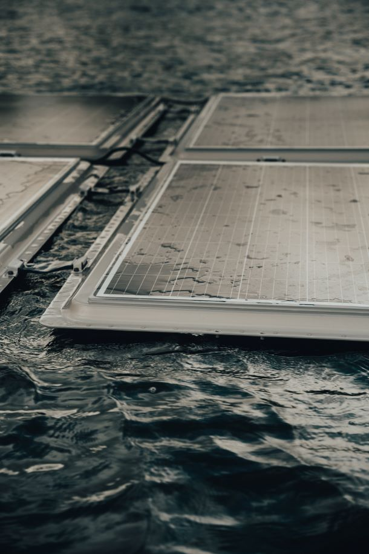

## WP2: Global Framework Definition and General Specifications {layout="Title"}

Final Review Meeting, Remote – December 2, 2026

::: notes
Good morning. I am Eirik Larsen from Sunlit Sea, the leader of work package 2, the global framework definition and general specifications of the floating photovoltaic solution. In this work package we set the design basis that the rest of SUREWAVE built on: use-case scenarios, requirements for the critical components, integration requirements with the breakwater, and stakeholder engagement through the Stakeholder Advisory Board.

Three of the four tasks were completed in the previous reporting period. The fourth, stakeholder engagement, ran into this period, so most of what I show today concerns the Advisory Board. I close, as you asked, with delays and deviations, the results of the period and the lessons we learned.
:::

## WP2 – Objectives and Contribution

| WP2 objective | Task | Status at project end |
|---|---|---|
| Establish a technical Stakeholder Advisory Board (SAB) | T2.4 | Fully achieved |
| Research, analysis and preliminary requirements of critical components | T2.2 | Fully achieved (previous period) |
| Integration requirements with breakwater and other critical components | T2.3 | Fully achieved (previous period) |
| Use-case scenario definition | T2.1 | Fully achieved (previous period) |

- Contribution: the design basis for exposed sites (wind above 25 m/s, current above 1.2 m/s, waves above 14 m) used in WP3 to WP7

::: notes
The Grant Agreement gives WP2 one overall aim: holistic and detailed requirements for floating photovoltaic installations with breakwaters at sites with very high wind, current and wave loads and with corrosion, plus requirements for installation, operation and maintenance, and decommissioning. Under it sit four specific objectives, one per task.

All four are fully achieved. The use-case scenarios, the component requirements and the integration requirements were completed and reported in the first period, in D2.1, D2.2 and D2.3. The Stakeholder Advisory Board was set up in the first period and reported in D2.4 on 22 April 2024; its engagement continued in this period.

The contribution to the project objectives is the design basis. The breakwater design in WP3, the material work in WP4, the modelling in WP5, the tests in WP6 and the sustainability and economic assessments in WP7 all started from the WP2 scenarios and load levels.
:::

## WP2 – Work Carried Out in RP2

- Tasks 2.1, 2.2 and 2.3: completed in the previous period
- Task 2.4, stakeholder engagement, continued with the SAB:
  - D2.4 delivered, 22 April 2024: the Board and its consolidated feedback (MS5)
  - Public webinar with the Board, 19 November 2024, organised and moderated by Sunlit Sea; recording published
  - Follow-up meeting with Board members, March 2025
  - Board review and extension of the list of potential social impacts (D8.2)

::: notes
This is the short summary of the period, from April 2024 to September 2026, which we call RP2, the second reporting period.

Tasks 2.1 to 2.3 were completed in the previous period, and I will not repeat them.

Task 2.4 continued. The Stakeholder Advisory Board, or SAB, was set up and reported in D2.4. In this period we used it actively. On 19 November 2024 we held a public webinar with the Board. Sunlit Sea organised and moderated it; SINTEF, Sunlit Sea and Clement Germany presented; IFEU and ACCIONA answered questions from the audience. The recording was published. In March 2025 we followed up with the Board members in a dedicated meeting. The Board members also reviewed and extended the list of potential social impacts in the societal needs and engagement report, D8.2, led by IFEU.
:::

## WP2 – Time schedule

| Task | Lead | Months | Status |
|---|---|---|---|
| T2.1 Use-case scenario definition | SINTEF | M1–M4 | Completed, previous period |
| T2.2 Requirements of critical components | Clement Germany | M1–M4 | Completed, previous period |
| T2.3 Integration requirements with breakwater | Sunlit Sea | M1–M4 | Completed, previous period |
| T2.4 Stakeholder engagement | Sunlit Sea | M1–M36 | Completed |

- RP2 = months 19 to 48 (April 2024 – September 2026)

::: notes
The schedule of WP2 was front-loaded by design. The first three tasks ran in the first four months of the project, since every other work package needed the scenarios and requirements early. They are all completed.

Task 2.4, stakeholder engagement, ran from month 1 to month 36, that is to September 2025. The webinar in November 2024 was in month 26 and the follow-up meeting in March 2025 in month 30, both inside the task period. There is no change to the schedule.
:::

## WP2 – Planned Activities in RP2

- Task 2.1, Task 2.2, Task 2.3:
  - No activities planned; completed in the previous period
- Task 2.4, stakeholder engagement:
  - Keep the SAB engaged after its establishment (D2.4)
  - Hold a workshop with the Board to discuss and disseminate project results
  - Seek the Board's informal advice: views, requirements, potential show-stoppers and counter-measures

::: notes
For this period the plan for WP2 was limited to Task 2.4. After the Board was established and its first consolidated feedback was reported in D2.4, the plan was to keep the members engaged, to hold a workshop with them on the project results, and, as the Grant Agreement puts it, to use their informal advice to identify potential show-stoppers and counter-measures.
:::

## WP2 – Progress in RP2

- Task 2.4, stakeholder engagement:
  - Webinar with the SAB, 19 November 2024: SINTEF, Sunlit Sea and Clement Germany presented; IFEU and ACCIONA answered questions
  - Recording published for a wider audience
  - Follow-up meeting with Board members, March 2025
  - Board review and extension of the list of potential social impacts (D8.2)

::: notes
All planned activities were carried out.

The workshop took the form of a public webinar, which let the Board members take part with little travel and opened the discussion to a wider audience. Sunlit Sea organised and moderated it. SINTEF, Sunlit Sea and Clement Germany presented the project and its results, and IFEU and ACCIONA answered questions from the audience. The recording was published afterwards.

In March 2025 we followed up with the Board members in a separate meeting. The Board members reviewed and extended the list of potential social impacts that IFEU drew up for D8.2.
:::

## Stakeholder Advisory Board

- Seven experts from across the value chain
- Sectors: project development, technology, regulation, finance, insurance, energy utilities, installation, operation and maintenance, policy
- Four of the seven member organisations are companies
- Engagement: questionnaires and interviews (D2.4), two Board meetings, the webinar, the review of D8.2

::: notes
A short reminder of who the Board is. It has seven experts. Together they cover the value chain of an offshore floating photovoltaic project: project developers, technology providers, regulators, finance, insurance, utilities as end users, installers, operation and maintenance, and policy makers. Four of the seven member organisations are companies, which gave the project direct industry feedback.

Board members give their time for free. D2.4 set out to keep the workload low: tailored questionnaires and interviews, two Board meetings, the webinar, and the Board's review of the social-impact list in D8.2.
:::

## Key Technical Results

- Design basis in use throughout RP2:
  - Use-case scenarios and site conditions (D2.1)
  - Requirements for the surface mooring between array and breakwater (D2.2)
  - General system loads (D2.3)
- Installation, operation and maintenance, and decommissioning requirements carried into the lifecycle cost estimates (D7.4)
- SAB feedback carried into the societal report (D8.2)

{side=right}

::: notes
The technical results of WP2 were produced in the first period; in this period they were used.

The use-case scenarios in D2.1 defined the reference sites and site conditions. D2.2 gave the requirements for the surface mooring between the floating array and the breakwater. D2.3 gave the general loads on the system. Clement Germany used these for the breakwater, mooring and transition element design in WP3; MARIN and SINTEF for the modelling and basin tests; IFEU and Sunlit Sea for the sustainability and economic assessments in WP7.

The requirements for installation, operation and maintenance and decommissioning were carried into the lifecycle cost estimates of the economic assessment, D7.4, which includes decommissioning and end-of-life costs in the levelised cost of electricity.

The Board's views went into the societal report D8.2.

The photo shows Sunlit Sea's Generation 1 floats at sea; these floats were the floating array of the SUREWAVE system.
:::

## WP2 – Deliverables and Milestones

| No. | Title | Lead | Due | Delivered |
|---|---|---|---|---|
| D2.1 | Use-case scenario basis for typical, rough location | SINTEF | M4 | 31 Jan 2023 |
| D2.2 | Requirements for surface mooring system between array and breakwater | Clement Germany | M8 | 1 Feb 2023 |
| D2.3 | High-level understanding of the system general loads | Sunlit Sea | M10 | 31 Jan 2023 |
| D2.4 | Establishing a technical stakeholder advisory board | Sunlit Sea | M18 | 22 Apr 2024 |
| MS1 | Power production estimates with wave-corrected performance ratio | Sunlit Sea | M4 | Achieved (D2.1) |
| MS5 | SAB consolidated feedback | Sunlit Sea | M18 | Achieved (D2.4) |

::: notes
D2.1 to D2.3 and milestone MS1 were completed in the previous period. D2.4, which establishes the Board and reports its consolidated feedback, milestone MS5, was delivered on 22 April 2024, at the start of this period.

MS1, power production estimates with a wave-corrected performance ratio, was verified in D2.1. MS5, the Board's consolidated feedback, was verified in D2.4. D2.1 and D2.4 are public; D2.2 and D2.3 are sensitive.
:::

## WP2 – Use of resources

| Partner | WP2 planned person-months (PM) |
|---|---|
| Sunlit Sea (lead) | 11.0 |
| Clement Germany | 9.5 |
| ACCIONA | 6.0 |
| SINTEF | 2.0 |
| Ceit | 1.0 |
| MARIN | 0.6 |
| Total WP2 | 30.1 |

- Sunlit Sea, whole project: 40.5 of 46.0 PM reported (−12 %); budget of €500,000 claimed in full
- Cost of the 12-month extension above the budget carried by Sunlit Sea, not claimed

::: notes
The table gives the planned person-months, PM, for WP2 from the Grant Agreement: 30.1 PM in total, of which Sunlit Sea has 11 as work package leader and Clement Germany 9.5. The three requirement tasks ran in months 1 to 4; in this period, WP2 effort went to the Board engagement under Task 2.4.

Effort and costs are reported per beneficiary. For Sunlit Sea: 40.5 person-months reported over the project against 46 planned, 12 per cent below plan, and the full budget of 500,000 euro claimed. Sunlit Sea's costs exceeded the budget, mainly through the 12-month extension; Sunlit Sea carried the excess itself and did not claim it. The audit of the first reporting period corrected Sunlit Sea's costs, not the effort declared per work package. The other partners' use of resources is presented by the coordinator.
:::

## Dissemination and Exploitation of WP Results

| Output | WP2 contribution |
|---|---|
| Publications | Joint wave-basin paper (Energies 2024) and D7.4 preprint (2026), both built on the WP2 design basis |
| Datasets and public reports | D2.1 and D2.4, public; webinar recording |
| Software and tools | Load cases and site conditions feeding the modelling toolchain (WP5) |
| Key Exploitable Results | KER1 integrated system (Sunlit Sea), product sales and project delivery; KER3 breakwater design (Clement Germany), engineering, design-build and consultancy |

::: notes
WP2 results reached the public through the other work packages. The wave-basin paper in Energies in 2024, written by MARIN, Ceit, SINTEF, Clement Germany and Sunlit Sea, tested the system defined in the WP2 design basis. The economic assessment D7.4, now also a preprint, uses the WP2 lifecycle requirements.

D2.1 and D2.4 are public deliverables, and the webinar recording is public.

The WP2 load cases and site conditions are the starting point of the modelling toolchain developed in WP5.

On exploitation, the design basis feeds two of the seven Key Exploitable Results, KERs: KER1, the integrated floating photovoltaic system with breakwater, owned by Sunlit Sea and exploited through product sales and project delivery; and KER3, the floating breakwater design, owned by Clement Germany and exploited through engineering, design-build and consultancy.
:::

## WP2 – Delays, Deviations and Corrective Actions

- Delays: none in WP2
- Technical deviations from the proposal: none in WP2
- Impact on project timeline and objectives: none
- Scope: unchanged
- Corrective actions: none needed

::: notes
To answer your questions directly. There was no delay in WP2: the deliverables and milestones were completed in the previous period, and Task 2.4 ran to month 36 as planned. There was no technical deviation from the proposal in WP2. The project timeline and objectives were not affected, the scope did not change, and no corrective action was needed.

Changes elsewhere in the project, such as the move from one continuous 10 MW array to five modular 2 MW units, were handled in the work packages that made them, using the WP2 design basis as the reference.
:::

## Major Results Achieved during RP2

- SAB engaged through a public webinar and a follow-up meeting
- Board review and extension of the social-impact list in D8.2
- WP2 design basis carried through to the integrated system at technology readiness level (TRL) 5 and the economic assessment
- Contacts made through the Board led to SuRE, a Horizon Europe project that uses SUREWAVE results

::: notes
The results of WP2 in this period are these.

The Board was engaged through a public webinar and a follow-up meeting, and its members reviewed and extended the list of potential social impacts in the societal report D8.2.

The design basis set in WP2 carried through to the end of the project: the integrated system is assessed at technology readiness level, TRL, 5, and the economic assessment gives a levelised cost of electricity of 0.076 euro per kilowatt-hour for the 10 MWp Mediterranean reference plant.

Finally, a result beyond the plan: contacts made through the Advisory Board led to SuRE, another Horizon Europe project in which Sunlit Sea now develops its next-generation floats and uses SUREWAVE results.
:::

## WP2 – Lessons Learned

- Requirements set in months 1–4 must serve to the end: keep the design basis as a maintained reference and update it when the architecture changes
- Advisory Board members give their time for free: keep formats short and concrete (interviews, a webinar on results)
- Plan the Board's role in societal engagement from the start: the Board sat in WP2 and societal engagement in WP8; the Board's review of the social-impact list in D8.2 shows the value of the link
- Stakeholder engagement creates value beyond the project: a new Horizon Europe project grew out of the Board

::: notes
Lessons learned, which you asked us to weigh.

First, a design basis written in the first four months has to carry a project of more than four years. In SUREWAVE the system architecture changed from one continuous array to five 2 MW units, and the sustainability work revised its common baseline. Keeping the design basis as a maintained reference, updated at such decisions, gives every work package the same current basis.

Second, Board members give their time for free. Formats should be short and concrete, such as interviews and a webinar on results.

Third, the Board sat in WP2, while societal engagement sat in WP8, led by IFEU. The Board's review of the social-impact list in D8.2 shows what the link gives; the Board's role in societal engagement belongs in the plan from the start.

Fourth, engagement creates value beyond the project: the contacts from the Board led to SuRE.
:::

## THANK YOU {layout="End slide"}

::: notes
Thank you. I am glad to take your questions.
:::
