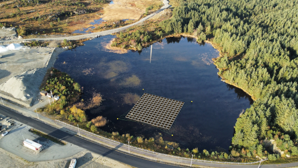
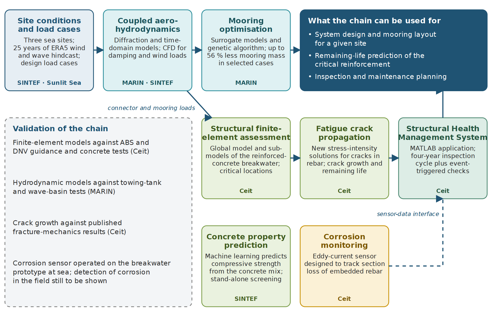

## WP8: Dissemination, Communication, Exploitation and Societal Engagement {layout="Title"}

Final Review Meeting, Remote – December 2, 2026

::: notes
I am Eirik Larsen from Sunlit Sea, the leader of work package 8 on dissemination, communication, exploitation and societal engagement. In the next 25 minutes I show where WP8 stands against its objectives and targets, how the project results will be exploited, and, at the end, delays and deviations, the results of the period and the lessons we learned.
:::

## WP8 – Objectives and Contribution

| WP8 objective | Status at project end |
|---|---|
| O1 Raise awareness of the project, its results and benefits | Fully achieved |
| O2 Disseminate results in appropriate and impactful channels | Achieved; 5 papers deposited open access after publication |
| O3 Identify and engage critical stakeholders | Fully achieved |
| O4 Develop exploitation strategies for long-lasting impact | Fully achieved |

- Contribution: carries the results of WP2–WP7 to industry, research and the public, and sets out how each partner exploits them

::: notes
WP8 has four specific objectives in the Grant Agreement. Three are fully achieved. The second, dissemination, is achieved with one shortfall: five peer-reviewed papers were deposited in an open repository after publication instead of at publication. I come back to that under deviations.

Awareness: the project appeared at 14 conferences, in 15 presentations, in seven journalistic articles and nine interviews, and the LinkedIn page has 694 followers. Dissemination: ten publications, five preprints, public deliverables and datasets on Zenodo, and the technical brochure. Stakeholders: the Advisory Board, the societal needs assessment with IFEU, and joint events with other EU projects. Exploitation: seven Key Exploitable Results, each with an owner, an exploitation route and a four-year action plan, and a business plan for the integrated system.

The contribution to the project objectives is that WP8 takes what WP2 to WP7 produced to the people who can use it, and sets out who uses which result after the project.
:::

## WP8 – Work Carried Out in RP2

- Ten publications at project end: six journal articles, four conference papers
- Events: CINEA clustering event (April 2024), Stakeholder Advisory Board (SAB) webinar (November 2024), joint webinar with NaturSea-PV (February 2026), final workshop in Trondheim and online (30 September 2026)
- Communication: website, LinkedIn, videos, interviews, articles, press release on the Gijón prototype (October 2024)
- Societal engagement (Task 8.1, IFEU): needs and SWOT analysis with the SAB and partners (D8.2)
- Technical brochure (D8.3), by Sunlit Sea and SINTEF
- Exploitation (Task 8.4): seven Key Exploitable Results (KERs); business plan for the integrated system built in the Horizon Results Booster's Go-to-Market service (D8.4)

::: notes
In the second reporting period, RP2, the work moved from setting up channels to communicating validated results.

The publications reached ten, on breakwater aerodynamics, wave-basin testing, farm-scale hydrodynamics, corrosion sensing, wireless monitoring and fatigue-crack modelling.

We held or joined four main events: the CINEA clustering event on solar photovoltaics in April 2024, the webinar with the Stakeholder Advisory Board in November 2024, a joint webinar with the NaturSea-PV project in February 2026, and the final workshop on 30 September 2026 in Trondheim and online.

Communication ran through the website, the LinkedIn page, videos, interviews and articles, and ACCIONA's press release on the Port of Gijón prototype in October 2024.

IFEU led the societal engagement, with a needs assessment and a SWOT analysis of strengths, weaknesses, opportunities and threats, together with the Advisory Board and the partners, reported in D8.2.

Sunlit Sea and SINTEF wrote the technical brochure, D8.3. And the exploitation work produced D8.4: seven Key Exploitable Results, or KERs, and a business plan for the integrated system, which Sunlit Sea built in the Horizon Results Booster's Go-to-Market service. I come back to that work in detail.
:::

## WP8 – Time schedule

| Task | Lead | Months | Status |
|---|---|---|---|
| T8.1 Societal engagement | IFEU | M13–M36 | Completed |
| T8.2 Strategy and monitoring | Sunlit Sea | M1–M36 | Completed |
| T8.3 Dissemination activities | Sunlit Sea | M1–M36 | Completed |
| T8.4 Exploitation pathways and business plan | Sunlit Sea | M19–M36 | Completed |
| T8.5 Communication activities | Sunlit Sea | M1–M36 | Completed |

- Months as in the Grant Agreement; with the extensions, WP8 work continued to the project end, 31 December 2026 (M51)

::: notes
WP8 has five tasks. In the Grant Agreement all of them end in month 36, the original end of the project in September 2025: three run from the start, societal engagement from month 13, and exploitation from month 19.

After the extensions of 12 and 3 months, the project ends on 31 December 2026, month 51. Dissemination, exploitation and communication continued to that date: the technical brochure and the exploitation plan were completed in autumn 2026, and newsletters, an infographic and LinkedIn posts are scheduled for November and December 2026. Communication continues after the project.
:::

## WP8 – Planned Activities in RP2

- Task 8.1: stakeholder identification, needs assessment and SWOT workshop with the SAB and partners
- Task 8.2: monitor the master plan (D8.5, M18) and its key performance indicators; define the definitive KERs with the partners
- Task 8.3: ten or more scientific publications; technical brochure (D8.3)
- Task 8.4: KER and intellectual property rights (IPR) analysis, market and value analysis, business models, business and exploitation plans (D8.4)
- Task 8.5: website, LinkedIn, newsletters, infographics, factsheets, articles, interviews, videos

::: notes
These were the activities planned for the period.

In Task 8.1, IFEU was to identify the societal stakeholders and run a needs assessment and a SWOT workshop with the Board and the partners.

In Task 8.2, we were to monitor the dissemination, exploitation and communication master plan, revised at month 18 as D8.5, and to define the definitive Key Exploitable Results with the partners.

In Task 8.3, the consortium was to produce ten or more scientific publications, and Sunlit Sea and SINTEF the technical brochure.

Task 8.4 followed the proposal's steps: results and intellectual property rights, IPR; market and value analysis; value propositions; and business models and plans.

Task 8.5 covered all communication channels and products.
:::

## WP8 – Progress in RP2

- Task 8.1: needs assessment and SWOT analysis completed; D8.2 used in the social and integrated assessments (D7.5, D7.6)
- Task 8.2: indicators monitored with Matomo and LinkedIn statistics; every indicator checked against publisher records, Crossref, OpenAIRE and Zenodo
- Task 8.3: ten publications, five preprints, 14 conferences, 15 presentations; brochure D8.3
- Task 8.4: KERs set through a written input round and the WP8 lead's screening; seven KERs; KER1 business plan with the Horizon Results Booster
- Task 8.5: 694 LinkedIn followers; more than 50,000 website visits; five newsletters

::: notes
All tasks delivered their planned results.

Task 8.1: IFEU completed the needs assessment and SWOT analysis; D8.2 fed the social assessment D7.5 and the integrated sustainability assessment D7.6.

Task 8.2: website traffic was monitored with Matomo and LinkedIn through its own statistics. In September to November 2026 I collected the partners' records and checked each indicator against publisher records, Crossref, OpenAIRE, Zenodo and the website.

Task 8.3: ten publications, five preprints and two submitted journal manuscripts; partners presented at 14 conferences and in 15 presentations.

Task 8.4: the definitive KERs were set through a written input round and my screening and mapping of the results. On 29 September 2026 I sent the partners a template with seven candidate KERs. Five partners replied with written exploitation summaries within a week; ACCIONA and Clement Germany had sent theirs earlier. Sunlit Sea prepared the business plan for the integrated system with the Horizon Results Booster.

Task 8.5: the LinkedIn page has 694 followers against a target of more than 500, the website passed 50,000 visits, and there are five newsletters, three of them scheduled for November and December 2026.
:::

## Dissemination: Targets and Actuals

| Indicator | Target | Achieved |
|---|---|---|
| Scientific publications | 10 | 10 (7 with stated peer review) |
| Conferences | 5 | 14 |
| Presentations | More than 10 | 15 |
| Posters | 1 | 3 |
| Web events | 2 | 4 |
| Joint events with EU projects | More than 2 | 3 |
| Conference workshops | 3 | 3 |
| SAB workshops | 2 | 2 |
| Technical brochure | 1 | 1 (D8.3) |

- All dissemination targets met

::: notes
This is the table of targets against actuals that you asked for, first for dissemination. The targets come from the Grant Agreement, from the master plan D8.5, and, for five indicators that these name without a number, conferences, posters, web events, roll-ups and LinkedIn posts, from the WP8 key performance indicator monitoring. They are counted like the others.

Ten scientific publications against a target of ten; seven of them state peer review. 14 conferences against 5, 15 presentations against more than 10, three posters, four web events, three joint events with other EU projects. Three conference workshops: the CINEA clustering event in April 2024, the joint webinar with NaturSea-PV in February 2026 and the final workshop in September 2026. Two Advisory Board workshops. And the technical brochure.
:::

## Communication: Targets and Actuals

| Indicator | Target | Achieved |
|---|---|---|
| Newsletters | 5 | 5 (3 scheduled, 24 Nov – 8 Dec 2026) |
| Journalistic articles | 6 | 7 |
| Press releases | At start and milestones | 2 (start 2022; prototype 2024) |
| Interviews | 9 | 9 |
| Videos | Introduction and final summary | 7 |
| Infographics | 6 | 6 (1 scheduled, 15 Dec 2026) |
| Factsheets, flyer, roll-up | 3, 1, 1 | 3, 1, 1 |
| LinkedIn followers / posts | More than 500 / 25 | 694 / 40 by 31 Dec 2026 |
| Website visits | More than 36,000 | More than 50,000 by end 2024 |

- All 21 output targets met

::: notes
For communication: five newsletters, two published in 2023 and three written and scheduled for 24 November, 1 December and 8 December 2026. Seven journalistic articles against six. Two press releases: SINTEF's news article at the start of the project on 1 November 2022, and ACCIONA's announcement at the prototype milestone on 11 October 2024. Nine interviews. Seven videos and webinar recordings: the concept explainer of April 2024 is the introduction, and the seven together form the final summary. Six infographics, the last one, on the modelling toolchain, scheduled for 15 December. Three factsheets, a flyer and a roll-up. 694 LinkedIn followers and 40 posts by the end of the year. And more than 50,000 website visits by the end of 2024, against a target of 36,000 over the project.

Together, all 21 output targets are met.
:::

## Reach and Impact Targets

- 22 targets in the Grant Agreement and D8.5: 18 met, 2 partly met, 2 not met
- Partly met:
  - Citations: 41 in Crossref against more than 140; two of the seven peer-reviewed papers appeared in 2026
  - Final conference: 27 guests invited to the final workshop, open invitation, against more than 100 stakeholders
- Not met:
  - A new PhD completed within the project
  - A separate replication guide; its content is in D7.6, D8.3 and D8.4

::: notes
Beyond outputs, the Grant Agreement and D8.5 set 22 targets for reach and impact. 18 are met, among them publications reaching academics, new research and development lines, events, training, digital reach, media reach and two new partnerships that adopt SUREWAVE results.

Two are partly met. Citations: 41 in Crossref against more than 140. Two of the seven peer-reviewed papers were published in 2026. The final conference: the final workshop on 30 September 2026 invited 27 guests and was open to a wider audience online, against a target of more than 100 stakeholders.

Two are not met. No doctoral thesis was completed within the project. And the separate sustainability and replication guide was not produced as its own document: its content, deployment conditions and replication, is covered by the integrated sustainability assessment D7.6, the technical brochure D8.3 and the exploitation plan D8.4.
:::

## Publications, Preprints and Open Science

- 10 publications: 6 journal articles, 4 conference papers
- Open access of the 7 peer-reviewed papers:
  - 1 in a trusted repository at publication (Sensors, PubMed Central)
  - 5 deposited on Zenodo after publication (1 done, 4 in progress)
  - MARINE 2025 paper: deposit depends on the publisher's agreement
- 5 preprints (October–November 2026), among them the D7.4 economic assessment (doi 10.20944/preprints202611.2292.v1)
- Public deliverables and datasets in the SUREWAVE Zenodo community

::: notes
Open science. The ten publications are six journal articles and four conference papers.

The Grant Agreement asks for peer-reviewed papers to be in a trusted repository at the time of publication. Of the seven papers with stated peer review, one met this: the Sensors paper, through PubMed Central. Five are being deposited on Zenodo after publication: Ceit has deposited its fatigue paper, and the partners are depositing four papers published under a CC BY licence. For the MARINE 2025 paper, MARIN deposits the accepted manuscript under CC BY if its publishing agreement with the conference publisher allows it.

Early sharing: five preprints were posted in October and November 2026, among them the economic assessment D7.4 by Sunlit Sea and SINTEF.

For reproducibility, the public deliverables and datasets are in the SUREWAVE community on Zenodo, so the methods and data behind the results can be reused.
:::

## WP8 Results: Seven Key Exploitable Results

| KER | Owner | Exploitation route |
|---|---|---|
| KER1 Integrated floating PV system with breakwater | Sunlit Sea | Product sales, project delivery |
| KER2 Circular concrete formulations | ACCIONA | Own projects, R&D, consultancy |
| KER3 Floating breakwater design | Clement Germany | Engineering, design-build, consultancy |
| KER4 Modelling and testing methods | SINTEF | Research, contract research, testing |
| KER5 Hydrodynamic models and basin testing | MARIN, SINTEF | Software licences, modelling, basin tests |
| KER6 Structural health monitoring, eddy-current sensing | Ceit | Sensor transfer, contract R&D |
| KER7 Integrated sustainability assessment | IFEU | Funded and commissioned studies |

::: notes
The exploitation result of WP8 is D8.4. The partners reported 27 results. 23 fall under seven Key Exploitable Results, one anchored in each beneficiary, and four are reported as impact, such as network and visibility.

KER1, the integrated floating photovoltaic system with breakwater, is Sunlit Sea's, exploited through product sales and project delivery. KER2, ACCIONA's circular concrete formulations, through its own projects, research and consultancy. KER3, Clement Germany's floating breakwater design, through engineering, design-build and consultancy. KER4, SINTEF's modelling and testing methods, through research and testing services. KER5, the hydrodynamic models and basin testing of MARIN and SINTEF, through software licences and services. KER6, Ceit's structural health monitoring and eddy-current sensing, through transfer of the sensor and contract research. KER7, IFEU's integrated sustainability assessment, through funded and commissioned studies.

Each KER has an owner, a protection position, an exploitation route and a four-year action plan with indicators. KER1 has a full business plan.
:::

## Horizon Results Booster: KER1 Go-to-Market Service

| Date (2026) | Step with META Group, the Booster's provider |
|---|---|
| 30 Sep | Coordinator applies, following the previous review's recommendation |
| 2 Oct | Kick-off |
| 23 Oct | Training on exploitation pillars |
| 5 Nov | Market definition and value proposition canvases |
| 6 Nov | Workshop on the unique value proposition |
| 11 Nov | Characterisation table, exploitation roadmap, risk map, Business Opportunity Self-Assessment Tool (BOSAT) |
| 13 Nov | Expert review: very high quality, no major changes |
| 14–23 Nov | Business plan, financial plan 2027–2031, value chain, risk map revised |

::: notes
The previous review recommended that we use the Commission's exploitation-support services. We did, for the result that carries the commercial risk: the integrated system, KER1. The coordinator applied for the Horizon Results Booster's Go-to-Market service on 30 September 2026, and from October Sunlit Sea worked through it with META Group, which delivers the service.

In eight weeks we went through the full Go-to-Market sequence: a kick-off, training on the exploitation pillars, the market definition and value proposition canvases, a workshop on the unique value proposition, and then the exploitation files: the characterisation table, the exploitation roadmap, the risk map and the Business Opportunity Self-Assessment Tool, BOSAT.

At the review of 13 November, META Group's expert judged the files to be of very high quality and asked for no major changes. Between 14 and 23 November we completed the business plan, the financial plan for 2027 to 2031, the value chain analysis and the revised risk map. These are the basis of the KER1 business plan in D8.4.
:::

## Horizon Results Booster: What It Gave KER1

- BOSAT: above 3 of 5 in all six dimensions; market and value proposition strongest, intellectual property and finance lowest
- Value proposition: six hypotheses tested against evidence from 2023–2026; first market coastal industry in southern Norway
- Risk map: 26 risks rated; four in the action zone, each with dedicated actions
- Financial plan: four public-funding scenarios; EBITDA break-even in 2030 in all four; hiring and investment tied to decision gates
- Next: Booster intellectual-property service from January 2027; KER1 on the Horizon Results Platform in Q1 2027

::: notes
What the Booster gave the business plan.

The Business Opportunity Self-Assessment Tool scored KER1 above 3 of 5 in all six dimensions: technology, team, market, unique value proposition, intellectual property and finance. Market and value proposition are strongest; intellectual property and finance are lowest, and both now have actions.

The value proposition rests on six hypotheses, tested against evidence collected from 2023 to November 2026. They set the order of the route to market: coastal industry in southern Norway first, where power is expensive or the grid constrained, with three Norwegian hosts committed to permits and site studies; reference plants before kit sales, since buyers and lenders want a track record; and the open-sea ring plant after a field record.

The risk map rates 26 risks by criticality and probability. Four are in the action zone with dedicated actions: buyers and lenders waiting for a track record, key-person dependency, cost outside the best sites, and a one-year delay of the Norwegian reference plants, the largest single effect in the financial plan.

The financial plan covers 2027 to 2031 in four scenarios for public funding. EBITDA, earnings before interest, tax, depreciation and amortisation, breaks even in 2030 in all four, and hiring and investment are tied to four decision gates.

The work continues after the project: the Booster's intellectual-property service supports the freedom-to-operate review from January 2027, Sunlit Sea enters KER1 on the Horizon Results Platform in the first quarter of 2027, and its board adopts the updated plan in the second quarter.
:::

## KER1: Business Plan for the Integrated System

- Integrated system at technology readiness level (TRL) 5, from Generation 1 wave tests and plants
- First product: Sunlit Sea CONNECT (Generation 2), TRL 4–5
- Reference plants in Norway from 2027, kits from 2028, then protected and open-sea sites
- D7.4 reference plant, 10 MWp Mediterranean: LCOE €0.076/kWh, IRR 15.6 %, NPV €7.3M
- EBITDA break-even in 2030 in all four funding scenarios

{side=right}

::: notes
This is the business plan that came out of the Booster work.

The integrated system is at technology readiness level, TRL, 5. The basis: Sunlit Sea's Generation 1 prototypes were tested in waves in the Oslofjord; Generation 1 plants have been in long-term grid-connected operation in Germany since 2023 and in Norway since autumn 2024; ACCIONA's breakwater prototype was exposed at sea in Gijón; and SINTEF's technological assessment, D7.2. The photo shows the Norwegian plant at Skiftestjørna.

The first product is Sunlit Sea CONNECT, the Generation 2 platform, at TRL 4 to 5. Three CONNECT prototypes have been made, a fourth is under construction and a fifth is planned.

The route to market starts at sheltered coastal sites: Norwegian reference plants from 2027, the first in operation in the third quarter of 2027, and kit sales from 2028. Where a site needs more protection, a breakwater goes on the exposed side; the EIC Transition proposal for that exposed-site version starts from TRL 4. The open-sea plant with a ring breakwater is the long-term configuration.

The economic assessment D7.4 gives the 10 MWp Mediterranean reference plant a levelised cost of electricity, LCOE, of 0.076 euro per kilowatt-hour, an internal rate of return of 15.6 per cent and a net present value of 7.3 million euro. Sunlit Sea's financial plan reaches break-even in earnings before interest, tax, depreciation and amortisation, EBITDA, in 2030 in all four public-funding scenarios.
:::

## Infographic: the SUREWAVE Modelling Toolchain

{side=full}

::: notes
This is an example of how WP8 turns technical results into communication. The infographic shows the SUREWAVE modelling toolchain as one chain: site conditions and load cases from SINTEF and Sunlit Sea; coupled aero-hydrodynamics from MARIN and SINTEF; mooring optimisation by MARIN, with up to 56 per cent less mooring mass in selected cases; then Ceit's structural finite-element assessment, fatigue-crack propagation and structural health management system, fed by SINTEF's concrete-property prediction and Ceit's corrosion sensor. On the left, how each part was validated.

It is the sixth infographic and is scheduled for LinkedIn on 15 December 2026. The chain is also the core of KER4, KER5 and KER6.
:::

## Results Carried into Other Projects

| Project | Partner | Results carried forward |
|---|---|---|
| SuRE (Horizon Europe, 2024–2027) | Sunlit Sea | Generation 2 redesign started from the SUREWAVE hinge tests and models |
| MariSol (Research Council of Norway, 2020–2025) | Sunlit Sea (lead) | Wave-corrected performance ratio from the nearshore models |
| CIRCWIND (Horizon Europe, 2024–2028) | SINTEF | Concrete damage models; hydrodynamic modelling |
| SFI BLUES (Research Council of Norway) | SINTEF | Connection-testing methods |
| FlexiShape (Research Council of Norway, 2021–2025) | SINTEF | Fatigue-testing setup |
| EIC Transition proposal (submitted 16 Sep 2026) | SINTEF, Sunlit Sea, Clement Germany, EDP | CONNECT behind a directional breakwater, TRL 4 to TRL 6 |

::: notes
SUREWAVE results are used in five projects, and follow-on work builds on them.

In SuRE, a parallel Horizon Europe project coordinated by IFE, Sunlit Sea develops the Generation 2 floats; the redesign started in SUREWAVE from the hinge tests and models. In MariSol, a Research Council of Norway project led by Sunlit Sea, the SUREWAVE nearshore models gave the wave-corrected performance ratio; in the other direction, Sunlit Sea's Stadt Towing Tank tests let MARIN validate its motion model. SINTEF carries concrete damage models and hydrodynamic modelling into CIRCWIND, which it coordinates, connection-testing methods into SFI BLUES and its fatigue-testing setup into FlexiShape.

On 16 September 2026, SINTEF, Sunlit Sea, Clement Germany and the Portuguese energy company EDP, as end-user partner, submitted an EIC Transition proposal to take CONNECT behind a directional breakwater from TRL 4 to TRL 6 in exposed inland water, with a pilot-scale demonstrator. A decision is expected in December 2026 or January 2027. A national project with GEOPON, planned by SINTEF, will use the hydrodynamic model and the concrete testing.
:::

## WP8 – Deliverables and Milestones

| No. | Title | Due | Delivered |
|---|---|---|---|
| D8.1 | Dissemination, exploitation and communication master plan | M6 | 31 Mar 2023 |
| D8.5 | Master plan, M18 revision | M18 | 15 Aug 2024 (v3.0) |
| D8.2 | Report on societal needs and engagement | 31 Oct 2024 | 24 Sep 2025 (v2.0) |
| D8.3 | Technical brochure | 30 Sep 2026 | 18 Nov 2026 |
| D8.4 | Exploitation pathways and definitive business plan | 30 Sep 2026 | 24 Nov 2026 |
| MS7 | Successful societal engagement | 31 Oct 2024 | Achieved (D8.2) |

::: notes
The deliverables of WP8 with their due dates and delivery dates. D8.1 was delivered in the previous period, and its month-18 revision D8.5 in August 2024. In this period followed the societal report D8.2, the technical brochure D8.3 and the exploitation plan D8.4, delivered on 24 November 2026; D8.4 is the basis of what I present today.

Milestone 7, successful societal engagement, led by Sunlit Sea, is verified by key social actors' input to Task 8.1: the stakeholder survey and the Board's review of the social-impact list, reported in D8.2.
:::

## WP8 – Use of resources

| Partner | WP8 planned person-months (PM) |
|---|---|
| Sunlit Sea (lead) | 10.0 |
| IFEU (Task 8.1 lead) | 4.0 |
| Clement Germany | 3.6 |
| ACCIONA | 3.0 |
| Ceit | 2.0 |
| SINTEF | 1.0 |
| MARIN | 0.6 |
| Total WP8 | 24.2 |

- Sunlit Sea, whole project: 40.5 of 46.0 PM reported (−12 %); budget of €500,000 claimed in full
- Cost of the 12-month extension above the budget carried by Sunlit Sea, not claimed

::: notes
The table gives the planned person-months, PM, for WP8 from the Grant Agreement: 24.2 PM in total, 10 for Sunlit Sea as leader and 4 for IFEU as leader of the societal engagement, with the rest spread over the partners, since every partner disseminates its own results.

Effort and costs are reported per beneficiary. For Sunlit Sea: 40.5 person-months reported over the project against 46 planned, 12 per cent below plan, and the full budget of 500,000 euro claimed. Sunlit Sea's costs exceeded the budget, mainly through the 12-month extension; Sunlit Sea carried the excess itself and did not claim it. The audit of the first reporting period corrected Sunlit Sea's costs, not the effort declared per work package. The other partners' use of resources is presented by the coordinator.
:::

## WP8 – Delays, Deviations and Corrective Actions

- Timeline: WP8 work continued after month 36 within the extended project; no effect on the project end or objectives
- Exploitation route: the proposal's 25 MW offshore pilot (2025–2027) replaced by a staged route through sheltered sites; objective met, scope unchanged
- Open access: 5 papers deposited after publication instead of at publication; deposits on Zenodo under way, MARIN seeks the publisher's agreement
- Reach targets: 2 partly met, 2 not met; replication content in D7.6, D8.3 and D8.4; communication continues after the project

::: notes
Delays and deviations, as you asked.

Timeline: the WP8 tasks were planned to end in month 36. With the project extensions, the work continued to the new project end; it does not move that end or affect the objectives. All 21 output targets are met.

A technical deviation in exploitation: the proposal planned a 25 MW offshore pilot in 2025 to 2027, plants of about 50 MWp and 1,240 MW by 2032. The business plan replaces that with plants of 0.3 to 10 MWp from 2027, about 28 MWp by 2031, and an open-sea pilot after field experience at an exposed site: from sheltered coastal sites through breakwater-protected exposed sites to the open-sea plant. The reason is the market: buyers and lenders ask for an operating record first, and the D7.4 results show the open-sea plant is viable first in the Mediterranean. The objective of a business plan for the global solution is met and the scope is unchanged.

Open access is a deviation from the Grant Agreement: five peer-reviewed papers are deposited after publication instead of at publication. The corrective action is the deposit on Zenodo, which is under way, and for the MARINE paper MARIN seeks the publisher's agreement.

The reach targets: two are partly met and two not met, as shown before. The replication content is delivered in other documents, and communication continues after the project on LinkedIn, on the website and in partner channels.
:::

## Results Achieved during RP2

- All 21 dissemination and communication output targets met
- Ten publications and five preprints; public results on Zenodo
- Technical brochure (D8.3) for industry stakeholders
- Societal needs and SWOT analysis (D8.2)
- Seven KERs with owners, routes and four-year action plans (D8.4)
- KER1 business plan through the Horizon Results Booster: rated very high quality by the Booster expert; BOSAT above 3 of 5 in all six dimensions
- SUREWAVE results used in five projects (SuRE, MariSol, CIRCWIND, SFI BLUES, FlexiShape) and in an EIC Transition proposal

::: notes
To summarise the results of the period. All 21 output targets for dissemination and communication are met. Ten publications and five preprints, with the public results on Zenodo. The technical brochure for industry. The societal needs assessment and SWOT analysis. Seven Key Exploitable Results, each with an owner, an exploitation route and a four-year action plan. And a business plan for the integrated system built in the Horizon Results Booster, which the Booster expert rated of very high quality. And SUREWAVE results used in five projects and in an EIC Transition proposal.
:::

## WP8 – Lessons Learned

- Give every indicator a number and a source at the start: five indicators had no number, and readings had to be settled at the end
- Plan dissemination to follow the results: most publications appeared in the second reporting period, once test and model results existed
- Arrange open access before submission: repository and licence chosen with the journal, not after publication
- Bring in EU exploitation support at mid-term: the Horizon Results Booster strengthened the business plan, and earlier use gives more time to act on it
- A written input round with a template of candidate KERs gave the remaining five partners' exploitation input within a week

::: notes
Lessons learned, which you asked us to stress.

First, indicators. Five indicators in the plan had no number, and some targets could be read in more than one way, for example whether all ten publications had to be peer reviewed. Every indicator should have a number, a definition and a source from the start.

Second, timing. Most publications appeared in the second reporting period, once the test and model results existed. A dissemination plan should follow the result timeline, with mid-term targets that reflect it.

Third, open access. Five papers were deposited after publication. Repository and licence should be settled with the journal before submission, and the partners reminded at acceptance.

Fourth, exploitation support. The Horizon Results Booster gave the business plan external review, canvases and a risk map. We brought it in at the end of the project; at mid-term there is time to act on its advice.

Fifth, a method that worked: a template with seven candidate KERs, sent to all partners, gave written replies within a week from the five partners that had not yet sent a summary.
:::

## THANK YOU {layout="End slide"}

::: notes
Thank you. I am glad to take your questions.
:::
